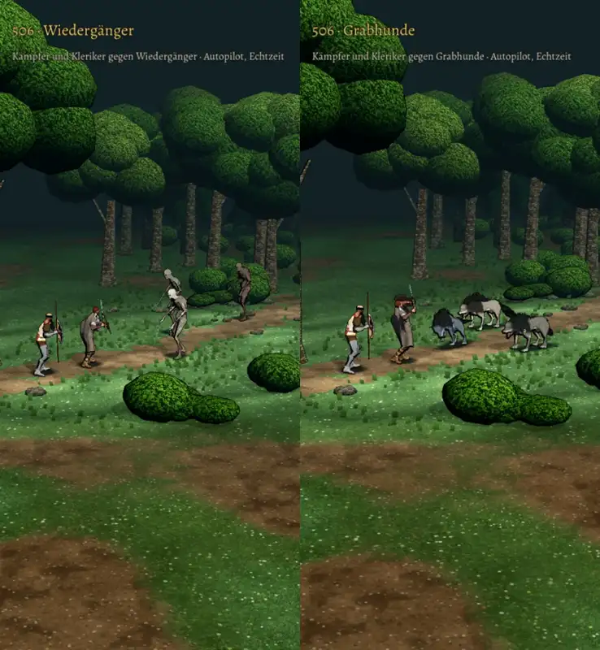

# 506 · Wiedergänger und Grabhund im Kampf (Film) · Tom (Spike) · 10.11., 12:15

Film per Telegram (49 Sekunden): je Gegner erst von nah in Ruhe, dann 18 Sekunden Kampf gegen Kämpfer und Kleriker, die automatisch kämpfen, Licht des Spiels im Wald. Stand `claude/tom-506-untote` (c5ecd4885), am Rechner mit den Kaufmodellen gefilmt.

Geprüft an: https://github.com/tramour-cmyk/androidapp_rpg_bornim/tree/c5ecd4885

Offen aus Toms Prüfung: die Lumpen des Wiedergängers heben sich am Umriss noch schwach ab; der Grabhund hebt im Stehen den Kopf eher, als dass er ihn senkt.

Sag „506 passt“ oder was nicht passt.
