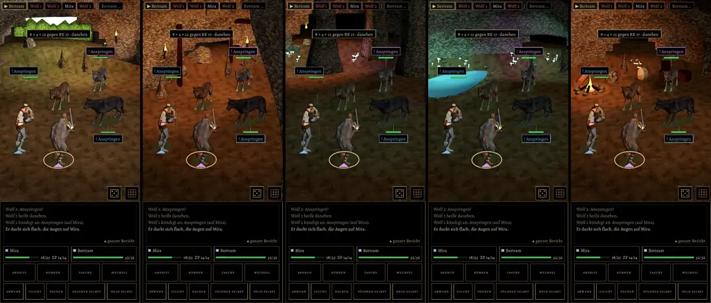

# 507 · Kampforte der Höhle: Eingang, Gang, Halle, Teich, Lager · Jerry · 08.11., 08:53

E Kampf · je Ort ein Standbild vom Bauserver (Lauf 287, Renderer wie am Handy, Probekampf gegen das Wolfsrudel); welcher Ort gilt, richtet sich wie alt (`CaveScene.spotFor`) nach der Kachel, auf der der Kampf beginnt. Noch nicht im Spiel.

Geprüft an: https://github.com/tramour-cmyk/androidapp_rpg_bornim/actions/runs/42455595272

- Seit Lauf 247 behoben (Prüfer): Gang hinter dem Mund geschlossen und dunkler werdend, Eingang draußen ohne Höhlenlicht, Stützbalken als ganze Joche, Ansage mit Strich.
- Mittlere Helligkeit 27–45 von 255 (Halle am dunkelsten); in Lauf 234 waren Halle und Teich fast schwarz.

Bitte sagen: „507 passt“ oder was anders sein soll (je Ort).
