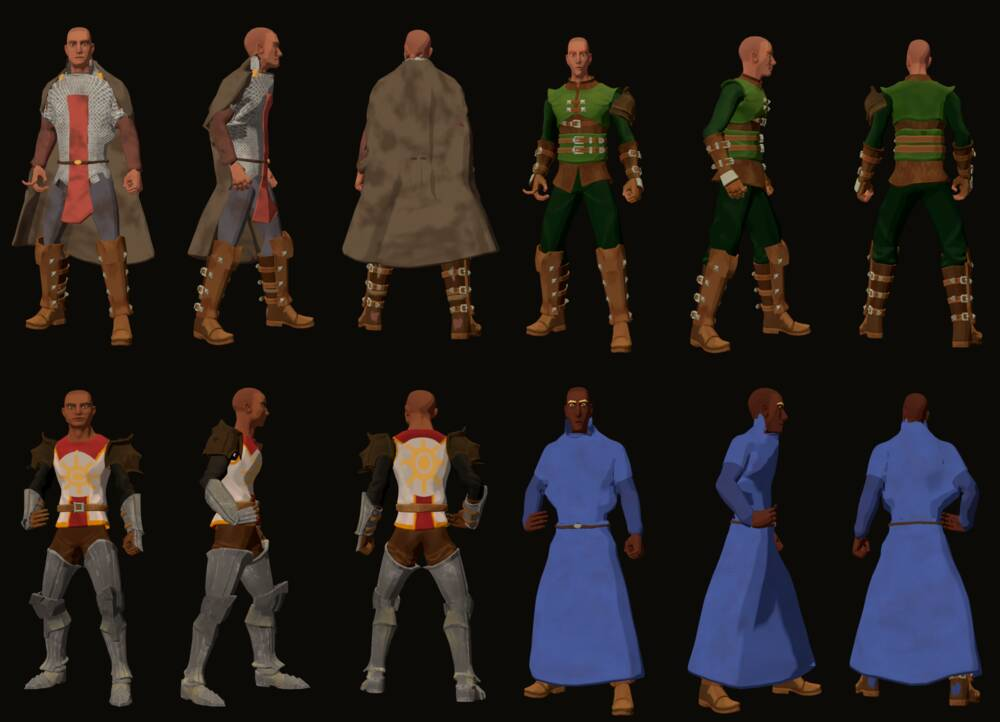

# 513 · Ein Figurenstand: Schild am Rücken, Robe des Magiers, Umhang · Team Tom (Spike) · 03.11., 19:2x

E Figuren
Kurz: ein Zweig mit allem, was du an Figuren abgenommen hast; der Schild liegt jetzt am Rücken an, beim Magier sticht nichts mehr durch die Robe; am Umhang hat sich nichts geändert.
Geprüft an: https://github.com/tramour-cmyk/androidapp_rpg_bornim/actions/runs/41686998047 (Lauf 2 von 2, Commit 47b09d566)

**Zu sehen:** der Held jeder Klasse im Drehteller der Erschaffung, je von vorn, von der Seite und von hinten.

**Figurenstand:** Zweig `claude/figurenstand-513` enthält die Waffe in der Hand (417), Umhang und Robe (463) und den Drehteller (499). Alle Figurenzweige können darauf aufbauen.

**Schild:** Er wurde bisher an der Ruhehaltung ausgerichtet; im Stehen neigt sich der Oberkörper, und der Schild stand unten ab. Jetzt wird er am Stehen ausgerichtet. Gemessen von der Seite: Kleriker oben 0, unten 1 cm vom Rücken; Kämpfer oben 0, unten 5 cm (vorher 20 bis 25 cm). Beim Kämpfer hält der Griff hinter dem Rundschild ihn so weit weg.

**Magier:** Im Stehen stach der Kittel unter der Robe auf Höhe der Oberschenkel bis Knie 4 mm durch die Robe. Der Kittel unter der Robe ist jetzt entfernt; gemessen sticht im Stehen nichts mehr durch. Der Gürtel auf der Robe zählt die Messung jetzt als Fleck; ob er so richtig aussieht, siehst du im Bild.

**Umhang:** Gürtel (von hinten) und Ärmel an der Schulter stechen weiter durch; mein Weg, sie unter dem Umhang weiter wegzunehmen, hat nicht gewirkt (gemessen gleich). Ursache noch offen.

Bestand geprüft: kein neues Modell, nur Lage des Schilds und Unterlagen der vorhandenen Trachten.

**Bekannt, nicht Teil von 513:** Den Stab halten Kleriker und Magier 11 cm neben der Faust (Tragart 417).

**Stärkstes Gegenargument:** Der Umhang ist nicht besser geworden, obwohl du ihn mit „513 B“ jetzt wolltest; beide Läufe sind verbraucht.

**Zu sagen:** passt oder nicht, je für Schild und Magier; für den Umhang: zwei neue Läufe oder nach dem Durchspielen.

Erledigt: Antwort ins Vorgangsarchiv, Datei löschen (Spike).
