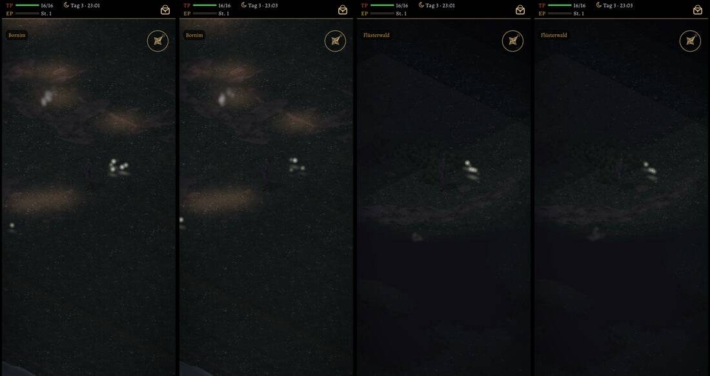

# 514 · Glühwürmchen nachts wie im alten Spiel · Team Tom · 03.11., 19:10

O Orte
Kurz: Glühwürmchen wie im alten Spiel auf allen Gebietskarten; Bild aus dem Spiel, Dorf und Flüsterwald nachts, je zwei Augenblicke; Lauf 2 von 2
Geprüft an: https://github.com/tramour-cmyk/androidapp_rpg_bornim/actions/runs/41682936902 (Lauf 2, Commit dd4cb1d1a); Test gluehwuermchen_514 ohne Fehler

**Zu sehen:** Links zweimal das Dorf, rechts zweimal der Flüsterwald, 23 Uhr. Jeweils der größte Schwarm der Karte, neben dem Helden. Zwischen dem ersten und dem zweiten Bild einer Karte liegt ein Augenblick: andere Glühwürmchen leuchten, manche antworten ihrem Nachbarn.

**Wie im alten Spiel:** kleine Schwärme an festen Stellen, über Blumen und Wiesen, am Wasser und am Waldrand, im Dorf über den Feldern; wenig im tiefen Wald, selten an Wegen. Jedes treibt langsam, leuchtet sanft auf und lange nach, im eigenen Takt. Nur in etwa zwei von fünf Nächten, erst wenn es dunkel ist; außer Sicht verschwinden sie mit dem Nebel. Vorher gab es nur ein paar Funken an den Blumenbeeten im Dorf, jede Nacht.

**Prüfer nach Lauf 1 (18:16):** Der Lichtschein am Boden war hart und zu hell, jetzt weicher und schwächer (dieses Bild). Nachts hat der Held keinen Schatten unter dem Körper; das kommt nicht von den Glühwürmchen. Im Wald ist die dunkle Fläche unten der Nebel (noch nie gesehen).

**Noch nicht:** Regen gibt es in Godot noch nicht; im alten Spiel blieben sie im Regen weg, das kommt mit dem Regen.

**Stärkstes Gegenargument:** Ein Standbild zeigt das Blinken nicht; wie es wirkt, siehst du erst im Spiel.

**Zu sagen:** „514 passt“, oder was anders sein soll.

Erledigt: Antwort ins Vorgangsarchiv, Datei löschen (Tom).
