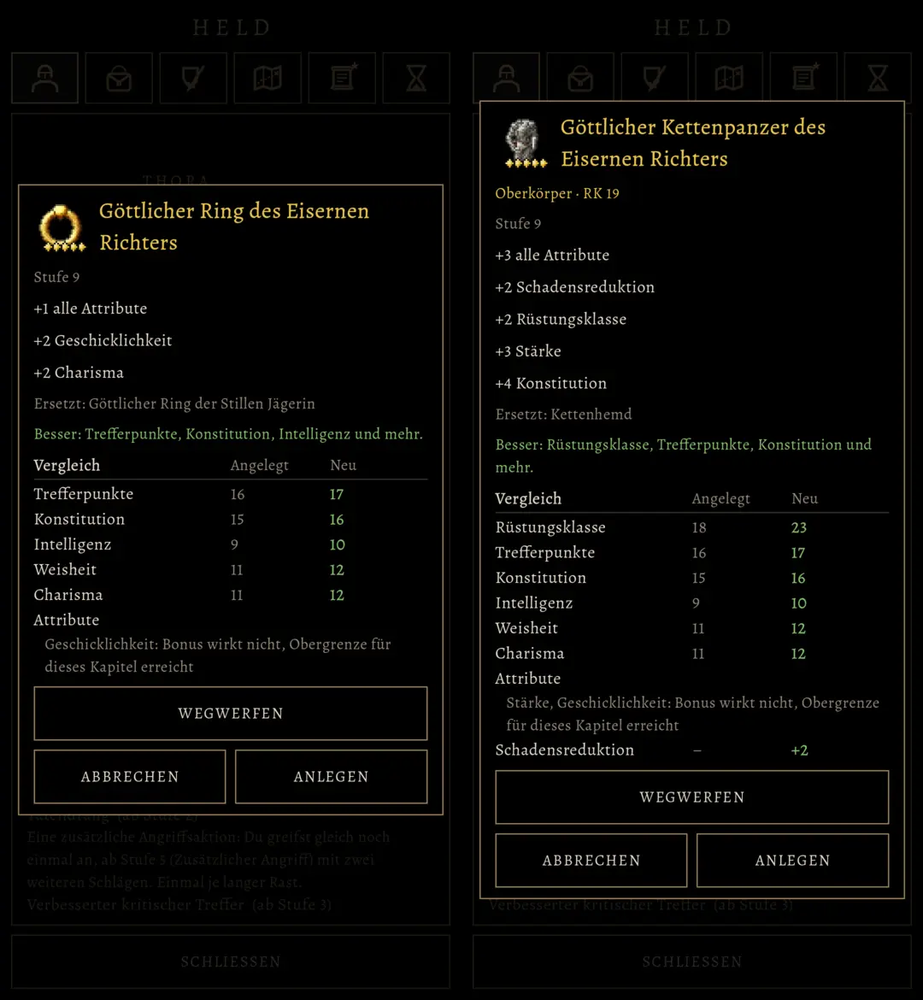

# 519 · Fenster eines Gegenstands passt auf den Schirm, wie alt · Team Tom (Spike) · 03.11., 23:5x

A Spiel
Kurz: dein Befund von 23:13 (Build 249) am Rechner nachgestellt (Fenster 1128 statt höchstens 1080 Bildpunkte breit) und behoben; kommt mit dem nächsten Testbuild. Nur ansehen, nichts zu entscheiden.
Geprüft an: https://github.com/tramour-cmyk/androidapp_rpg_bornim/commit/fd80a395a (Test fenster_519 ohne Fehler; vorher 5 Fehler)

**Wo:** Spielmenü, Reiter Ausrüstung oder Tasche, einen Gegenstand antippen.

**Zu sehen, wie in der alten Fassung:**
- Rand zu beiden Seiten; nichts ragt hinaus.
- Der Name steht neben dem Bild des Gegenstands, in seiner Farbe, und bricht bei langen Namen um.
- Die Knöpfe teilen sich die Breite; eine zu lange Aufschrift wird zweizeilig oder kleiner.
- Schluckt die Obergrenze des Kapitels einen Bonus, steht das unter dem Vergleich („Geschicklichkeit: Bonus wirkt nicht, Obergrenze für dieses Kapitel erreicht“). Darum fehlte Geschicklichkeit im Vergleich deines Rings; der Wert selbst war richtig (Hinweis von Sokrates).

Erledigt: nach deinem Test im nächsten Build Datei löschen (Spike oder Tom).
