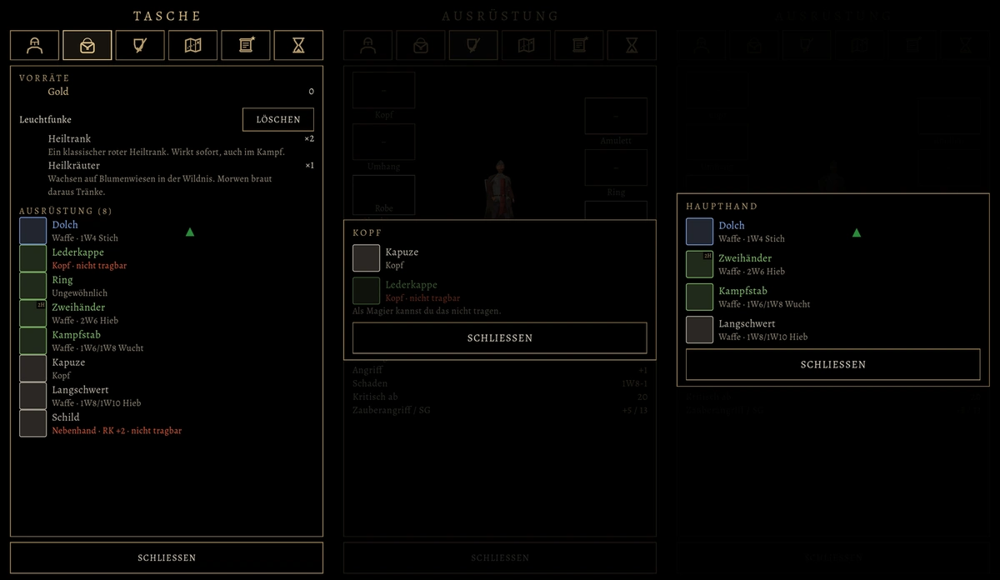

# 521 · Tasche und Wechselfenster: Gegenstände auf einen Blick unterscheiden · Team Tom · 04.11., 00:2x

[Bild von 04.11., 00:25](https://github.com/tramour-cmyk/androidapp_rpg_bornim/blob/bilder/2026-11/04-0025-521-Tom.png) (eingetragen von meldung.sh, Tom)

A Spiel
Kurz: Du hast gesagt (23:23): „Leider kann man da die Items null unterscheiden … Zweihänder? Was überhaupt? Sind gesperrte Gegenstände darunter?“ und (23:26) „besser machen“. Jetzt hat jede Zeile in Tasche und Wechselfenster wie alt: Bild, Name in der Farbe der Seltenheit, darunter Art, Platz und Wert; besser als alt dazu „zweihändig“ und bei Ring und Amulett die Seltenheit statt einer leeren Zeile. Nicht Tragbares sagt rot „nicht tragbar“, im Wechselfenster matt mit dem Grund („Als Magier kannst du das nicht tragen.“). Rechts ▲ grün, wenn es in allem besser ist, ▼ rot, wenn schlechter. Die Tasche ist wie alt nach Seltenheit, dann nach Platz geordnet; der Leuchtfunke hat wieder „Löschen“ (auch 523).
Geprüft an: https://github.com/tramour-cmyk/androidapp_rpg_bornim/commit/569a816f1 (Test `tasche_521` ohne Fehler, Zweig `claude/tom-531-garrick`)

Bitte ansehen: passt das so? Am Rechner fehlen die Bilder der Gegenstände (leere Kästchen), im Spiel stehen dort die Bilder wie in Build 249.

Großbild: Telegram 04.11. 00:2x
