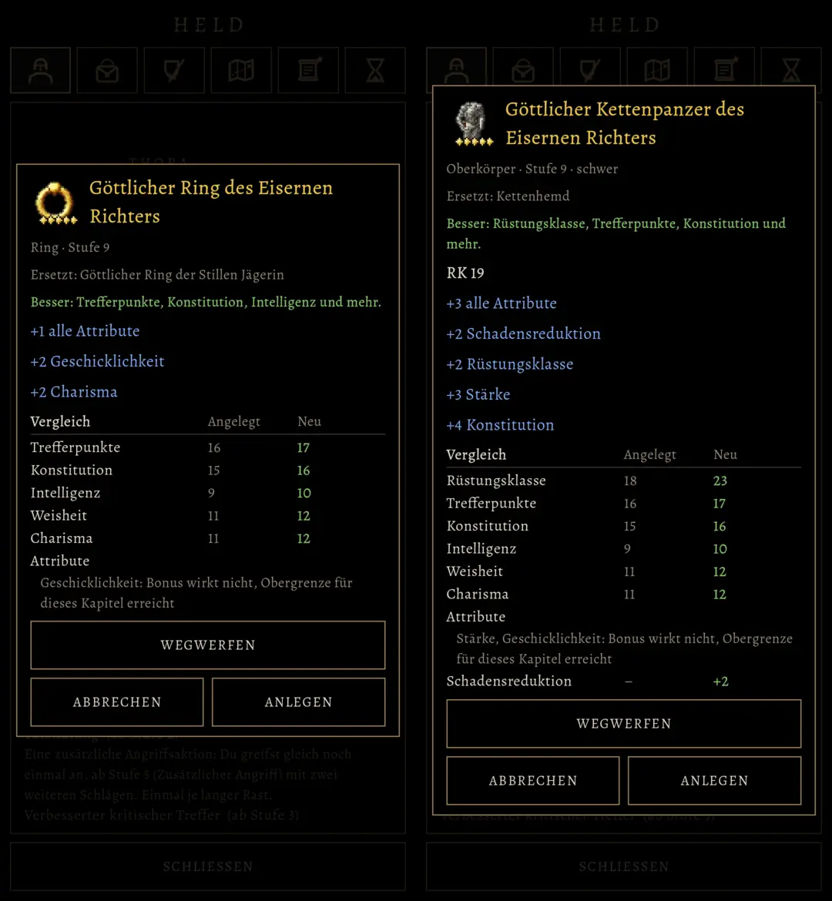

# 524 · Fenster eines Gegenstands: Inhalt wie in der alten Fassung · Team Tom (Spike) · 04.11., 00:1x

[Bild von 04.11., 00:15](https://github.com/tramour-cmyk/androidapp_rpg_bornim/blob/bilder/2026-11/04-0015-524-Spike.png) (eingetragen von meldung.sh, Spike)

A Spiel
Kurz: Das Fenster (519) zeigt jetzt alles, was die alte Fassung zeigte; kommt mit dem nächsten Testbuild. Das ist die Untergrenze; was darüber hinaus besser werden soll (Chef 23:26), lege ich erst nach deinem Blick darauf vor.
Geprüft an: https://github.com/tramour-cmyk/androidapp_rpg_bornim/commit/043e1b907 (Test gegenstand_524 ohne Fehler)

**Wo:** Spielmenü, Tasche oder Ausrüstung, einen Gegenstand antippen; ebenso im Laden.

**Neu im Fenster, wie alt:**
- unter dem Namen Seltenheit und Art, darunter Tragort, Stufe und Gewicht (zweihändige Waffen fett in Rot: ein Schild muss herunter);
- gleich oben, was dafür abgelegt wird, und das Urteil („Besser: …“);
- bei Waffen der Schaden mit Schadensart, bei vielseitigen auch mit beiden Händen, „Angriff +1“, „Finesse“, „Fernkampf“;
- bei Rüstung die Rüstungsklasse („RK 16“, leichte mit „+ GES“), beim Schild „RK +2“, bei Kugel und Buch die Zauberkraft;
- Warnungen: „Deine Klasse kann das nicht tragen.“, „Ungeübt: kein Übungsbonus auf Angriffe.“, „Zauberkraft nützt nur Zauberwirkern.“;
- bei der Fackel ihre Erklärung; im Vergleich der Schnitt beim Schaden („im Schnitt 8,5 statt 7,5“).

Erledigt: nach deinem Test im nächsten Build Datei löschen (Spike oder Tom).
