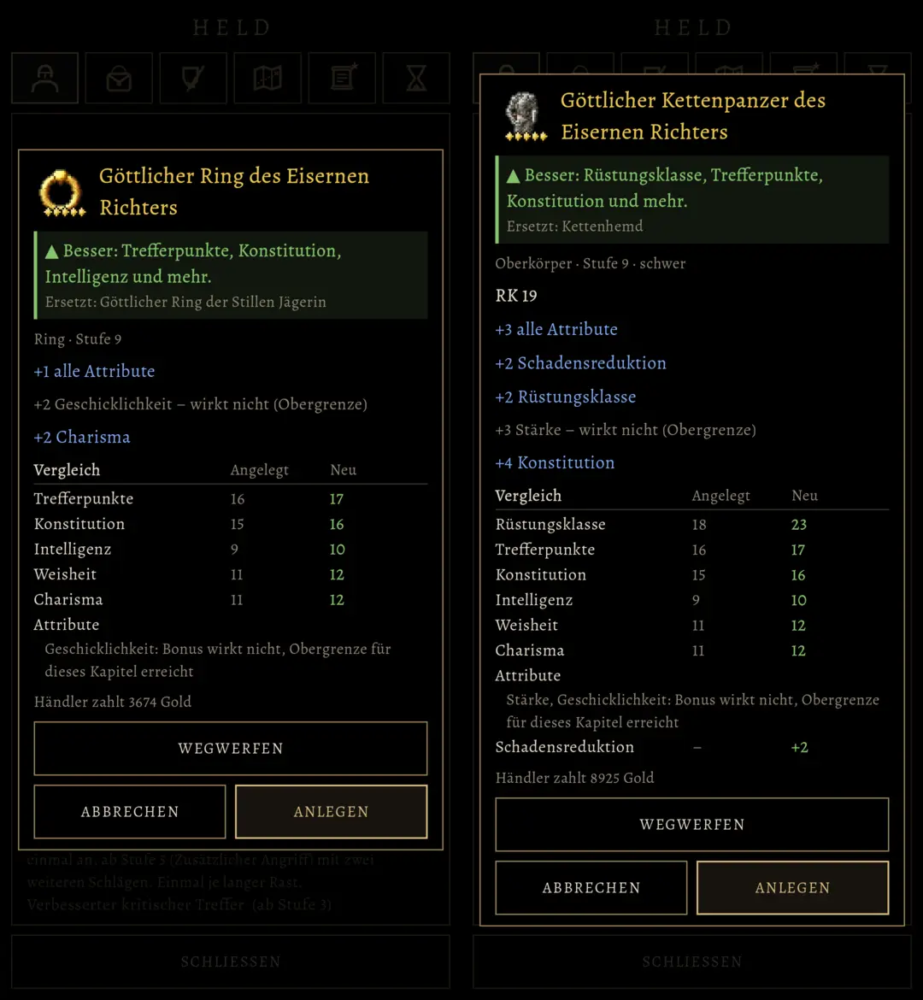

# 524.1 · Gegenstandsfenster spielerfreundlicher: Vorschlag · Team Tom · 04.11., 02:26

A Spiel
Kurz: Du hast gesagt (00:52): „Vorschlag zum Verbessern und spielerfreundlicher machen von Spike ist erwünscht“. Grundlage ist das Fenster aus 524 (passt, 00:50). Ein Prüfer hat das alte Bild 524 gelesen: Ein klares „lohnt sich“ springt nicht ins Auge; verpuffte Boni stehen blau wie wirksame, der Grund steht erst unten klein; es gibt keinen Wert, also keinen Anhalt fürs Verkaufen oder Behalten; der größte Knopf ist WEGWERFEN. Neu, so gebaut, wie es ins Spiel käme (Bild aus Godot):
1. **Urteil als Band gleich unter dem Namen**, vor allen Zahlen: ▲ grün „Besser: …“, ▼ rot „Schlechter: …“, ◆ gold „Gemischt: …“, 16 sp fett, Streifen links; „Ersetzt: …“ im Band darunter.
2. **Verpuffte Boni matt** mit „– wirkt nicht (Obergrenze)“ in derselben Zeile statt blau.
3. **Begriffe erklärt:** „Finesse: trifft mit GES oder STÄ, was höher ist“, „Fernkampf: trifft mit GES“.
4. **„Händler zahlt n Gold“** unten (bisher nur in der Rückfrage zum Wegwerfen).
5. **„Anlegen“ hervorgehoben** (heller Rahmen), wenn das Stück besser ist.
Geprüft an: https://github.com/tramour-cmyk/androidapp_rpg_bornim/commit/2df4df4d4 (Bild `fenster_bild_519`, Godot, Rechner, Probelauf 1 von 2; Tests `gegenstand_524`, `fenster_519`, `menue_test` ohne Fehler; Zweig `claude/tom-524-1-fenster`).

Bitte ansehen:
1. **Die fünf Punkte so bauen?** Ein Wort je Punkt genügt („1 ja, 2 nein …“).
2. **WEGWERFEN** steht weiter als breiter Knopf über ABBRECHEN | ANLEGEN (wie alt). Kleiner machen, etwa WEGWERFEN | ANLEGEN in einer Reihe und Abbrechen nur über Zurück oder Tippen daneben (526)?

Stil-Abgleich (88): Oberfläche (schwarz, Goldrand, Alegreya; Grün, Rot, Gold wie im Vergleich), Zeichen ▲ ▼ ◆ als Schrift. Übergänge keine (Fenster wie bisher). Spielerfreundlich: das Urteil zuerst, Gründe darunter, nichts Neues zum Antippen.

Noch offen aus dem Prüferbefund zu 524, nicht in diesem Vorschlag: die Rüstung steht dreimal (RK 19, „+2 Rüstungsklasse“, Tabelle 18 → 23); die Zeile „Besser: … und mehr“ wiederholt die Tabelle; „schwer“ unerklärt; Schadensreduktion unter dem Attributhinweis statt in der Tabelle.
