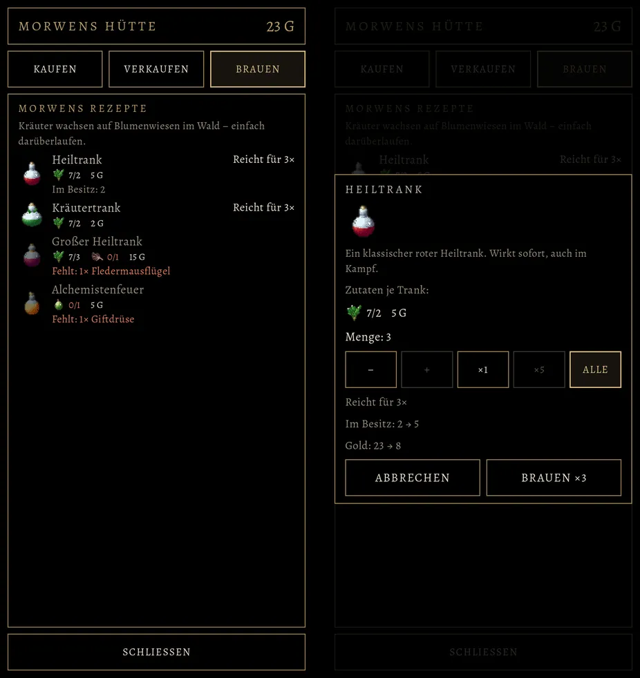

# 525 · Brauen bei Morwen: was fehlt, wie oft es reicht · Team Tom · 04.11., 01:29

A Spiel
Kurz: Du hast gefragt (00:31): „Kann kenntlich gemacht werden, was für einen Trank fehlt oder sonstige sinnvolle Verbesserungen?“ Links die Seite „Brauen“: je Rezept unter dem Namen jede Zutat mit Bild und „hat/braucht“ (wie alt), Fehlendes und zu wenig Gold rötlich; was nicht geht, matt mit „Fehlt: 1× Fledermausflügel“; rechts in der Zeile „Reicht für 3ד; „Im Besitz: 2“, wenn du den Trank schon hast; oben der Kräuterhinweis wie alt. Rechts der Kasten nach Antippen: Bild, Wirkung, Zutaten je Trank, Menge mit −, +, ×1, ×5, „Alle“ (so oft es reicht, bleibt markiert), Bestand und Gold vorher → nachher, „Brauen ×3“.
Geprüft an: https://github.com/tramour-cmyk/androidapp_rpg_bornim/blob/bilder/2026-11/04-0129-525-Tom.webp (Bilder `laden_bild_525` (Lauf 2 von 2, Godot, Rechner), Test `laden_525` ohne Fehler, Zweig `claude/tom-525-laden`, Commit 5fee7fc7b).

Bitte ansehen:
1. **Passt so?** Oder was ändern (ein Wort genügt)?

Ebenfalls in 525, ohne Bild (fährt im nächsten Build): an Rowenas Theke „Fleisch verkaufen · n Gold“, solange du rohes Fleisch trägst, mit ihrem Satz wie alt; Speichern nach Met und Fleisch; „Zurückkaufen“ in der Farbe der Seltenheit; im Mengenkasten bleibt „Alle“ markiert; „1 gewöhnlicher Gegenstand verkauft.“ in Einzahl; bei „Gewöhnliche verkaufen“ Gold vorher → nachher.

Stil-Abgleich (88): Oberfläche (schwarz, Goldrand, Alegreya, Warnfarbe nur für Fehlendes), Zeichen statt Textwände (Zutatenbilder wie alt). Spielerfreundlich: was fehlt, steht in der Zeile, ohne Antippen; mehrere Tränke in einem Zug statt einzeln.

Befund des Prüfers (Helfer, 01:28, vor dem Versand, behoben): Name nicht brauarer Rezepte war doppelt gedämpft, kaum lesbar (jetzt nur das Bild matt). Nicht behoben: Zutatenzahlen und „Im Besitz“ klein (12 sp, wie alt); über dem Kasten scheint die Liste gedämpft durch (wie bei jedem Kasten); Fledermausflügel-Bild klein und braun.
