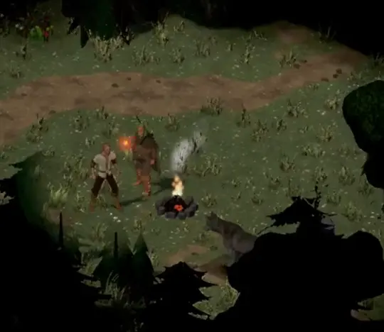

# 531 · Garrick vertreibt den Wolf mit der Fackel (Tag, Abend, Nacht)

Tom · 17.11., 02:55 · E Oberfläche · dein Wort 03.11., 23:42 („vertreibt Tiere sichtbar mit der Fackel“)
Kurz: 531 (Garrick, Fackelabwehr): ein Wolf jagt den Helden an Garricks Feuer, Garrick nimmt die Fackel, schwenkt sie zum Wolf, der Wolf geht; jetzt im Renderer des Handys und mit sichtbarem Wolf.

Geprüft an: https://github.com/tramour-cmyk/androidapp_rpg_bornim/actions/runs/43985772092 (Lauf 543, grün; Stand `claude/tom-531-film` `a0525a5b8`; `garrick_531`: Wolf im Nebel sichtbar 406 von 406 Bildern)

**Was du siehst:** dreimal dieselbe Abwehr, je 4,6 s: Tag, Abend, Nacht. Neu: Garricks Fackel leuchtet im Nebel wie die des Helden; vorher blieb der Wolf 4,6–7 m vor dem Helden außer Sicht und war unsichtbar (auch im Spiel). Am Tag ist der Wolf gut zu sehen, abends und nachts nur als dunkle Gestalt am Rand des Fackelscheins.

👍 passt: Garrick greift die Fackel, schwenkt sie zum Wolf, der Wolf weicht; Köcher und Bogen liegen am Rücken · 👎 falsch: der Wolf ist nicht zu erkennen (auch nachts), die Fackel geht durch Kopf oder Kapuze, oder die Bewegung wirkt falsch
