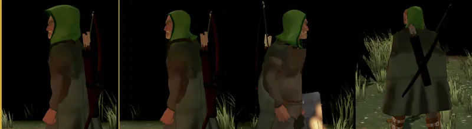

# 531 · Garrick: Köcher, Bogen, Gurt liegen an, Kapuze kleiner · Tom · 16.11., 21:55

[Bild von 16.11., 21:55](https://github.com/tramour-cmyk/androidapp_rpg_bornim/blob/bilder/2026-11/16-2155-531-Tom.png) (eingetragen von meldung.sh, Tom)

E Leute · Tom · 16.11. · aus deinem Wort 17:34 (531.2): „Da schwebt ein Gürtel über Schulter und durch die Kapuze und die Kapuze ist größer … der Köcher schwebt auch und der Bogen schwebt auch … Beides fail“

Geprüft an: Lauf 43935087465 (`claude/tom-531-film`, `b6d80be96`), Bauserver; Messung `schweben_531` 0 Fehler

Von links: im Profil vorher (Kapuze wie bisher), im Profil nachher, von rechts nachher, von hinten nachher; nachts am Feuer.

**Ursache des Schwebens:** Köcher, Bogen und Gurt waren nach der Grundhaltung des gekauften Körpers (Arme waagrecht) gesetzt; im Stehen kippt die Brust nach vorn, alles stand hinten ab (Köcher 12 cm, Bogen 5 cm, Gurt 7 cm). Jetzt im Stehen angelegt: Köcher höchstens 1,2 cm Luft, Bogen 0,3 cm, Gurt nirgends im Körper und unter der Kapuze.

**Kapuze:** liegt jetzt bis auf 6 mm am Kopf (vorher deutlich weiter).

Offen (eigene Prüfung, du urteilst):
- Über dem Halsausschnitt des Hemds spannt der Gurt bis 3,7 cm frei, weil dort keine Fläche ist.
- Die Kapuze behält ihre Spitze, sie ist nur enger.
- Der Film, wie Garrick die Tiere mit der Fackel vertreibt, kommt erst nach deinem Urteil hier (die Fackel schwenkt jetzt 3 cm weiter vom Kopf weg).

👍 passt: so ins Spiel, dann Film · 👎 falsch: mit Fund, ich stelle nach
