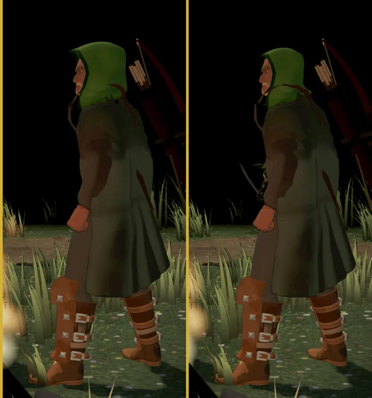

# 531 · Garrick im Profil: Gurt an Bogen und Köcher, Kapuze enger · Tom · 16.11.

[Bild von 16.11., 16:58](https://github.com/tramour-cmyk/androidapp_rpg_bornim/blob/bilder/2026-11/16-1658-531-Tom.png) (eingetragen von meldung.sh, Tom)

E Leute · Tom · 16.11. · aus deinem Wort 12:26 (Bild Rücken 10:17, Archiv „531.1“): „wie ist der Langbogen befestigt?“ und „die Kapuze ist wie für einen Riesen gemacht“

Geprüft an: Lauf 43887943297 (`claude/tom-531-film`, `aba9db679`), Bauserver

Links vorher, rechts nachher; Garrick im Profil auf der Seite des Bogens, nachts am Feuer.

**Gurt:** Neu: ein Gurt von der rechten Schulter zum Köcher und eine Schlaufe, die den Bogen mittig an den Köcher bindet. Von hinten ist nur die Schlaufe zu sehen.

**Kapuze:** Hinten und oben etwas enger am Kopf, im Verhältnis zum Gesicht noch groß.

Offen (eigene Prüfung, du urteilst):
- Der Gurt läuft am Hals über die Kapuze statt darunter, ein Ende hängt lose vor der Brust.
- Kapuze nur wenig kleiner; „wie für einen Riesen“ ist nicht behoben.
- Der Film, wie Garrick die Tiere mit der Fackel vertreibt, fehlt: die Aufnahme brach nach einem Bild ab (Ursache behoben); für eine neue Aufnahme brauche ich dein Urteil.
- Die Fackel kommt dem Kopf beim Schwenken bis 0,30 m nahe (Kopfmitte gemessen); unsere Prüfung verlangt mehr als 0,30 m. Mit der alten Kapuze war es genauso knapp.
- Die kleine grüne Gestalt mit Messer an der Hüfte im rechten Bild steht im Hintergrund, gehört nicht zu Garrick.

👍 passt: Gurt und Kapuze so ins Spiel übernehmen, dann Film · 👎 falsch: Gurt unter die Kapuze und an den Körper, Kapuze deutlich kleiner, dann neues Bild und Film
