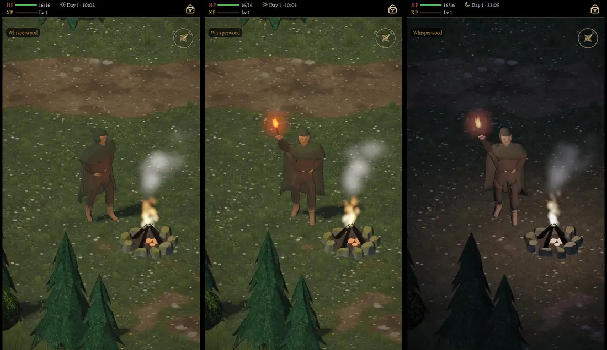

# 531 · Garrick am Feuer: wie er aussieht und wie er Tiere mit der Fackel vertreibt · Team Tom · 04.11., 00:1x

[Bild von 04.11., 00:16](https://github.com/tramour-cmyk/androidapp_rpg_bornim/blob/bilder/2026-11/04-0016-531-Tom.png) (eingetragen von Tom)

A Spiel
Kurz: Du hast gefragt (23:42): „Gesicht wirkt sonderbar, Bogen fehlt, vertreibt keine Mobs. Hat er schon Animation?“ Das Vertreiben ist jetzt gebaut wie im alten Spiel: Jagt dich ein Tier bis an sein Feuer, nimmt Garrick die Fackel, dreht sich zum Tier, hält sie hoch und schwenkt sie links und rechts, das Tier gibt auf, dann kommt die Fackel zurück ins Feuer (3,7 s). Bild: links Tag in Ruhe, Mitte Tag beim Vertreiben, rechts nachts beim Vertreiben.
Geprüft an: https://github.com/tramour-cmyk/androidapp_rpg_bornim/blob/bilder/2026-11/04-0016-531-Tom.png (Lauf 2 von 2; Test `garrick_531` mit Walddaten am Rechner ohne Fehler (kein Kampf am Feuer, Tier gibt auf, Meldung kommt, Fackel 0,39 m über der Schulter und 0,36 m vor ihm, mindestens 0,48 m von der Kopfmitte, Blick zum Tier); Zweig `claude/tom-531-garrick`, Commit cac2a27f4).

Bitte ansehen:
1. **Vertreiben mit der Fackel** (Mitte, rechts): so bauen, oder anders halten?
2. **Gesicht** (links): was wirkt sonderbar? Ein Wort genügt (Augen, Nase, Bart, Hautton, Kapuze …); ich baue es dann nach deinem Wort.
3. **Bogen**: wie alt ein Langbogen quer über dem Köcher auf dem Rücken. Bestand: Kurzbogen aus `waffen.py`, Langbogen fehlt im Bestand; ich lege dir Bestand und Netz nebeneinander vor, bevor ich baue.

Zu „Hat er schon Animation?“: Er hat Stehen, Gehen, Umsehen, Müde (mit der gekauften Bewegungsbibliothek), eigenes Atmen und das Zuwenden, wenn du ihn ansprichst; jetzt dazu das Vertreiben. Wie im alten Spiel fehlen noch: Hände am Feuer wärmen, sich ans Feuer setzen, nachts einnicken. Die baue ich nach deinem Wort zu 1.

Der Held im Bild ist das Rechnermodell ohne Kaufkörper.

Großbild: Telegram 04.11. 00:1x
