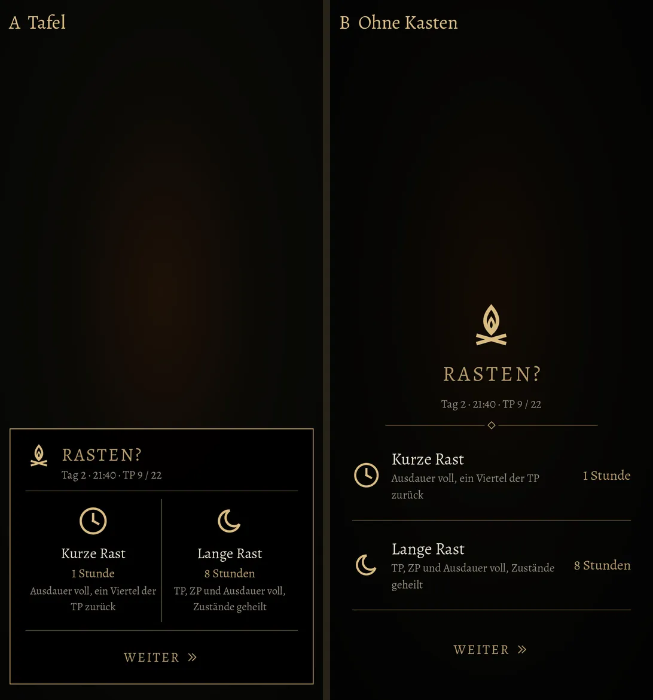
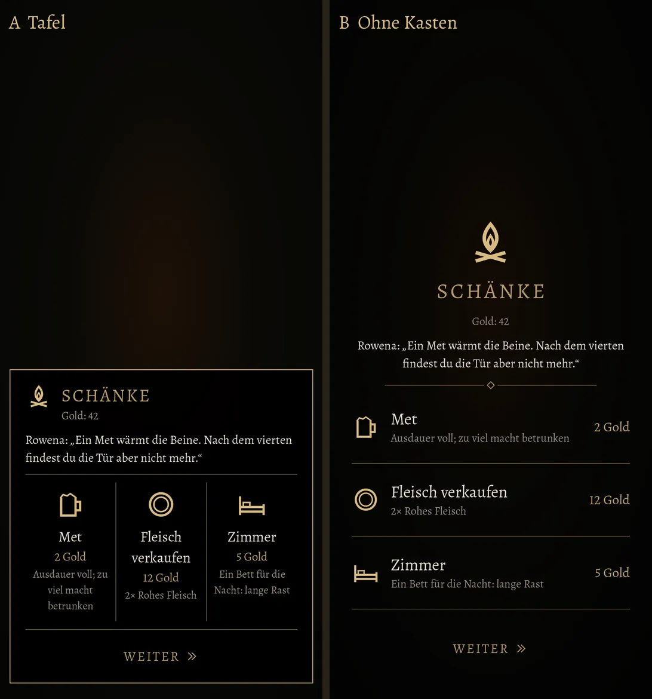

# 549 · Rastfenster neu: zwei Entwürfe, am Feuer und an der Theke · Team Tom · 04.11., 01:10

A Spiel
Kurz: Du hast gesagt (00:07, 00:08): „Rastscreen wirkt sehr klein und viele Kästen …“, „Kein schönes Design.“ Ursache „klein“: das Fenster setzte seine Schrift in rohen Bildpunkten (Titel 44, Text 30), alle anderen Schirme in sp; auf deinem Handy etwa drei Viertel der alten Größe. Neu, nach der Signatur (schwarz, dünner Goldrand, gedämpftes Gold, Alegreya, Zeichen statt Textwände), in zwei Entwürfen. Links A „Tafel“: eine Tafel unten, oben Flamme und „RASTEN?“, darunter Tag, Uhr, TP; die Wahlen als Zeichen nebeneinander (Uhr für die kurze, Mond für die lange Rast) mit Name, Dauer in Gold und Wirkung klein; „Weiter“ als Schrift ohne Kasten. Rechts B „Ohne Kasten“: die Welt dunkler, eine große Flamme, die Wahlen als Zeilen zwischen feinen Goldlinien, Dauer rechts in Gold. In beiden nur noch ein Kasten (A) oder keiner (B) statt einem je Wahl; Texte wortgleich aus dem Spiel, neu nur die Zeile mit Tag, Uhr, TP.
Geprüft an: https://github.com/tramour-cmyk/androidapp_rpg_bornim/blob/bilder/2026-11/04-0110-549-Tom.png (Bilder `rast_bild_549` (Lauf 2 von 2, Godot, Rechner), Test `rast_mass_549` ohne Fehler (alles auf dem Schirm, nichts überlappt, keine Schrift unter 13 sp), Zweig `claude/tom-549-rast`, Commit 7d202672b (noch nicht gepusht: der Haken hält den Push bis zu deinem Wort)).

Bitte ansehen:
1. **A oder B?** Oder was ändern (ein Wort genügt: Größe, Abstand, Zeichen, Farbe)?
2. **Zeile Tag, Uhr, TP** unter dem Titel: behalten oder weglassen?

Stil-Abgleich (88): Oberfläche (schwarz, Goldrand, Alegreya, Versalien gesperrt nur im Titel und „Weiter“), Zeichen (Raster 24, Linie 1,6; Flamme, Mond, Weiter wie DESIGN-STIL; Uhr wie Menü; neu Bett, Krug, Münze für Zimmer, Met, Fleisch). Übergänge: Antippen hebt die Wahl dunkel ab, dann wie bisher Schwarzblende mit „Eine Stunde vergeht.“; aus deaktiviert matt mit Grund („Heute hast du schon lange gerastet.“). Spielerfreundlich: eine Wahl je Tippen, Zurück wie „Weiter“.

Der Hintergrund ist ein Platzhalter (Nacht mit Feuerschein); im Spiel steht die Welt dahinter.
