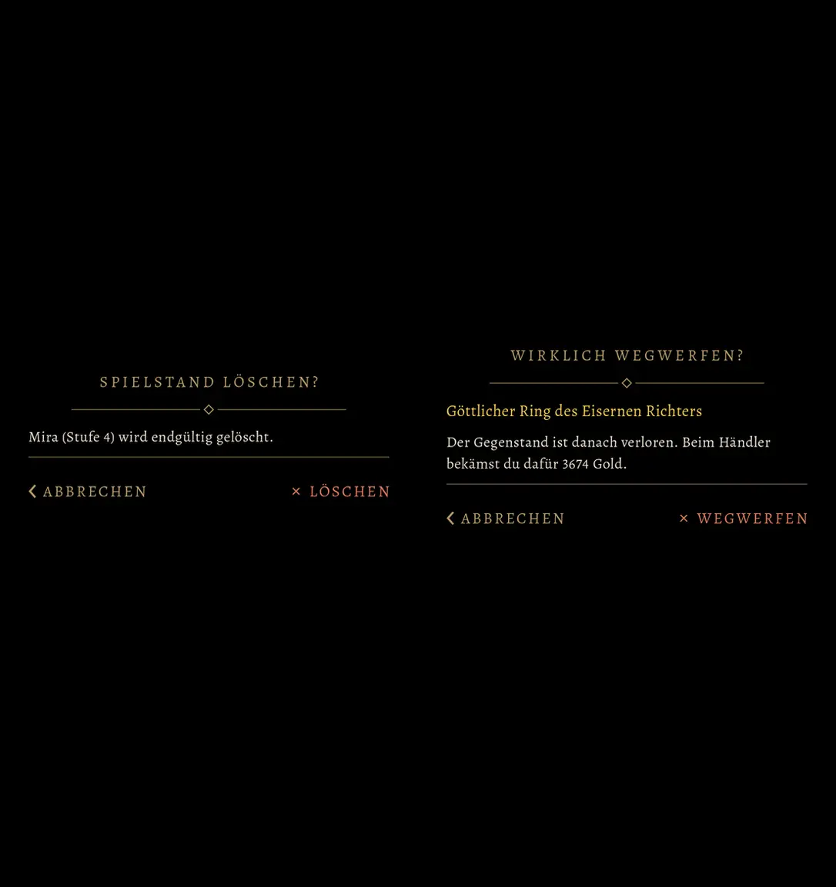
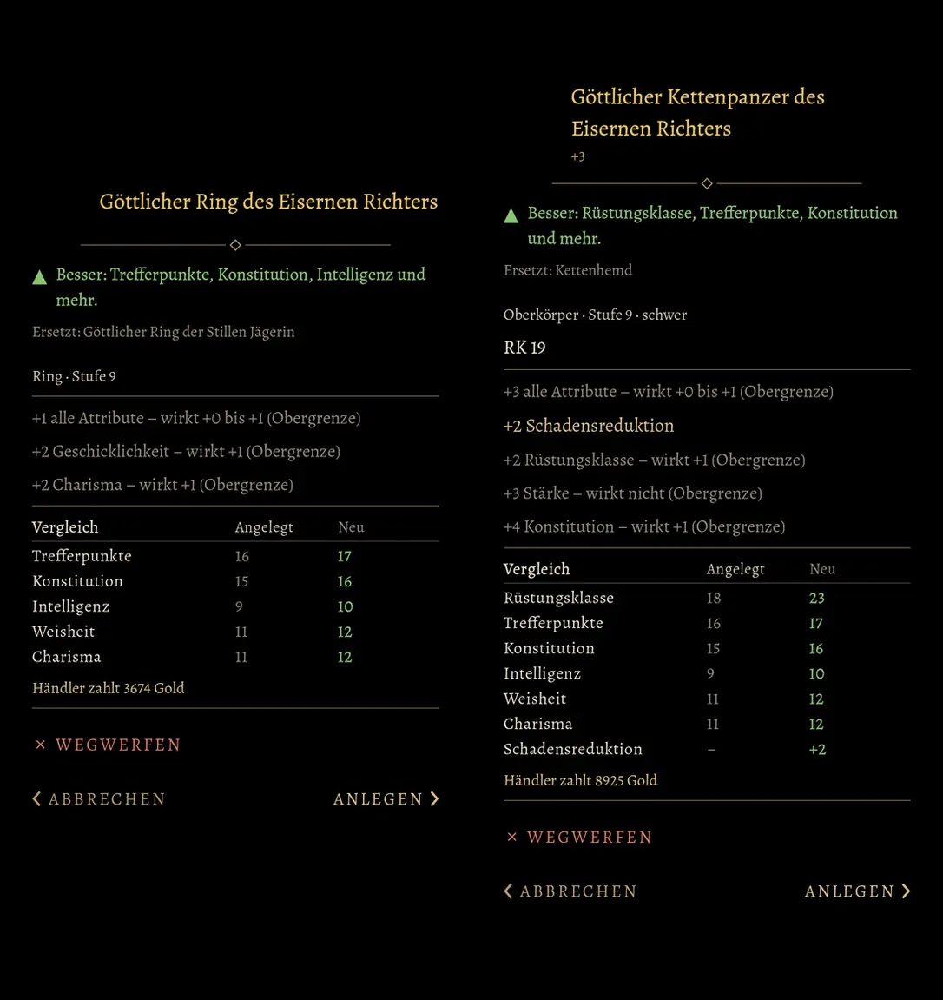
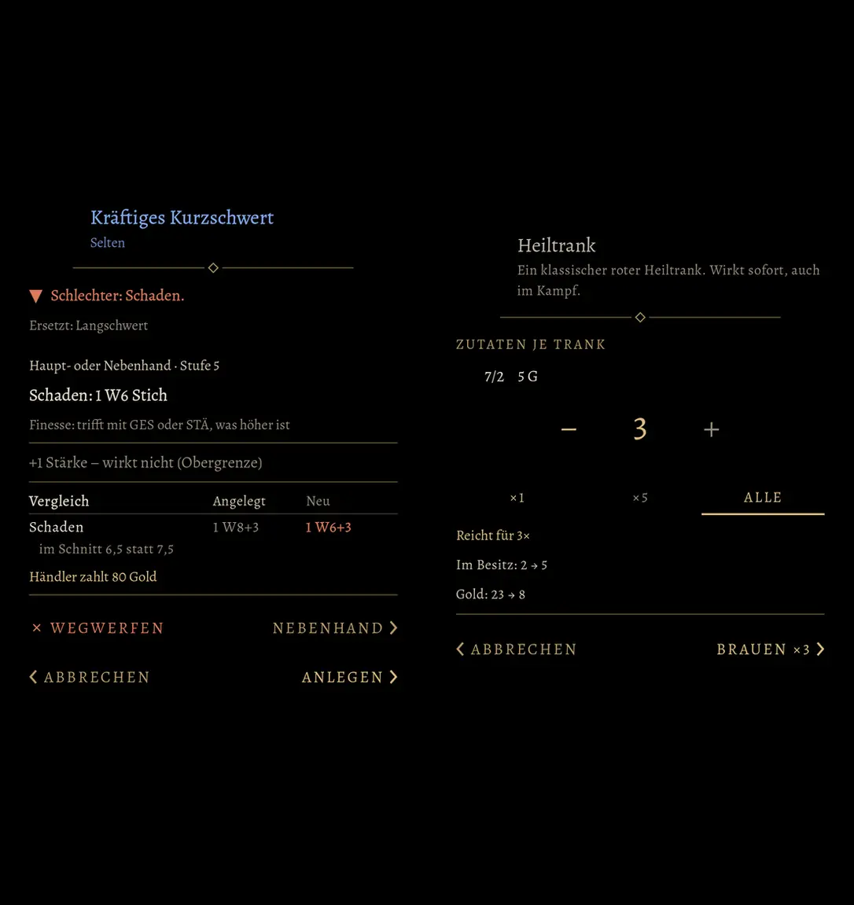
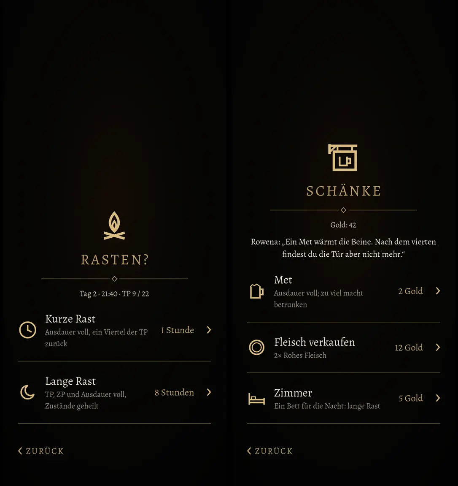
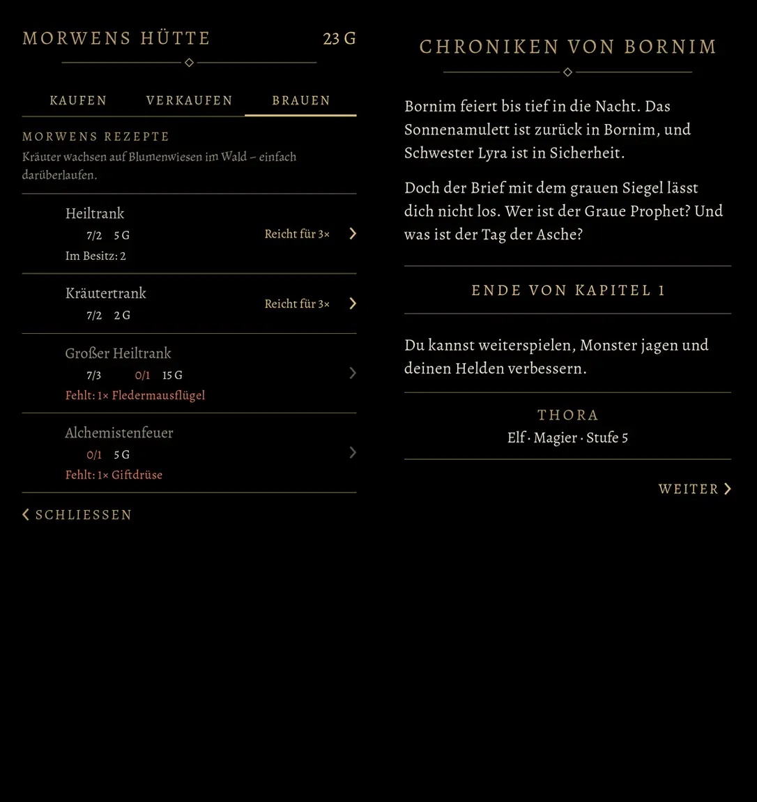
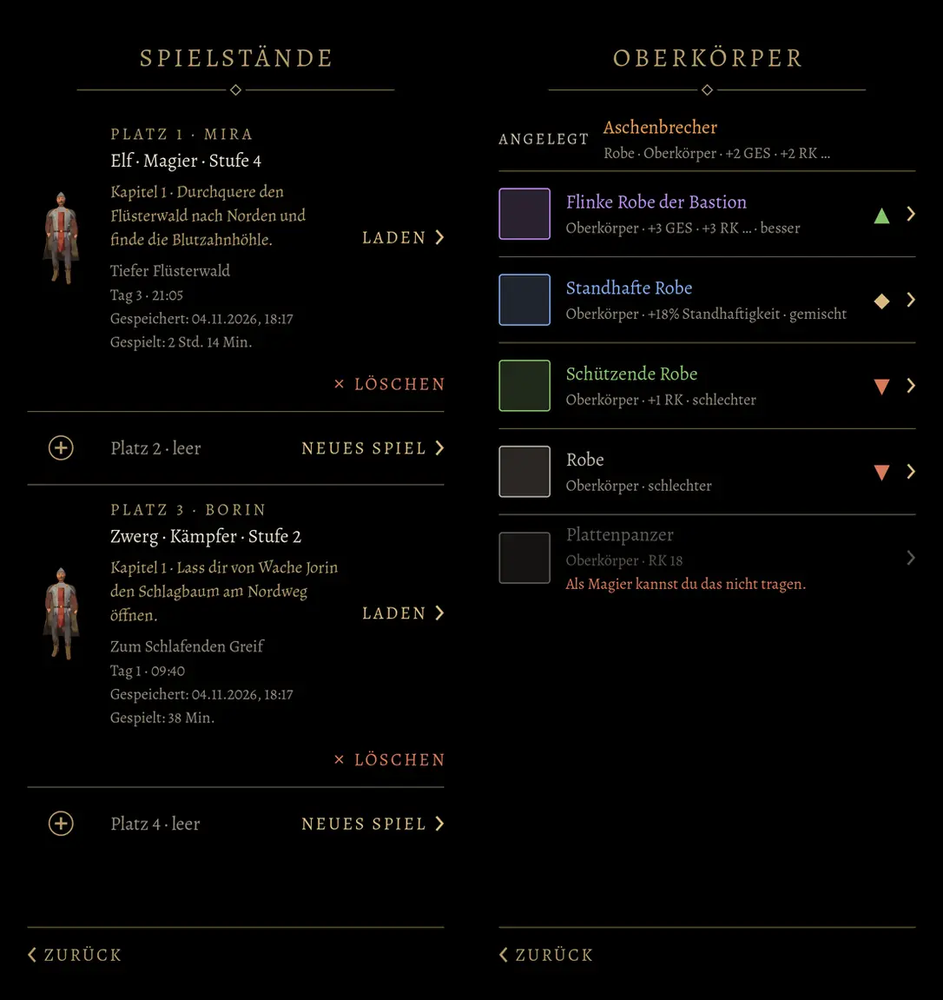

# 557 · Stil B, vierte Runde: alle Knöpfe gleich groß, Seite nach Bedeutung · Team Tom · 04.11., 18:20

[Bild von 04.11., 18:20](https://github.com/tramour-cmyk/androidapp_rpg_bornim/blob/bilder/2026-11/04-1820-557-Tom.png) (eingetragen von meldung.sh, Tom)

[Bild von 04.11., 18:19](https://github.com/tramour-cmyk/androidapp_rpg_bornim/blob/bilder/2026-11/04-1819-557-Tom.png) (eingetragen von meldung.sh, Tom)

Kurz: Deine Worte von 17:40 bis 17:44 sind umgesetzt. Alle Knöpfe gleich groß (je halbe Breite), Hauptwahl Gold, Nebenwahl gedämpftes Gold, was zerstört („× WEGWERFEN“, „× LÖSCHEN“) überall in derselben Warnfarbe. Zurück, Abbrechen, Schließen stehen links, Weiter, Laden, Anlegen rechts, nichts mehr mittig. Sag „passt“ oder was anders sein soll; danach entscheidest du 557, 549a und 524.1 zusammen.

Neu gegenüber Runde 3:
- Gegenstandsfenster in zwei Reihen: oben „× WEGWERFEN“ (Warnfarbe) und „NEBENHAND ›“, unten „‹ ABBRECHEN“ und „ANLEGEN ›“. „›“ an Nebenhand habe ich ergänzt, weil es etwas ausführt.
- Rast: „‹ ZURÜCK“ statt „‹ WEITERGEHEN“; an der Theke ein eigenes Zeichen (Wirtshausschild mit Krug) statt der Flamme.
- Brauen „‹ SCHLIESSEN“ links, Kapitelende „WEITER ›“ rechts.
- Mengenkasten: nicht wählbare Mengen lesbar gedämpft statt fast unsichtbar, „+“ und „−“ gleich hell.
- „1W6“ steht als „1 W6“ (die Eins dieser Schrift liest sich sonst wie ein I); der Ring heißt nicht mehr doppelt „göttlich“.

Geprüft: Maßtest der Gruppe ohne Fehler, auch auf 360 dp (alle Knöpfe gleich groß, Seiten richtig, Schrift mindestens 13 sp, Tippfläche mindestens 48 dp).

Bekannt: Auf 360 dp ist „× WEGWERFEN“ knapp (etwa 132 von 152 dp). Im laufenden Spiel steht „(göttlich)“ an zwei weiteren Stellen noch doppelt (Laden, Ausrüstung), das kommt mit dem Einbau. Offen bleibt die Zeile „Tag · Uhr · TP“ in der Rast (549).

Befund des Prüfers (18:21, nach dem Versand; nicht behoben):
- Erster Eindruck: leere Lücken, wo die Bildchen der Gegenstände, Tränke und Kräuter stehen sollten (3–6, 9). Ursache: meiner Bildkopie fehlten die Bilder der Dinge (Daten), im Spiel sind sie da; in Runde 3 waren sie im Bild.
- Erfüllt: Zurück links, Weiter rechts, nichts mittig (1–12); Wegwerfen und Löschen überall dieselbe Warnfarbe mit „ד; zwei Reihen in 5; „‹ ZURÜCK“ und eigenes Zeichen an der Theke (7, 8); „1 W6“ lesbar; Ring nicht doppelt.
- Gleich groß ist nur am Maß zu sehen, nicht im Bild (Schriftknöpfe ohne Kasten, Wörter verschieden breit).
- Mengenkasten (6): „+“ grau, „−“ gold, weil die Höchstmenge 3 erreicht ist (nicht wählbar = gedämpft).
- Dieselbe Warnfarbe steht auch bei „Schlechter“, „Fehlt“, „Als Magier kannst du das nicht tragen“; der Name „Aschenbrecher“ (12) in ähnlichem Orange.
- Sonst: Ring (3) „+2 Geschicklichkeit, wirkt +1“ ohne Zeile im Vergleich; einzelne Wörter allein in der zweiten Zeile (3, 4); Kettenpanzer (4) „+3“ unter dem Namen unklar, Kopf höher als beim Ring; Theke (8) „Fleisch verkaufen 12 Gold“ liest sich wie ein Preis; Brauen (9) Zeilen verschieden hoch.

Geprüft an: https://github.com/tramour-cmyk/androidapp_rpg_bornim/commit/74004a00c (Zweig `claude/tom-557-spielstaende`, Bildskripte `spielstaende_bild_557` und `rast_bild_549`, Lauf 1 von 2 am Rechner).
