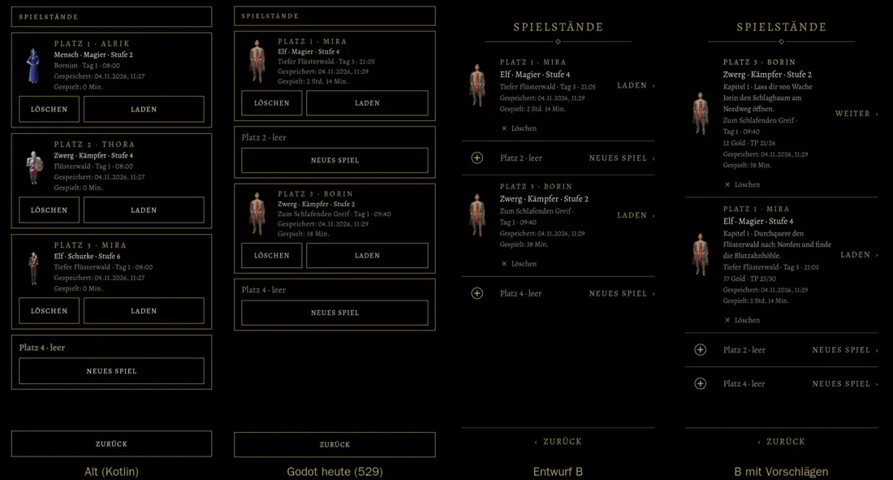
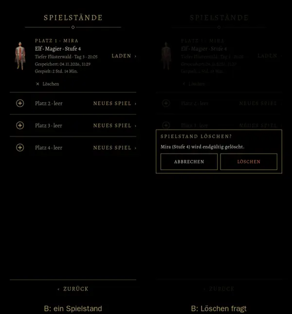

# 557 · Spielstände als Entwurf „ohne Kasten“ · Team Tom · 04.11., 11:31

A Spiel
Kurz: Du wolltest (11:15, 11:17) einen Entwurf der Spielstände im neuen Stil (549a), mit der Spieldauer und abgeglichen mit der alten Fassung. Er ist in Godot so gebaut, wie er ins Spiel käme, aber noch nicht eingeschaltet. Alles, was alt je Platz stand, steht auch im Entwurf: Bild des Helden, Platz und Name, Volk · Klasse · Stufe, Ort · Tag · Uhr, „Gespeichert“, „Gespielt“. In Build 257 fehlten Bild und Spieldauer, weil 529 noch nicht im Build war.

Geprüft an: https://github.com/tramour-cmyk/androidapp_rpg_bornim/commit/69a5744e4 (Zweig `claude/tom-557-spielstaende`), Bilder `spielstaende_bild_557` (Godot am Rechner, Lauf 2 von 2), alt aus `tools/preview` (64_slots)

So ist B gebaut: Der Titel steht ohne Rahmen. Jeder Platz ist eine Zeile zwischen feinen Goldlinien und über die ganze Breite antippbar; beim Antippen wird sie dunkel. Links steht das Heldenbild, rechts „LADEN ›“ in Gold. „Löschen“ steht leise grau eine Zeile darunter, weit weg von „Laden“, und fragt nach; die Rückfrage ist der einzige Rahmen, „Löschen“ darin in Warnfarbe. Ein leerer Platz ist eine Zeile mit „NEUES SPIEL ›“.

Vorschläge zum Zuschalten (Bild 4), je einzeln:
1. Der zuletzt gespielte Platz steht oben, die Hauptwahl heißt dort „WEITER ›“.
2. Eine Zeile, wo man steht: Kapitel und Hauptauftrag aus der Chronik, damit man nach Tagen weiß, was zu tun ist.
3. Gold und TP klein.

Bekannt: Am Rechner haben alle Helden dieselbe Figur, weil dort die Kaufkörper fehlen (513). Auf dem Gerät hat jeder Held seine eigene Figur nach Klasse und Volk. Unten bleibt bei vier Plätzen Platz frei, wie in der alten Fassung.

Bitte ansehen:
1. **B so bauen?** Oder was ändern (ein Wort genügt: Größe, Abstand, Farbe, Löschen)?
2. **Welche Vorschläge** 1, 2, 3 sollen dazu (keiner, einzelne, alle)?
