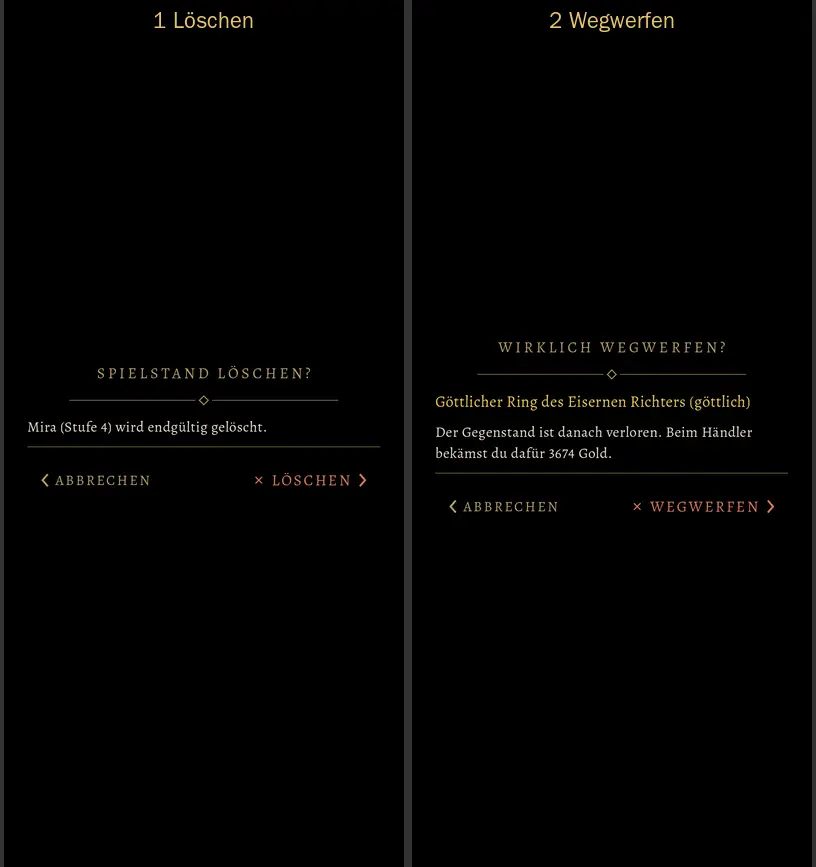
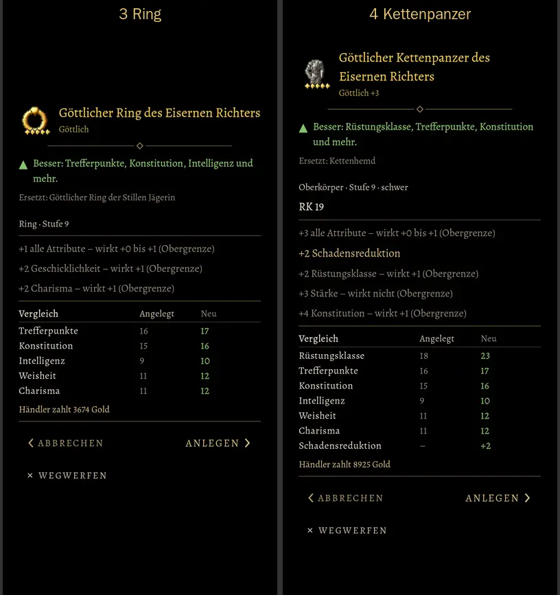
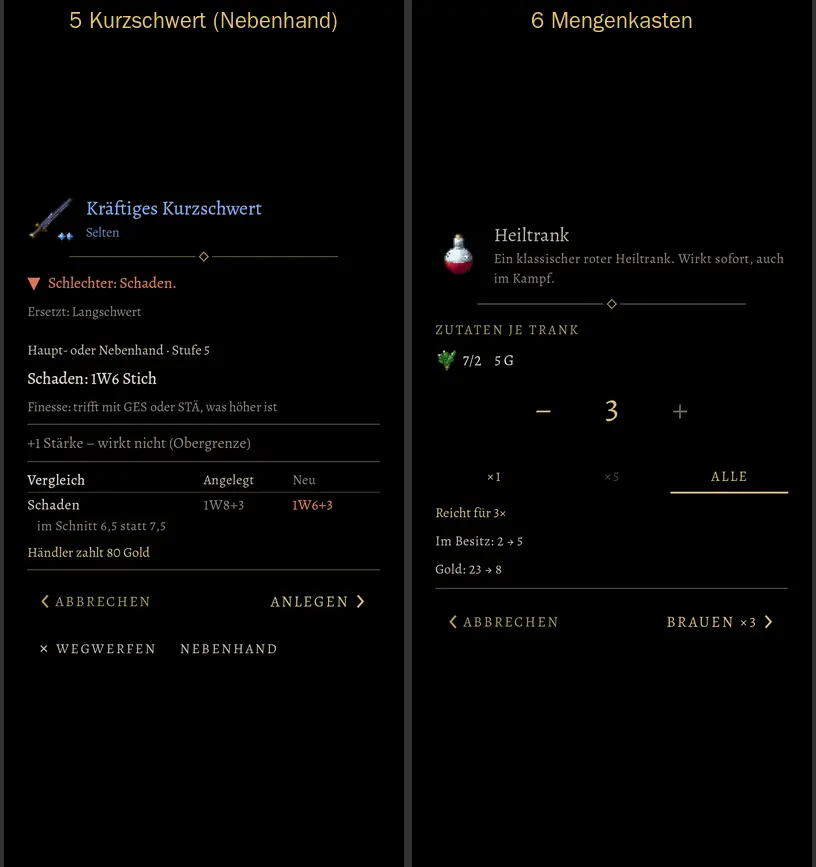
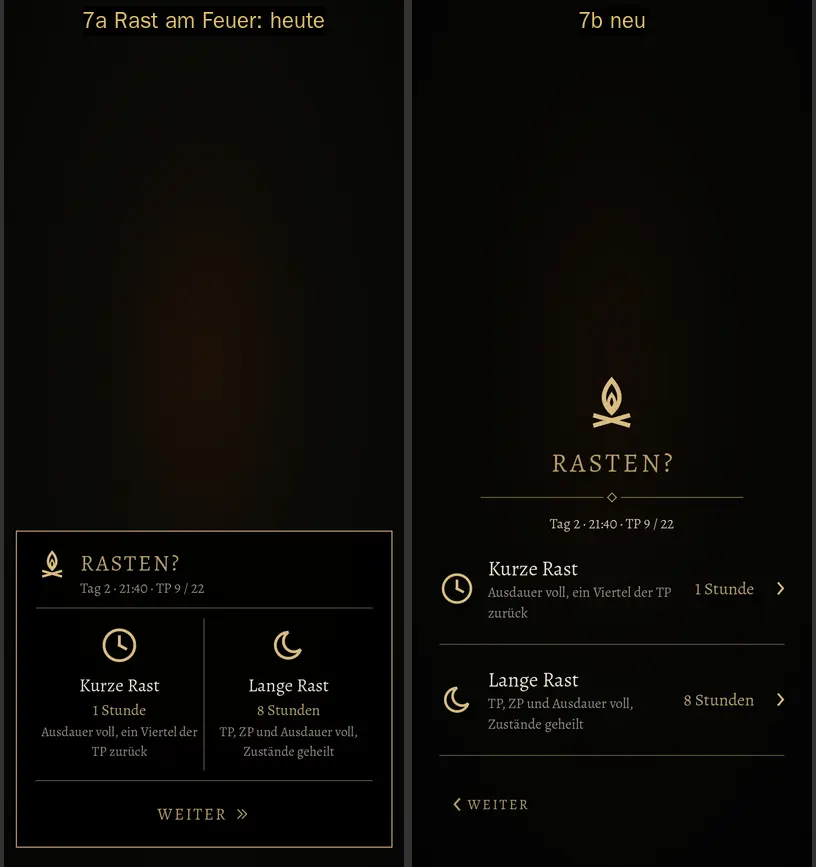
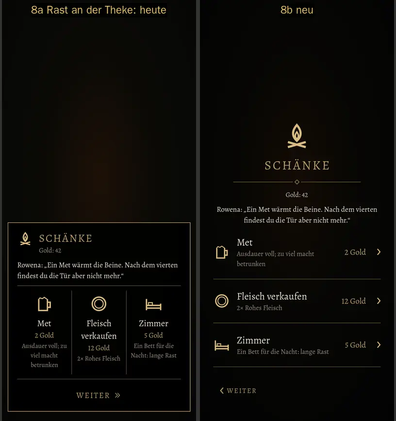
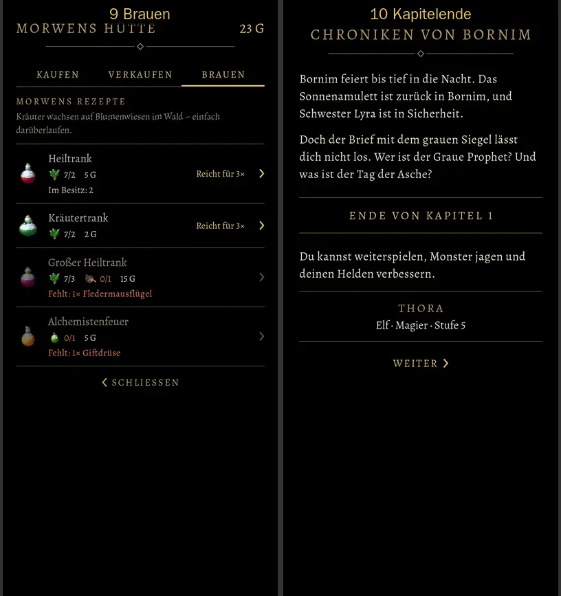

# 557 · Stil B, dritte Runde: Gegenstand ohne Rahmen, Kopf mit Zierlinie, Rast · Team Tom · 04.11., 17:11

[Bild von 04.11., 17:11](https://github.com/tramour-cmyk/androidapp_rpg_bornim/blob/bilder/2026-11/04-1711-557-Tom.png) (eingetragen von meldung.sh, Tom)

A Spiel
Kurz: Deine Worte von 16:42 bis 16:51 sind umgesetzt. Mengenkasten, Kapitelende und Brauen bleiben wie im Bild von 16:39; geändert ist dort nur, was alle Fenster gemeinsam haben (Kopf mit Zierlinie, Zeichen „‹“, hellere kleine Angaben). Die Rast ist neu im selben Stil, links jeweils die Rast von heute. Sag „passt“ oder was anders sein soll; danach entscheidest du 557, 549a und 524.1 zusammen, eingeschaltet wird erst dann.

Neu:
- Gegenstandsfenster (Bild 3–5) ohne Rahmen wie Rückfrage und Mengenkasten, das Bild im Kopf frei ohne Goldkästchen, der Grund schwarz und deckend (nichts scheint mehr durch).
- Jedes Fenster gleich: oben Titel oder Bild mit Name, darunter genau eine Zierlinie mit Raute; dann der Inhalt, eine schlichte Linie, die Knöpfe. Gilt für Rückfragen (1, 2), Gegenstand (3–5), Mengenkasten (6) und Rast (7, 8).
- „‹“ ist jetzt ein gezeichnetes Zeichen wie „›“ (vorher ein winziger Punkt); „ABBRECHEN“ ist nur eine Stufe kleiner als die Hauptwahl.
- „× WEGWERFEN“ und „NEBENHAND“ stehen leise in der Zeile von „‹ ABBRECHEN“. Reicht die Breite nicht (360 dp Schirm), rücken sie direkt darunter; ob das bei Bild 4 und 5 passiert ist, siehst du im Bild.
- Kleine Angaben (Reicht für, Im Besitz, Gold, Stufe, Händler zahlt, Angelegt) mindestens 13,5 sp und heller; ×1 · ×5 · ALLE und „+“ heller.
- Rast (7, 8) neu mit denselben Bausteinen: Kopf mit Flamme und Titel, Zierlinie, die Zeile „Tag 2 · 21:40 · TP 9 / 22“ leise darunter (deine offene Frage aus 549: behalten?), Wahlen als Zeilen mit „›“, unten „‹ WEITERGEHEN“.

Geprüft: Maßtest der Gruppe ohne Fehler (alles auf dem Schirm, keine Überlappung, Schrift mindestens 13 sp, jede Tippfläche mindestens 48 dp).

Bekannt: zwei Tests zum Laden melden am Rechner Fehler (Fleisch verkaufen, Zurückkaufen), unverändert gegenüber vorher; das gehört zu 525 und wird vor dem Build nachgestellt.

Geprüft an: https://github.com/tramour-cmyk/androidapp_rpg_bornim/commit/05bcedaa8 (Zweig `claude/tom-557-spielstaende`, Bildskripte `spielstaende_bild_557` und `rast_bild_549`, Lauf 1 von 2 am Rechner).

Antwort:
