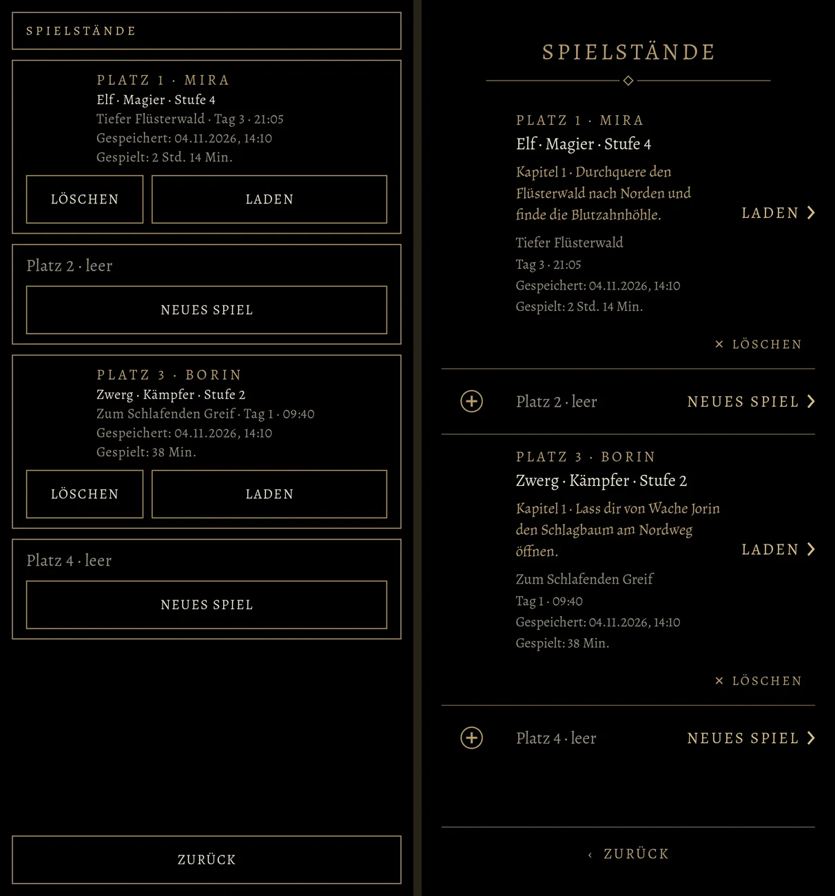
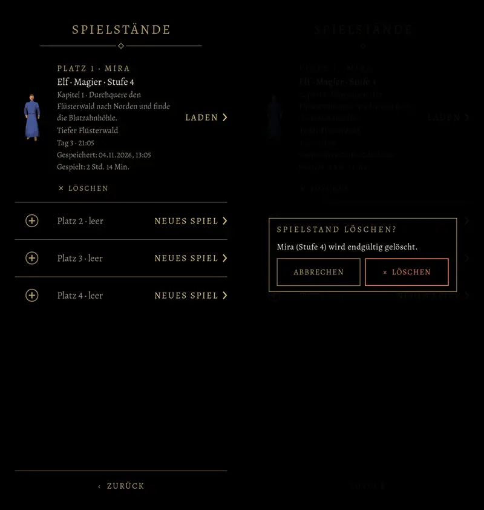
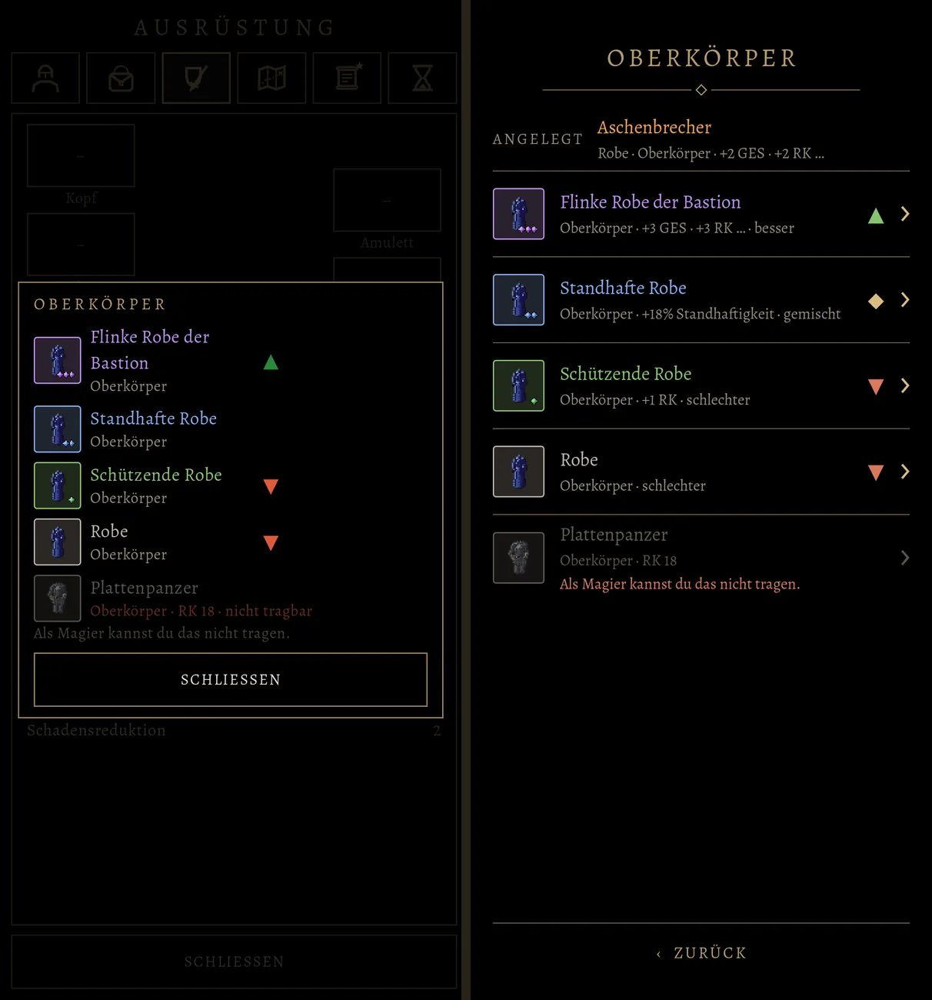
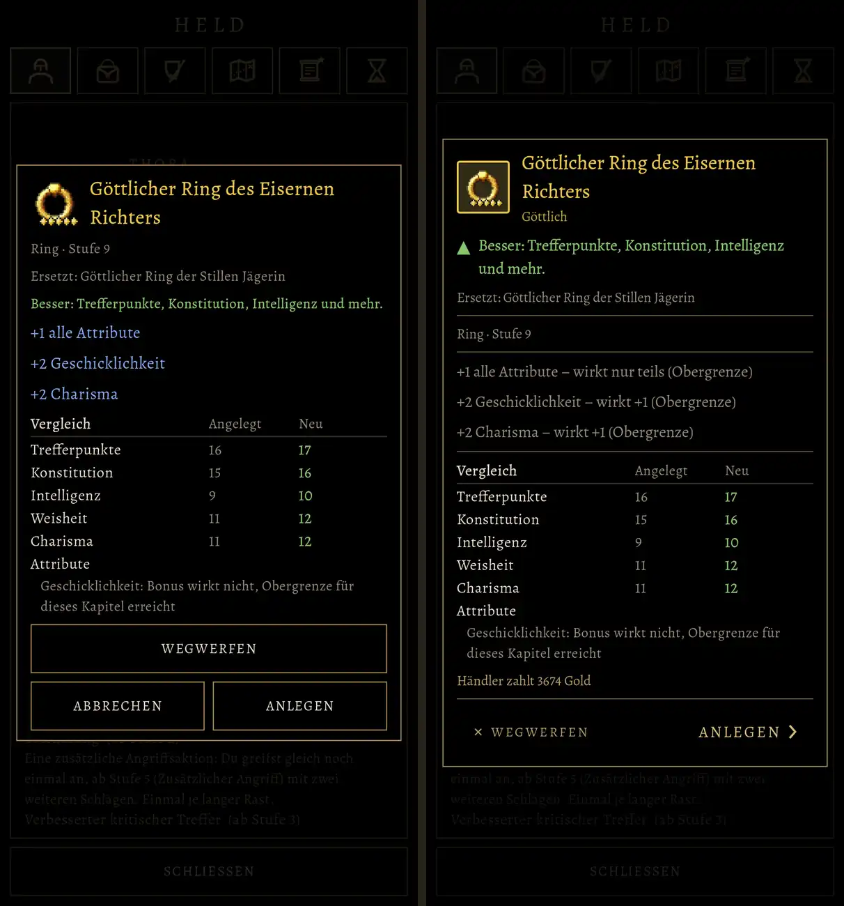
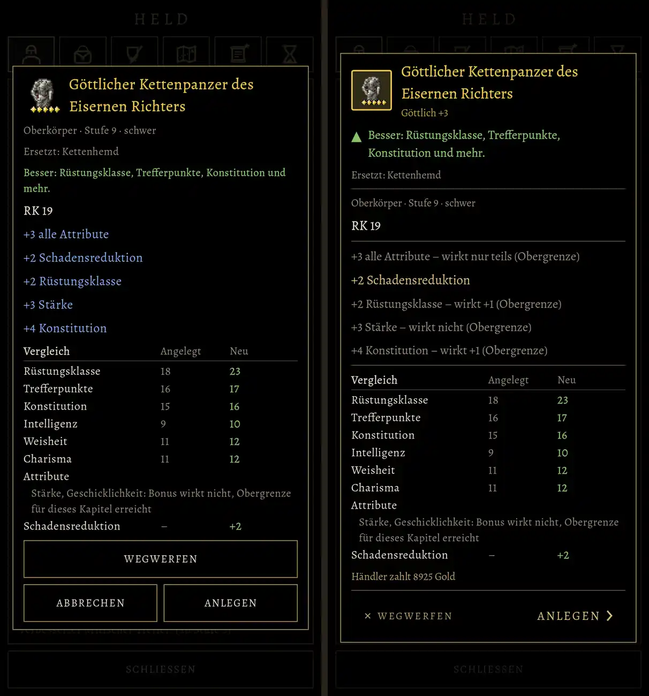
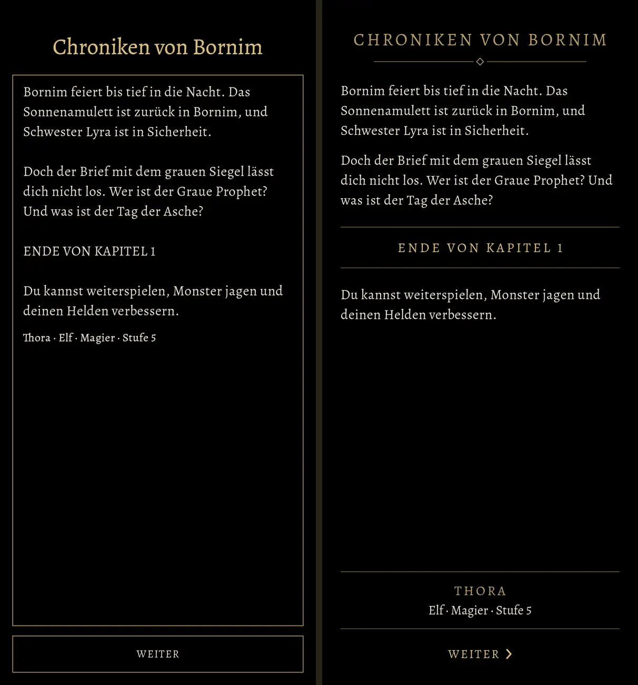
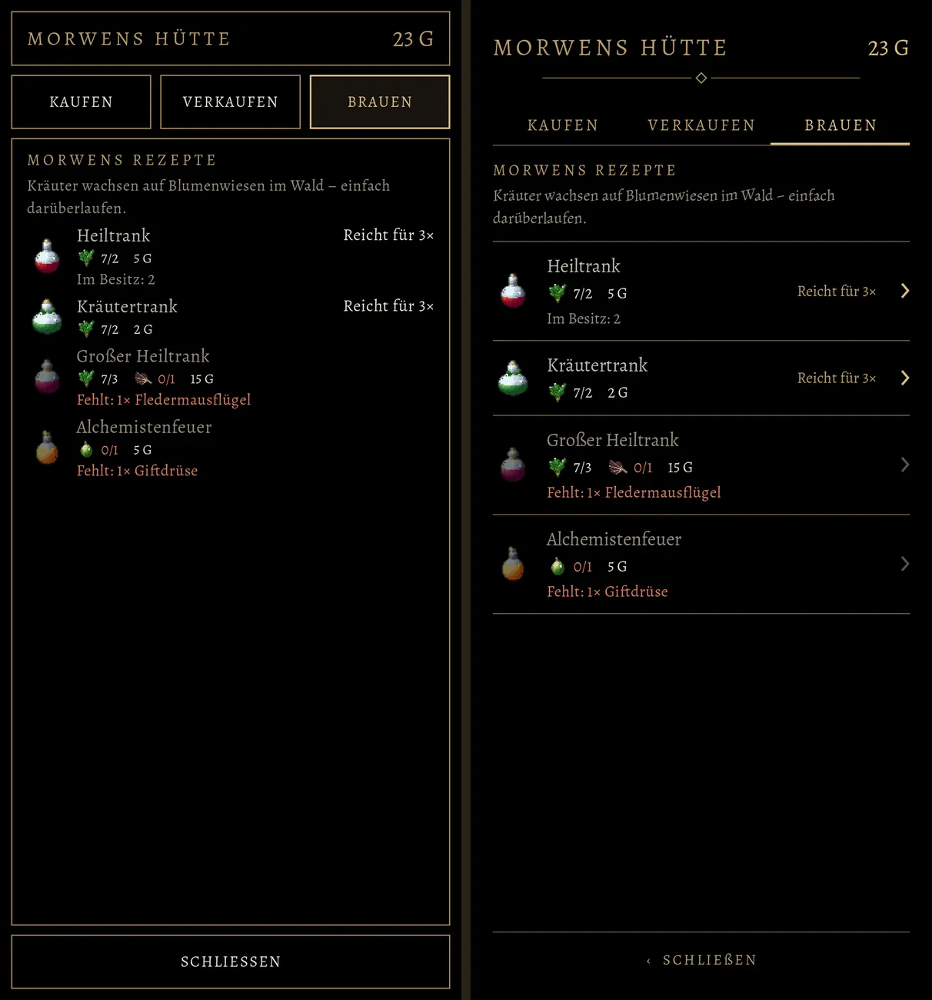
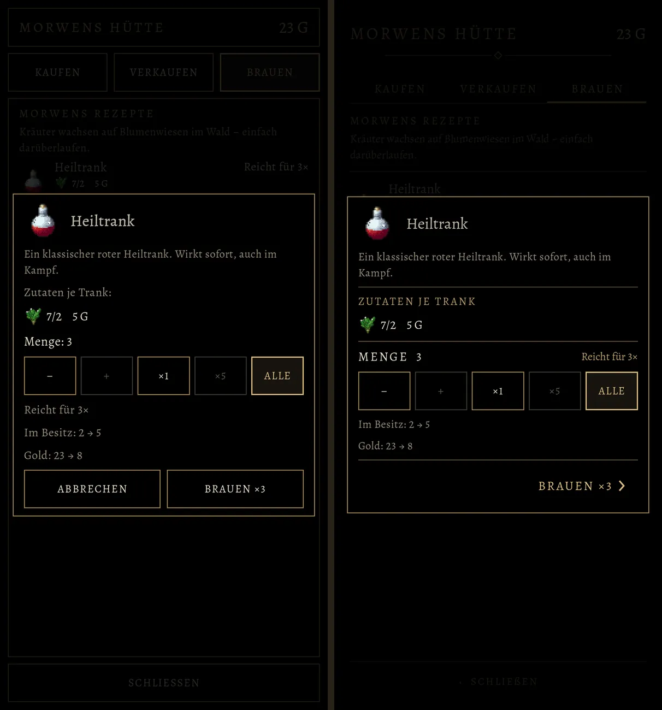

# 557 · Stil B an sechs Schirmen, vorher und nachher · Team Tom · 04.11., 14:15

[Bild von 04.11., 14:16](https://github.com/tramour-cmyk/androidapp_rpg_bornim/blob/bilder/2026-11/04-1416-557-Tom.png) (eingetragen von meldung.sh, Tom)

[Bild von 04.11., 14:15](https://github.com/tramour-cmyk/androidapp_rpg_bornim/blob/bilder/2026-11/04-1415-557-Tom.png) (eingetragen von meldung.sh, Tom)

A Spiel
Kurz: Du wolltest den Stil B an allen Schirmen der Gruppe sehen, je vorher und nachher, in einem Bildlauf (13:32, 13:42, 13:44). Alles ist in Godot gebaut, so wie es ins Spiel käme, aber nicht eingeschaltet. In jedem Bild links heute, rechts B.

Geprüft an: https://github.com/tramour-cmyk/androidapp_rpg_bornim/commit/ddce14bdf (Zweig `claude/tom-557-spielstaende`), Bilder `spielstaende_bild_557` (Godot am Rechner, Lauf 1 von 2), Maßtest `gruppe_mass_557` ohne Fehler (alles auf dem Schirm, kein Text überlappt, keine Schrift unter 13 sp, jede Tippfläche mindestens 48 dp).

Geändert seit 13:06 (Befund des Prüfers von 13:07):
- Rückfrage: dahinter jetzt ganz dunkel, die Liste ist ausgeblendet.
- Zeile Kapitel und Hauptauftrag: schräg in gedämpftem Gold, mit etwas Abstand.
- „× LÖSCHEN“ steht rechts unter „LADEN ›“.
- Das fehlende Bild der Robe war ein Fehler im Bildskript, nicht im Spiel.
- Stücke ohne eigene Zahl (Roben, Ringe) zeigen in der Liste ihre ersten zwei Boni, etwa „+2 GES · +2 RK“.

Neu in B:
- Gegenstandsfenster: außen bleibt der Goldrahmen, innen nur Linien. Das Urteil steht als Zeile unter dem Namen (▲ grün „Besser“, ▼ rot „Schlechter“, ◆ gold „Gemischt“), dieselben Zeichen wie in der Liste. Boni in Gold; was die Obergrenze des Kapitels schluckt, matt mit „wirkt nicht“ oder „wirkt +1 (Obergrenze)“. Unten „Händler zahlt n Gold“, links leise „× WEGWERFEN“, rechts „ANLEGEN ›“ in Gold. Abbrechen mit Zurück oder Tippen daneben.
- Kapitelende: kein Kasten mehr. Titel in Versalien mit Zierlinie, der Text frei, „ENDE VON KAPITEL 1“ zwischen zwei Linien, der Held zwischen Linien, unten „WEITER ›“ in Gold.
- Brauen: Kopf ohne Kasten, die Seiten als Wörter mit Goldstrich unter der gewählten, die Rezepte als Zeilen zwischen Linien mit „Reicht für nד und „›“. Der Mengenkasten behält seinen Rahmen, unten „BRAUEN ×3 ›“ in Gold.

Bekannt:
- Am Rechner haben alle Helden dieselbe Figur, weil dort die Kaufkörper fehlen.
- „Heute“ im Gegenstandsfenster ist der Stand von Build 257; das Band aus dem Vorschlag 524.1 ist in B durch die Zeile ersetzt.
- Im Laden sind nur die Seiten zum Brauen in B gebaut, Kaufen und Verkaufen noch nicht.
- Rast: das Bild von 01:10 (Frage 2 dort bleibt offen).

Befund des Prüfers (Helfer, 14:18, nach dem Versand):
- Ring: bei den Boni „+2 Geschicklichkeit – wirkt +1“, in der Tabelle darunter „Geschicklichkeit: Bonus wirkt nicht“. Beides stimmt (oben: was der Ring selbst bringt; unten: gegen den Ring, den er ersetzt), liest sich aber als Widerspruch. Im Zweig behoben, noch nicht im Bild: die Sammelzeile unten fällt weg; „wirkt nur teils“ heißt jetzt „wirkt +0 bis +1“.
- „‹ SCHLIEßEN“ mit ß in Versalien; im Zweig behoben (SCHLIESSEN).
- Gegenstandsfenster und Mengenkasten haben keine Wahl „Abbrechen“ mehr (so bestellt: Zurück oder Tippen daneben); sehen kann man das nicht.
- Rückfrage: dahinter ist jetzt alles schwarz, auch Kopf und Zurück nur noch zu ahnen.
- Spielstände: links bei vollen Plätzen eine leere Fläche (am Rechner fehlt die Figur); „× LÖSCHEN“ steht weit unter „LADEN ›“.
- Wechselliste: Werte enden mit „…“, wenn ein Stück mehr als zwei Boni hat; „Standhafte Robe“ in Hellblau (Farbe der Seltenheit); nicht Tragbares hat ein mattes „›“ (antippbar, zeigt das Fenster).
- Mengenkasten: die Knöpfe −, +, ×1, ×5, Alle haben eigene Goldrahmen im Fenster.
- Kettenpanzer: das hohe Fenster reicht über die Reiterleiste.

Stil-Abgleich (88): Oberfläche (schwarz, Goldrahmen nur an Fenstern und Rückfragen, Alegreya, Versalien gesperrt für Titel und Wahlen), Zeichen ▲ ▼ ◆ › ×. Übergänge: Antippen hebt die Zeile dunkel ab, sonst wie bisher. Spielerfreundlich: die Hauptwahl steht immer rechts in Gold, die Nebenwahl leise links oder darunter.

Bitte ansehen:
1. **Stil B an diesen Schirmen so?** Ja heißt: 549a gilt, die Schirme werden so gebaut, wenn sie ohnehin angefasst werden.
2. **Ein Schirm anders?** Ein Wort je Bild genügt („4 Band behalten“, „7 Kasten zurück“ …).
