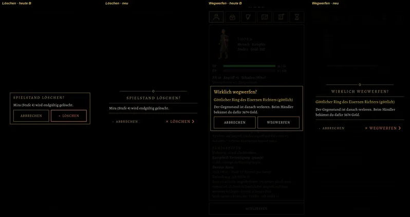
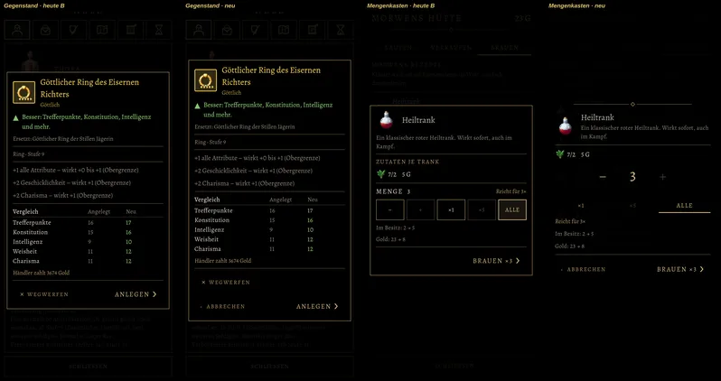
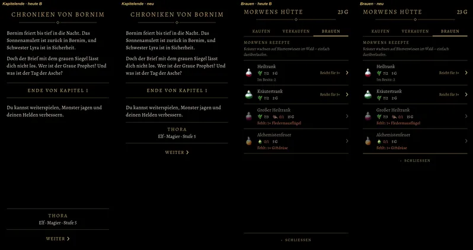

# 557 · Stil B, neue Vorlage: Rückfragen ohne Kasten, Abbrechen, Mengenkasten, Knopf am Inhalt · Team Tom · 04.11., 16:39

[Bild von 04.11., 16:38](https://github.com/tramour-cmyk/androidapp_rpg_bornim/blob/bilder/2026-11/04-1638-557-Tom.png) (eingetragen von meldung.sh, Tom)

A Spiel
Kurz: Deine Punkte von 14:21 bis 14:26 sind umgesetzt. Jedes Bild zeigt links B (Vorlage 14:15), rechts neu. Bild 1 war dort Bild 2, Bild 4 war Bild 8, Bild 5 und 6 waren Bild 6 und 7. Sag je Punkt (Rückfragen, Abbrechen, Mengenkasten, Knopf) „passt“ oder was anders sein soll. Danach entscheidest du 557, 549a und 524.1 zusammen; eingeschaltet wird erst dann. Spielstände, Wechselliste und Rast sind unverändert wie in der Vorlage 14:15.

Neu:
- Rückfragen (Bild 1, 2) ohne Kasten: fast schwarzer Grund, Titel in Gold zwischen Zierlinie und Linie, unten links „‹ ABBRECHEN“, rechts die Wahl in Warnfarbe mit Zeichen („× LÖSCHEN“, „× WEGWERFEN“).
- Abbrechen: „‹ ABBRECHEN“ steht jetzt sichtbar links in jedem Fenster mit einer Wahl, die Hauptwahl rechts in Gold. Zurück und Tippen daneben schließen weiterhin.
- Gegenstandsfenster (Bild 3): der Goldrahmen bleibt. Unten „‹ ABBRECHEN“ links und „ANLEGEN ›“ rechts in Gold; „× WEGWERFEN“ und „Nebenhand“ stehen leise eine Zeile darüber.
- Mengenkasten (Bild 4) ohne Rahmen: Kopf mit Bild und Name zwischen Zierlinie und Linie; die Menge groß in der Mitte „− 3 +“, die Tippflächen groß und ohne eigene Rahmen; darunter ×1 · ×5 · ALLE als Wörter, das gewählte hell mit Goldstrich wie die Seiten beim Brauen; Bestand und Gold vorher → nachher; unten „‹ ABBRECHEN“ links, „BRAUEN ×3 ›“ rechts in Gold.
- Knopf am Inhalt (Bild 5, 6): „WEITER ›“ und „‹ SCHLIESSEN“ stehen direkt unter dem Inhalt, solange alles auf einen Schirm passt; nur wenn die Liste rollt, stehen sie fest unten. Gemessen: Weiter bei 58 % statt 93 % der Schirmhöhe, Schließen bei 63 % statt 95 %. Sonst sag „immer unten“.

Geprüft: alles auf dem Schirm, kein Text überlappt, keine Schrift zu klein, jede Tippfläche groß genug für den Finger, Abbrechen in jedem Fenster da (für B und neu).

Befund des Prüfers (16:40, nach dem Versand), behebe ich für die nächste Runde:
- Wegwerfen und Mengenkasten (Bild 2, 4): der Grund ist nicht deckend genug, die Liste dahinter scheint durch und überlappt den Text. Löschen (Bild 1) wirkt dagegen „ruhig und klar, besser“.
- Gegenstandsfenster: durch die zusätzliche Zeile reicht der Rahmen beim Kettenpanzer bis in die Reiter oben; „× WEGWERFEN“ ist nicht leise (gleiche Farbe wie Abbrechen).
- Mengenkasten: die Überschrift „Zutaten je Trank“ fehlt, ohne sie ist „7/2“ unverständlich.
- Brauen (Bild 6): unter der letzten Zeile liegen zwei Linien übereinander. Kapitelende: oben voll, unten leer.
- Die Rast neu im Stil B (deine Frage 16:37) ist hier noch nicht drin; sie kam nach dem Bildlauf und kommt in die nächste Runde, sobald du hierzu geurteilt hast.

Bekannt: ein Test zum Laden meldet am Rechner drei Fehler beim Verkauf von Fleisch und beim Zurückkaufen, schon vor dieser Änderung; das prüfe ich beim nächsten Bauen nach.

Geprüft an: https://github.com/tramour-cmyk/androidapp_rpg_bornim/commit/f53aef228 (Zweig `claude/tom-557-spielstaende`, Bildskript `spielstaende_bild_557`, Maßtest `gruppe_mass_557`, Lauf 2 von 2 am Rechner).

Antwort:
