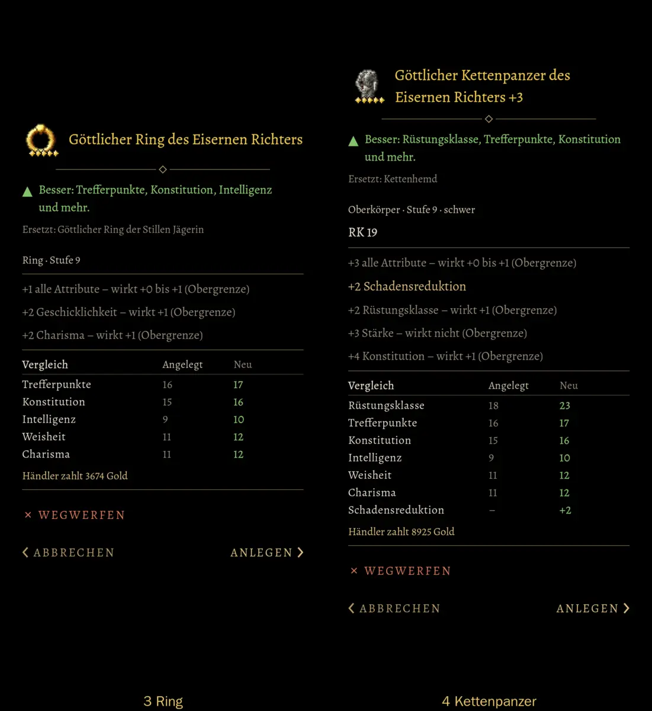
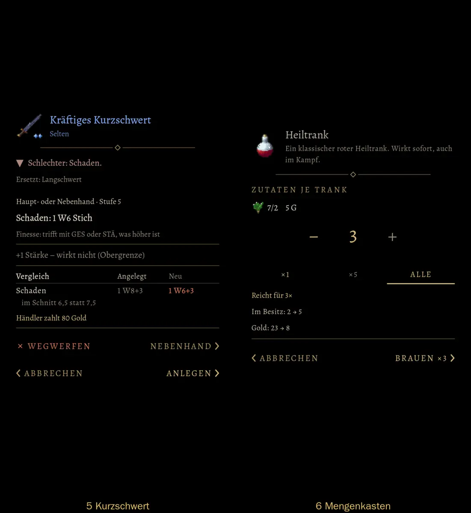
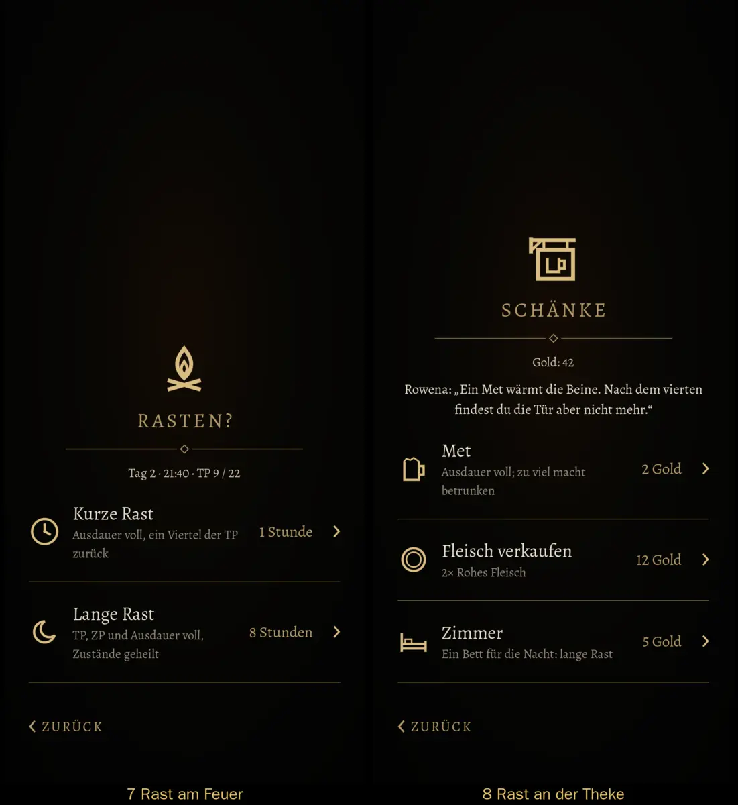
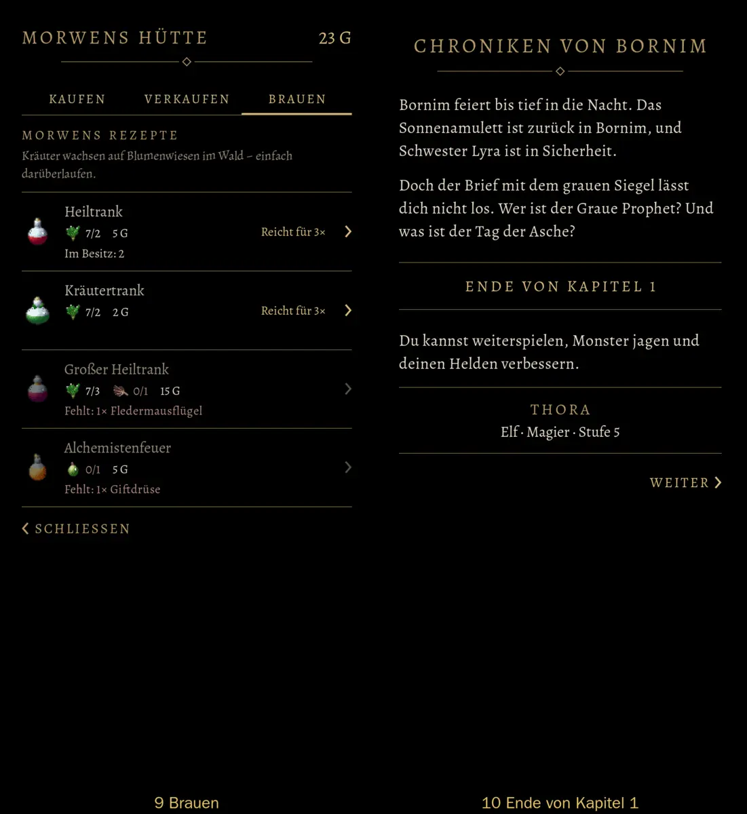
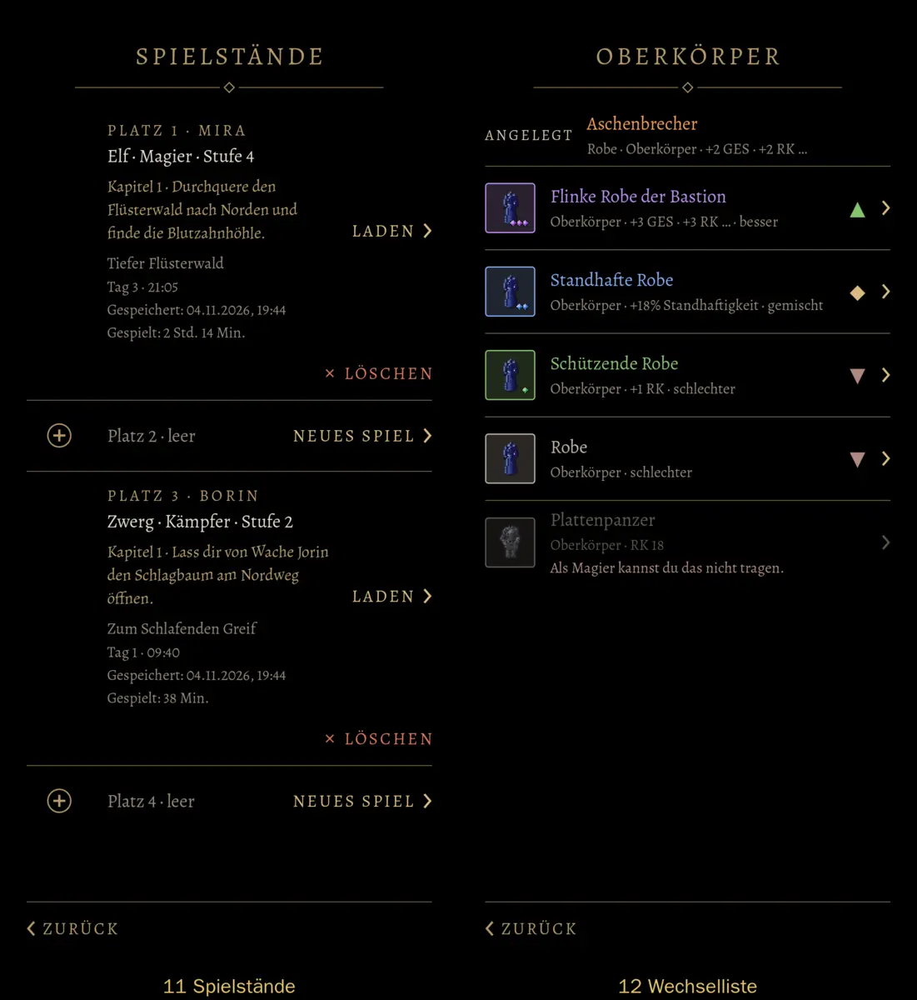

# 557 · Stil B, fünfte Runde: Bilder der Dinge, Rückfragen zentriert, „+x“ am Namen · Team Tom · 04.11., 19:46

[Bild von 04.11., 19:46](https://github.com/tramour-cmyk/androidapp_rpg_bornim/blob/bilder/2026-11/04-1946-557-Tom.png) (eingetragen von meldung.sh, Tom)

Kurz: Deine Worte von 19:19 bis 19:28 sind umgesetzt. Jedes Bildfeld zeigt das Ding (Gegenstand, Trank, Kraut, Zutat). Rückfragen stehen mittig wie der Titel, ab vier Zeilen Text linksbündig. „+3“ steht am Namen. Die Warnfarbe steht nur noch an dem, was etwas zerstört. Sag „passt“ oder was anders sein soll; danach entscheidest du 557, 549a und 524.1 zusammen.

Neu gegenüber Runde 4:
- Bilder der Dinge in 3–6 und 9 (fehlten nur in meiner Bildkopie); der Maßtest prüft jetzt, dass jedes Bildfeld gefüllt ist.
- Rückfragen (1, 2) zentriert: Titel, Name, Text.
- „Kettenpanzer +3“ in einer Zeile (4), bricht mit dem letzten Wort um.
- „Schlechter“, „Fehlt“, „kannst du nicht tragen“, „Ungeübt“ in einem stillen, grauen Rot statt der Warnfarbe; die Warnfarbe nur an „× WEGWERFEN“ und „× LÖSCHEN“.
- Kein einzelnes Wort mehr allein in der zweiten Zeile (3, 4).
- Brauen (9): alle Rezeptzeilen gleich hoch.
- Werte nach 549a: Titel der Rast 22 statt 26 sp, Zwischenüberschriften 14 sp, Fließtext 15 sp.

**Frage:** Der neue Ton für Mängel ist b08a80 (stilles, graues Rot). Passt er, oder lieber Grau?

Bekannt, nicht geändert:
- Theke (8) „Fleisch verkaufen · 12 Gold“ liest sich wie ein Preis: das ist Spieltext, geht an Homer (570).
- Seltenheit „episch“ (Aschenbrecher, 12) bleibt Orange wie im alten Spiel; die Warnfarbe steht jetzt nur noch an Knöpfen, darum treffen beide kaum noch aufeinander.
- Ring (3): ob in der Vergleichszeile „Geschicklichkeit“ fehlt, prüft der Helfer am Bild.

Befund des Prüfers (19:47, nach dem Versand; noch nicht behoben, ich baue es für die nächste Runde):
- Erster Eindruck: einzelne Wörter allein in der zweiten Zeile, in Rast (7 „zurück“, 8 „betrunken“), Brauen (9 „darüberlaufen.“) und Spielständen (11 „öffnen.“); behoben habe ich das bisher nur im Gegenstandsfenster.
- 5: „1 W6+3“ in der Spalte Neu steht noch in der Warnfarbe (Vergleichstabelle).
- Erfüllt: Bilder der Dinge in 3–6, 9, 12; Rückfragen zentriert; „+3“ am Namen; „Schlechter“, „Fehlt“, „nicht tragen“ im stillen Rot; Rezeptzeilen gleich hoch; Knöpfe gleich groß, Seiten richtig; Titel 7, 8 so groß wie 11, 12.
- 11: die belegten Plätze haben links kein Heldenbild (am Rechner gibt es kein Modell), die leeren ein ⊕.
- 3 Ring: im Vergleich fehlt die Zeile Geschicklichkeit (und Stärke trotz „+1 alle Attribute“). 4: Rüstungsklasse 18 → 23 passt nicht zu „RK 19“ und „+2 RK, wirkt +1“; ich rechne nach.
- Sonst: Gold uneinheitlich („23 G“ in 6, 9; „2 Gold“, „Gold: 42“ in 8); „7/2“ ohne Erklärung (6, 9); Bild zu „Fleisch verkaufen“ (8) ist ein Doppelring, kein Fleisch; in 3 beginnt der Inhalt tiefer als in 4; 9 „MORWENS HÜTTE“ kleiner und linksbündig; 3 Wegwerfen allein in der Reihe, in 5 neben Nebenhand; 10 „Bornim“ zweimal hintereinander (Spieltext, an Homer). Aschenbrecher (12) liegt nahe an der Warnfarbe.

Geprüft: Maßtest der Gruppe ohne Fehler, auch auf 360 dp; Rast, Gegenstand, Fenster, Tasche ohne Fehler.

Geprüft an: https://github.com/tramour-cmyk/androidapp_rpg_bornim/commit/3a1fe99cf (Zweig `claude/tom-557-spielstaende`, Bildskripte `spielstaende_bild_557` und `rast_bild_549`, Lauf 2 von 2 am Rechner).
