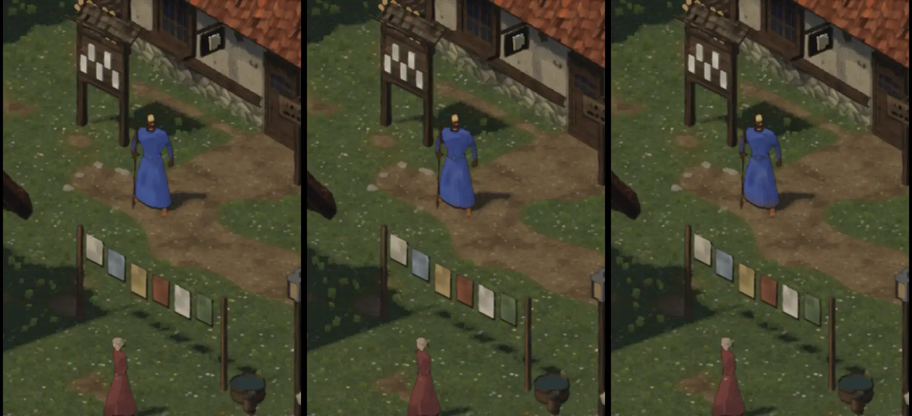
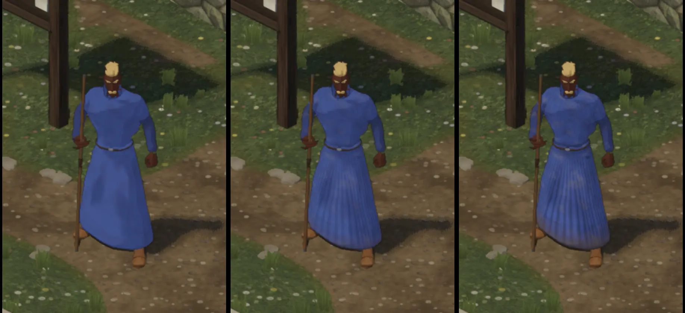
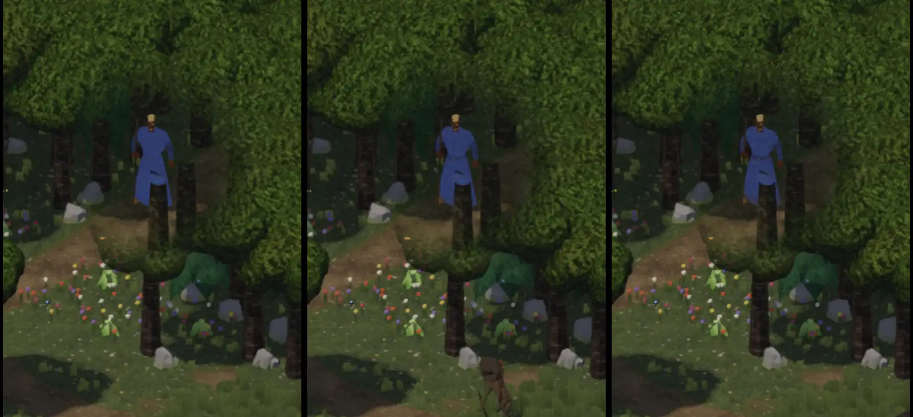
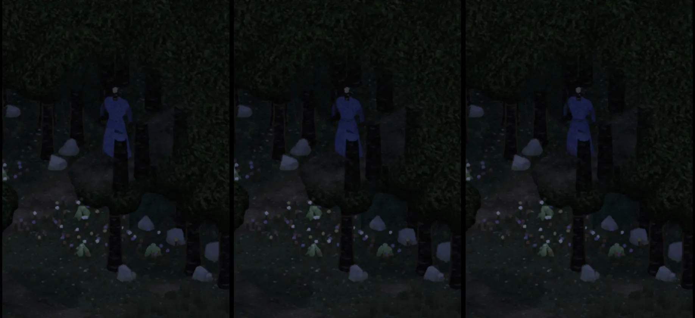

# 558 · Robe des Magiers mit Stoff: Probebild · Team Tom · 04.11., 14:21

[Bild von 04.11., 14:21](https://github.com/tramour-cmyk/androidapp_rpg_bornim/blob/bilder/2026-11/04-1421-558-Tom.png) (eingetragen von meldung.sh, Tom)

[Bild von 04.11., 14:20](https://github.com/tramour-cmyk/androidapp_rpg_bornim/blob/bilder/2026-11/04-1420-558-Tom.png) (eingetragen von meldung.sh, Tom)

A Spiel
Kurz: Du hast gesagt (11:31): „Robe des Magiers … sieht einfach viel zu clean aus … Das muss irgendwie lebendiger sein … Schattenstruktur, schmutzig, abgenutzt.“ Ursache: das feine Gewebe der Robe ist kleiner als ein Bildpunkt im Spiel, darum wirkte sie wie eine Fläche. Neu ist eine Stoffschicht in Spielgröße: Falten im Rock, ein dunkles Band unter dem Gürtel, Schatten in den Falten, ausgeblichene Stellen, Flecken, Schmutz am Saum. In jedem Bild links die Robe heute, in der Mitte der Stoff halb stark (0,6), rechts voll (1). Nur Probe, nichts eingebaut.

Geprüft an: https://github.com/tramour-cmyk/androidapp_rpg_bornim/actions/runs/41826697107 (Zweig `claude/tom-558-robe`, Lauf 2 von 2, Bilder aus dem Spiel mit Spielshadern).

Bekannt:
- Gilt zuerst für die eigenen Trachten (Robe, Wache). Gekaufte Trachten (Kloster, Wald, Bauer) bringen ihren Stoff schon mit.

Befund des Prüfers (Helfer, 14:20, vor dem Versand, Lauf 2 von 2, nicht behoben):
- Unterschied in allen vier Bildern sichtbar, am deutlichsten im Dorf nah, am schwächsten im Wald bei Nacht: senkrechte Falten im Rock (bei 1 kräftiger), dunkle Flecken auf Brust und Bauch, bräunlicher Saum; Band unter dem Gürtel kaum zu sehen; ausgeblichen nur gemessen (etwa 6 % heller), mit dem Auge kaum.
- Die Falten sind gleichmäßige senkrechte Streifen mit fast gleichem Abstand.
- Umrisslinie und Lichtstufen im Dorf da; im Wald schwach, bei Nacht nicht sicher zu sehen. Schatten unter dem Körper, keine Scheibe.
- Wald: der Unterleib steht hinter einem Baumstamm; rechts an der Hüfte ein dunkler schräger Fleck in allen drei Fassungen (nicht vom neuen Stoff), ob Stamm oder Loch, ist im Bild nicht zu klären.
- Nebenbei: im Wald steht der Ortsname englisch („Deep Whisperwood“); im Dorf nah wirkt das Gesicht dunkel mit gelbem Bart (Gesichter: 475).

Bitte ansehen:
1. **Welche Stärke: heute, 0,6 oder 1?** Oder was ändern (ein Wort genügt)?
2. **Danach für alle Trachten so?** (Du hast gesagt: „gilt für alle Trachten“; ich baue es dann auf die übrigen eigenen Trachten.)
