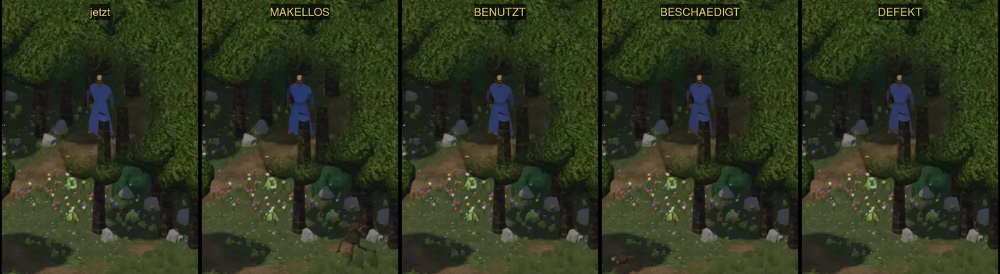
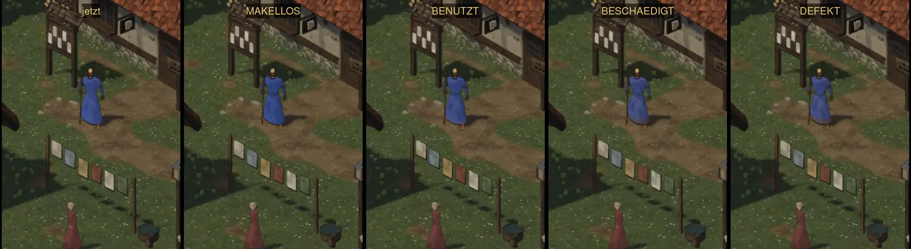
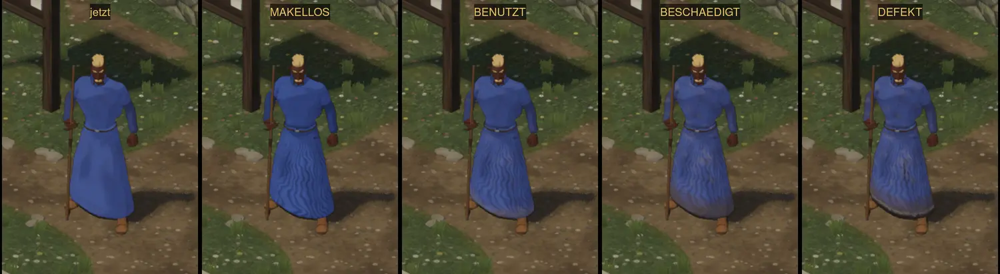
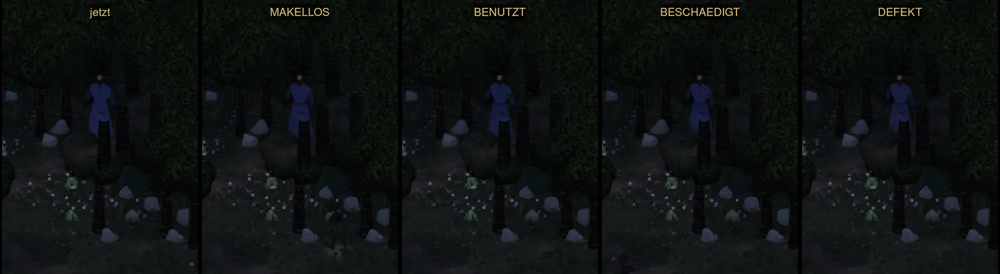

# 558 · Robe des Magiers, Probe 3: Falten voll, Spuren nach Zustand · Team Tom · 04.11., 17:23

[Bild von 04.11., 17:24](https://github.com/tramour-cmyk/androidapp_rpg_bornim/blob/bilder/2026-11/04-1724-558-Tom.png) (eingetragen von meldung.sh, Tom)

Kurz: Umgesetzt ist dein Wort von 15:46 („558 Form voll, Spuren nach Zustand“). In jedem Bild links die Robe von heute (Build 257), daneben neu in den vier Zuständen Makellos, Benutzt, Beschädigt, Defekt. Falten, Schatten in den Falten und Band unter dem Gürtel sind immer voll; Schmutz, Flecken, Ausbleichen und Saum folgen dem Zustand. Sag „passt“ oder was anders sein soll. Danach wird „Benutzt“ fest eingestellt, bis die Abnutzung gebaut ist (478), dann folgen Wache und Kauftrachten.

Neu gegenüber Probe 2:
- Falten unregelmäßig: Winkel und Tiefe wechseln von Falte zu Falte, stellenweise eine zweite, engere Schar (Prüfer 14:20: vorher gleichmäßige senkrechte Streifen).
- Makellos ohne Spuren; Benutzt Staub am Saum und einzelne Flecken; Beschädigt schmutzig und ausgeblichen; Defekt dazu ausgefranster Saum und ein Riss vorn am Knie.
- Die alten Flecken der Kleidung folgen demselben Zustand.

Geprüft an: https://github.com/tramour-cmyk/androidapp_rpg_bornim/commit/a58787341 (Zweig `claude/tom-558-robe`, Lauf [41852228803](https://github.com/tramour-cmyk/androidapp_rpg_bornim/actions/runs/41852228803)).
