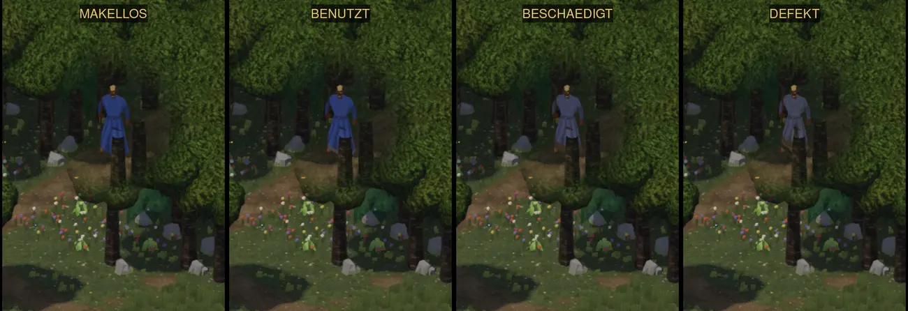
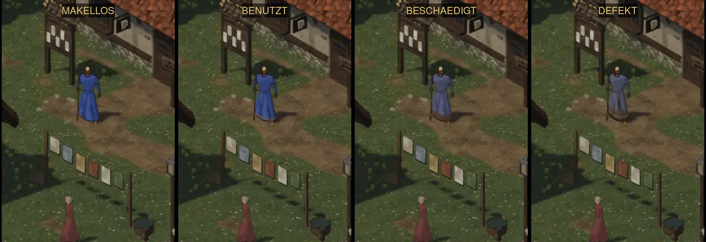
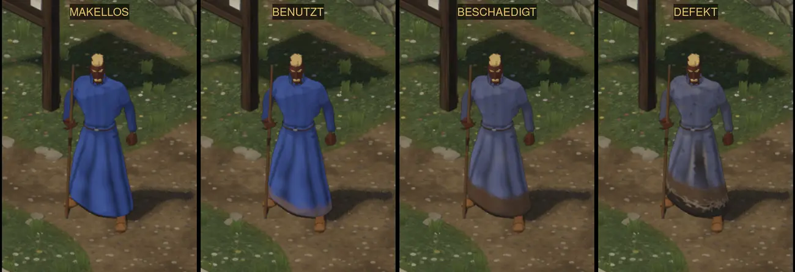
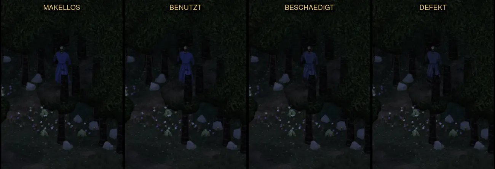

# 558 · Robe des Magiers, Probe 4: tiefe Falten, Zustände klar getrennt · Team Tom · 04.11., 19:36

[Bild von 04.11., 19:37](https://github.com/tramour-cmyk/androidapp_rpg_bornim/blob/bilder/2026-11/04-1937-558-Tom.png) (eingetragen von meldung.sh, Tom)

[Bild von 04.11., 19:36](https://github.com/tramour-cmyk/androidapp_rpg_bornim/blob/bilder/2026-11/04-1936-558-Tom.png) (eingetragen von meldung.sh, Tom)

Kurz: Umgesetzt ist dein Wort von 17:40 (Prüferbefund 17:26 gilt ganz). Je Bild die vier Zustände nebeneinander: Makellos, Benutzt, Beschädigt, Defekt. Maß (dein Wort): bei Dorf und Wald am Tag erkennt ein Prüfer jeden Zustand ohne Vergleich; sein Befund folgt. Sag „passt“ oder was anders sein soll. Danach wird „Benutzt“ fest eingestellt, bis die Abnutzung gebaut ist (478), dann folgen Wache und Kauftrachten.

In Spielgröße (ganzes Bild, Held etwa 120 Bildpunkte) kamen Wald und Dorf bei Tag per Telegram.

Neu gegenüber Probe 3:
- Neun tiefe Falten, vom Gürtel nach unten breiter, statt des Holzmusters (Ursache: Wellentextur mit Verzerrung).
- Benutzt nur Staub am Saum und einzelne Flecken; ab Beschädigt ausgeblichen (jede Farbe zu ihrem Grau); Schmutz erdbraun mit Spritzern.
- Defekt dazu Fransen bis 20 cm und ein Riss von 7 cm.

Geprüft an: https://github.com/tramour-cmyk/androidapp_rpg_bornim/commit/1a3ca6fdf (Zweig `claude/tom-558-robe`, Lauf [41878015595](https://github.com/tramour-cmyk/androidapp_rpg_bornim/actions/runs/41878015595)).
