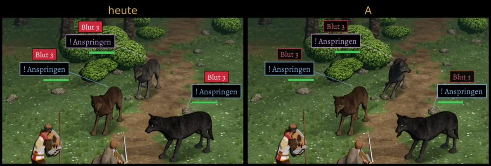

# 563 · Zustandsschilder über Gegnern im Stil der Ansage · Jerry · 08.11., 06:52

E Kampf · Bilder vom Bauserver (Lauf 273, Renderer wie am Handy), derselbe Augenblick: zwei Ansagen, die Gruppe am Zug, alle Wölfe „Blut 3“; noch nichts eingeschaltet (Schalter `ZUSTAND563`).

Geprüft an: https://github.com/tramour-cmyk/androidapp_rpg_bornim/actions/runs/42415644510

- **A:** Zustände wie die Ansage: schwarzer Grund, Rand und Schrift in der Farbe des Zustands (Blut rot, Gift grün); Leisten und Ansagen weichen einander, Ansagen liegen über den Leisten. Test `zustaende_563`: in Ruhe 0 Überlappungen, in Bewegung 11 Bilder (heute ebenso viele).
- Alt zeigte keine Zustände über den Figuren, nur im Kasten (`StatusChips`).

Votum: **A, mit hellerem Rot.** Gegenargumente (fremder Prüfer, 06:50): dunkelrote Schrift auf Schwarz ist kontrastarm, „Blut 3“ liest sich am Handy schlechter als heute (Grün geht); ein Blut-Schild gehört nur über die Stapelung zu seinem Wolf und steht 150–250 px von ihm weg; in diesem Augenblick überlappt auch heute nichts, das Bild zeigt also nur die neue Gestaltung, nicht das Ausweichen.

Bitte sagen: „A“, „A, Rot heller“ oder was anders sein soll.
