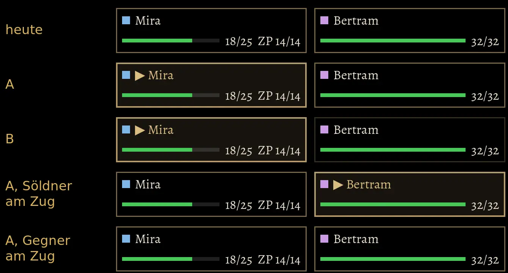
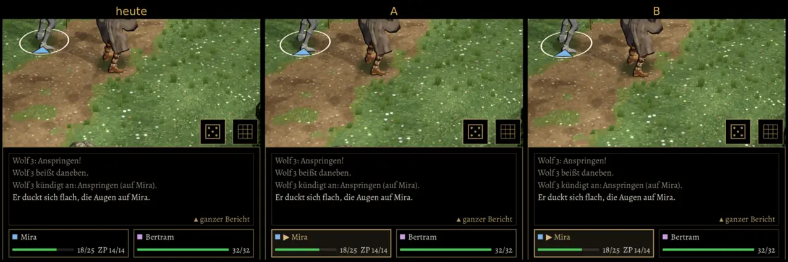

# 565 · Wer am Zug ist, im Gruppenkasten · Jerry · 08.11., 06:52

E Kampf · Bilder vom Bauserver (Lauf 270, Renderer wie am Handy), Probekampf Wölfe, zwei Helden; noch nichts eingeschaltet (Schalter `AMZUG565`).

Geprüft an: https://github.com/tramour-cmyk/androidapp_rpg_bornim/actions/runs/42411525868

- **A:** der Kasten dessen, der am Zug ist, sieht aus wie sein Feld in der Zugleiste oben: „▶“ vor dem Namen, Name in Gold, hellerer Goldrahmen. Ring an der Figur, Zugleiste und Kasten zeigen auf denselben Helden (auch wenn der Söldner dran ist).
- **B:** wie A, dazu die übrigen Kästen gedämpft.
- **Gegner am Zug:** kein Kasten hervorgehoben (wie alt; alt zeigte im Gruppenkasten nie, wer am Zug ist).

Votum: **A**. Gegenargumente (fremder Prüfer, 06:50): die Hervorhebung ist schwach, am deutlichsten wirken „▶“ und der goldene Name, Rahmen und Grund nur wenig heller; B unterscheidet sich kaum von A (nur der Rahmen der anderen dunkler, Name und Leiste voll hell). Wer B will, bekommt eine echte Dämpfung (Name und Leiste matt). Verwechslungsgefahr: das Dreieck in Heldenfarbe unter einer Figur heißt „wird angezielt“, nicht „am Zug“, es bleibt, wenn der andere Held dran ist.

Bitte sagen: „A“, „B“, „A, kräftiger“ oder was anders sein soll.
