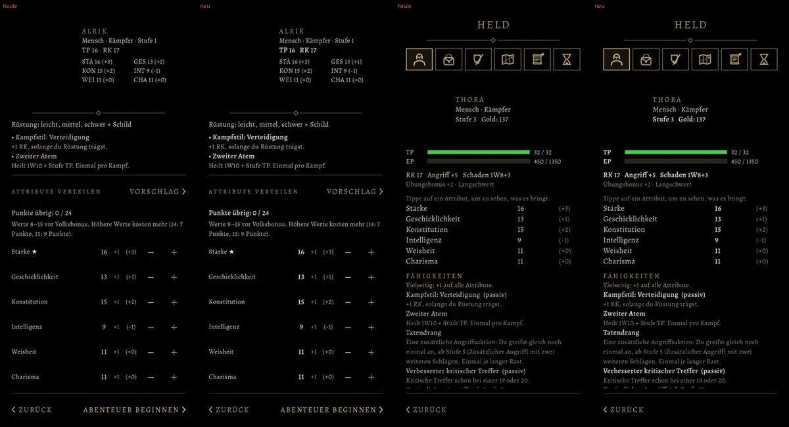

# 584 · Halbfetter Schnitt wie in der alten Fassung · Tom · 09.11., 20:36

[Bild von 09.11., 20:37](https://github.com/tramour-cmyk/androidapp_rpg_bornim/blob/bilder/2026-11/09-2037-584-Tom.png) (eingetragen von meldung.sh, Tom)

Von links: Erschaffung heute, Erschaffung neu, Heldenreiter heute, Heldenreiter neu. Neu ist der halbfette Schnitt der Alegreya, wie in der Kotlin-Fassung: für Werte, Namen der Fähigkeiten, TP und RK, Stufe und Gold, „Punkte übrig“. Versalien in Gold bleiben nur für Köpfe. Die Schrift kommt aus der alten Fassung (OFL wie der gerade Schnitt). Genauso gesetzt sind Chronik, Karte, System, Brett und Testmenü. Die sind hier nicht abgebildet, weil die Probe dort an den falschen Schirmen knipste.

Geprüft an: [e1fef8d61](https://github.com/tramour-cmyk/androidapp_rpg_bornim/commit/e1fef8d61) (Zweig `claude/tom-584-halbfett` mit `main` gemischt; menue_test 0, menue_breite_581 0), fährt im nächsten Build mit.

Sag „passt“ oder was anders sein soll.
