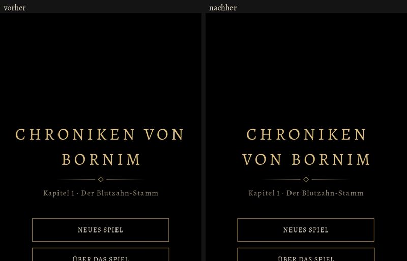

# 585 · Titel im Hauptmenü bricht wie alt um · Tom · 08.11., 20:18

[Bild von 08.11., 20:18](https://github.com/tramour-cmyk/androidapp_rpg_bornim/blob/bilder/2026-11/08-2018-585-Tom.png) (eingetragen von meldung.sh, Tom)

Der Titel bricht wie in der alten Kotlin-Fassung um: „CHRONIKEN / VON BORNIM“ statt „CHRONIKEN VON / BORNIM“. Links vorher, rechts nachher (am Rechner, 20:16).

Dazu gebaut, im Bild nicht zu sehen: Bei „Lizenzen der Engine“ zeigt der Pfeil aufgeklappt nach unten, und am Ende der Texte steht dieselbe Zeile noch einmal und klappt wieder zu (das Werkzeug für die Bilder hat den Knopf nicht getroffen; das Werkzeug ist in Vorgang 584 behoben).

Nicht gebaut: ein Bild in der Rückfrage „Wegwerfen“ (die abgenommene Vorlage hat kein Bild) und „Variante“ im Testmenü (im Kampf fehlen noch die Varianten „Elite“ und „Schimmernd“).

Geprüft an: https://github.com/tramour-cmyk/androidapp_rpg_bornim/commit/c304c5842 (Zweig `claude/tom-585-kleinigkeiten`)

Was du sagen sollst: „585 passt“ oder was nicht passt.
