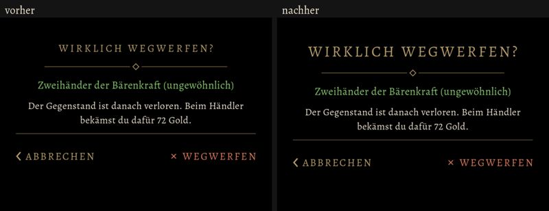

# 586 · Titel der Rückfragen und Fenster so groß wie die der Schirme · Tom · 08.11., 20:25

Die Titel aller Rückfragen und Fenster sind jetzt so groß wie die Titel der Schirme (dein Wort 586a vom 05.11., 09:39: „7-12“, also so groß wie die Titel auf den Bildern 7 bis 12 von 557). Links vorher, rechts nachher (am Rechner, 20:22).

Das Zeichen links neben dem Titel bei Rast und Schänke steht schon seit 557b; 586 ändert daran nichts.

Lange Titel brechen jetzt in zwei Zeilen um („ALLE GEWÖHNLICHEN / VERKAUFEN?“, „ALLE SPIELSTAND-PLÄTZE / SIND BELEGT“).

Nebenbei gesehen, nicht von 586: „1 GEGENSTÄNDE:“ statt „1 GEGENSTAND:“ in der Rückfrage des Ladens; die Platzwahl der Erschaffung hat noch einen Rahmen um jeden Spielstand-Platz.

Geprüft an: https://github.com/tramour-cmyk/androidapp_rpg_bornim/commit/3d56c4077 (Zweig `claude/tom-586-rast`)

Was du sagen sollst: „586 passt“ oder was nicht passt.
