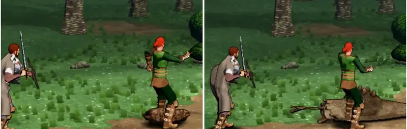

# 595 · Kampfbewegungen der Kaufgegner: Riesenspinne, Riesenegel, Säureschnecke (Vorgang 595) · Jerry · 11.11., 19:56

Dein Auftrag vom 05.11. (t266.1): Spinne mehr Angriffe, Egel und Schnecke schneller, Treffhöhe, Ruckeln, Ruhe. Film per Telegram (74 s) aus Lauf 356, Zweig `claude/jerry-595-kaufgegner-b1`: Riesenspinne, Riesenegel, Säureschnecke, je 18 Sekunden auf der Lichtung; vorn der Held mit Schwert und Schild und ein Söldner mit Kurzschwert ohne Schild, damit der Hieb ohne Schild gegen die niedrigen Gegner im Bild ist. Kein Build.

**Was du sagen sollst:** was an den Bewegungen der drei passt und was anders sein soll.

Selbst gesehen, nicht gelöst:
- Treffhöhe: Der Söldner schlägt in Brusthöhe über den Riesenegel hinweg und steht dabei auf ihm (links, 0:30).
- An der Säureschnecke steht er mitten in ihrem Körper (rechts, 0:55).
- Das rasche Ausweichen der Säureschnecke nach ihrem Angriff ist im Film nicht deutlich zu sehen.

Geprüft an: https://github.com/tramour-cmyk/androidapp_rpg_bornim/actions/runs/43068150091 (Lauf 356, Commit 15c41ce5b; rot an krogg_494 und skelett_506, prüfe ich vor dem nächsten Build).
