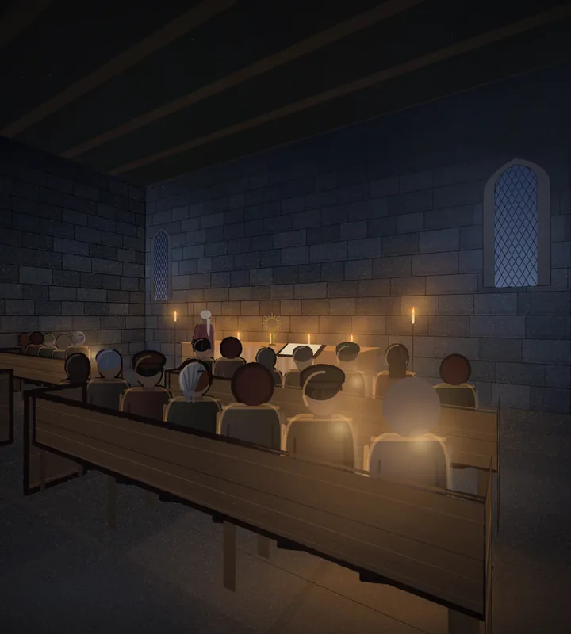
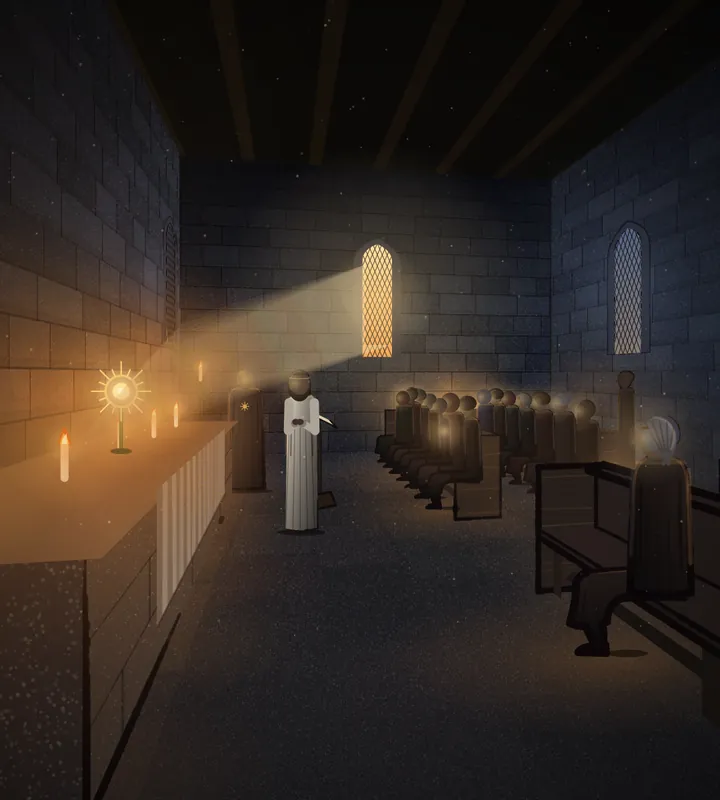

# 613 · Figur im Tempel neu: Tempel 1 und Tempel 4 · Tom (Spike) · 08.11., 19:31

Zu deinem Wort von 19:18 („weißer Knubbel … weißer Kegel als Kopf und sehr rechtwinklige, stilisierte Beine“). Beide weißen Köpfe waren Frauen mit Leinenhaube. Die Haube war ein helles Ei über dem ganzen Kopf, im Profil auch über dem Gesicht. Die Beine einer Sitzenden im Profil waren zwei Rechtecke.

Jetzt:
- **Haube:** ein Kopftuch. Es liegt über Scheitel und Hinterkopf, hat Falten zum Knoten im Nacken und zwei kurze Enden. Die Seite, die von den Kerzen abgewandt ist, und der untere Rand liegen im Schatten. Das Tuch ist gedämpfter als vorher, im Profil bleibt das Gesicht frei.
- **Beine (Tempel 4, die Frau vorn rechts):** Der Rock liegt über dem Schoß, rundet sich über dem Knie und fällt bis zur Mitte des Schienbeins. Darunter sieht man das Schienbein, etwas zurückgezogen, und den Schuh auf dem Boden.

Die übrigen acht Bilder sind unverändert, ebenso die Tusche.

## Tempel 1

## Tempel 4

Geprüft an: https://github.com/tramour-cmyk/androidapp_rpg_bornim/commit/5736caab0 (Vorschau am Rechner, `ZWISCHEN613=app`, Zweig `claude/tom-613-zwischensequenzen`; ein Lauf)

Die Bewegung (Kerzen, Licht, Staub, Fackelzug) folgt als kurzer Film.

Sag bitte: „613 Figur passt“ oder was anders sein soll.
