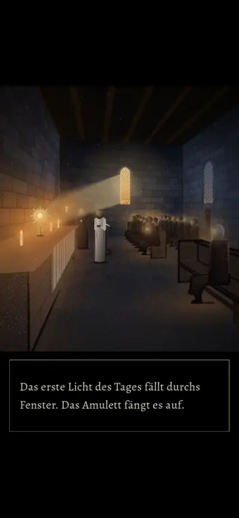

# 613 · Film der Zwischensequenzen im Spiel (Godot) · Tom (Spike) · 08.11., 21:10

Der Film ist 47 Sekunden lang, mit Ton, aufgenommen im Spiel (Godot, Lauf 309). Zuerst kommt Bild 3 des Intros (der Platz), danach die ganze Tempelszene mit der neuen Figur.

Was sich bewegt:
- **Tempel:** Die Kerzen flackern leicht, das Licht um sie atmet, in Tempel 4 treibt Staub im Sonnenstrahl. Dazwischen liegen die weichen Überblendungen.
- **Offen: der Fackelzug fehlt.** Über Bild 3 des Intros sollte rechts neben dem Tempel der Fackelzug gehen. Im Godot-Spiel wird er nicht gezeichnet, keine Träger und keine Flammen. Die Daten sind da: der Zug läuft in den ersten vier Sekunden des Bilds rechts neben dem Tempel. Die Ursache suche ich jetzt, ohne neuen Lauf. Das ist ein Fehler im Spiel, nicht nur im Film.

Geprüft an: https://github.com/tramour-cmyk/androidapp_rpg_bornim/commit/6822ec36f (Lauf 309, Zweig `claude/tom-613-zwischensequenzen`)

Sag bitte, ob die Bewegung im Tempel so passt („613 Bewegung passt“) oder was anders sein soll.
