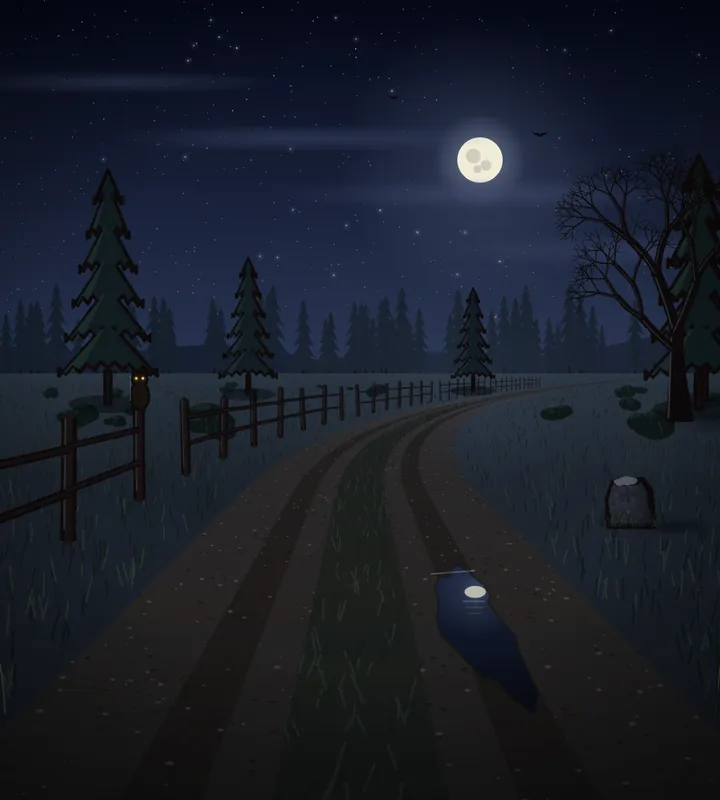
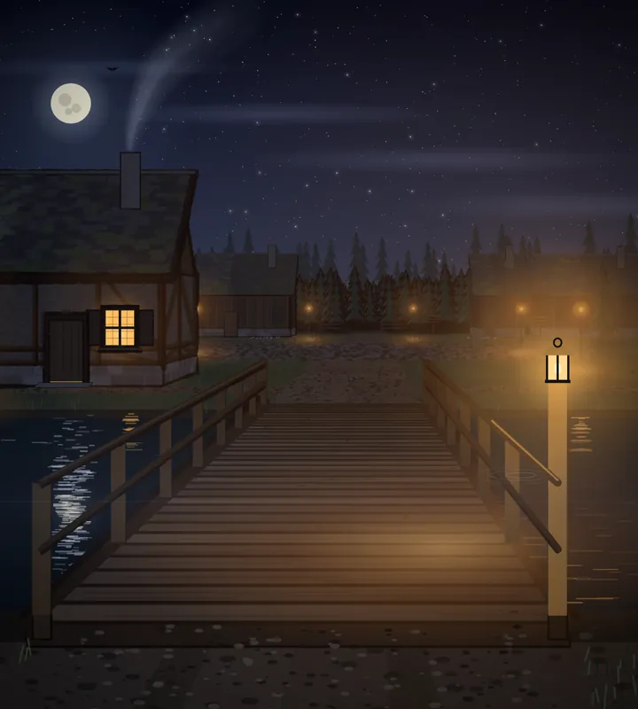
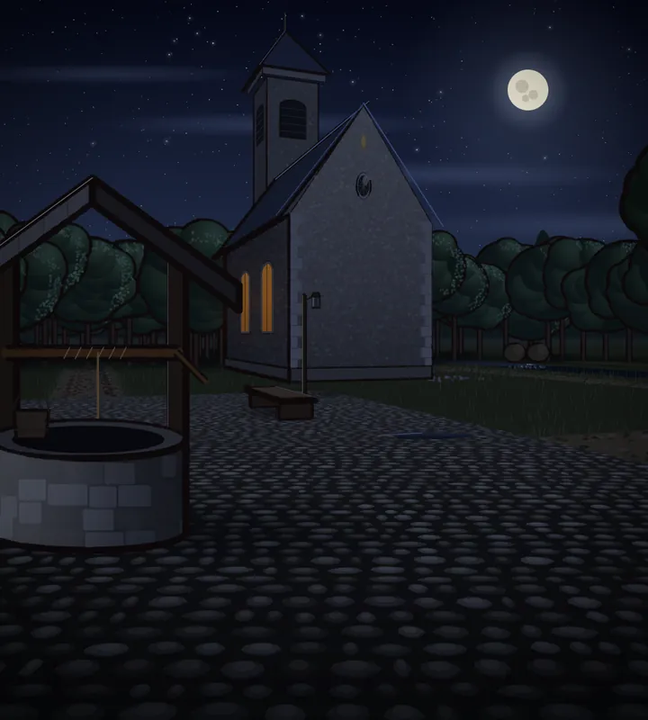
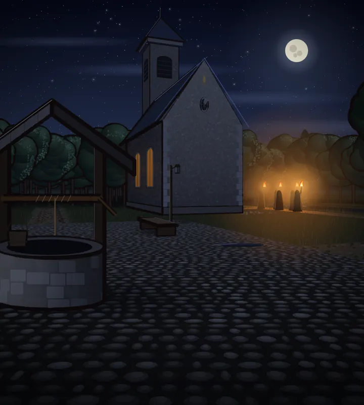
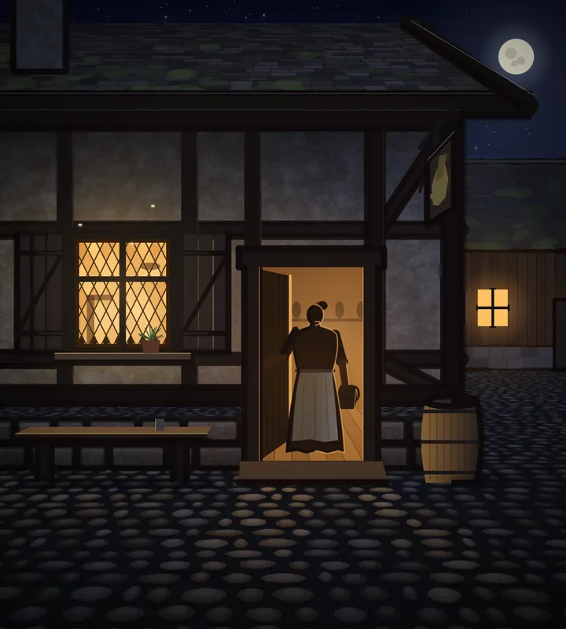
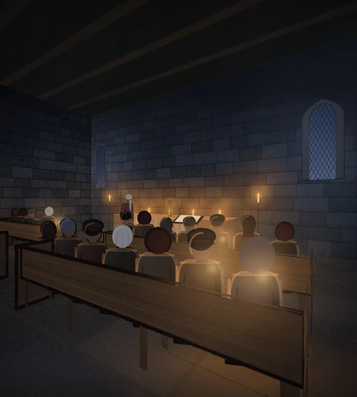
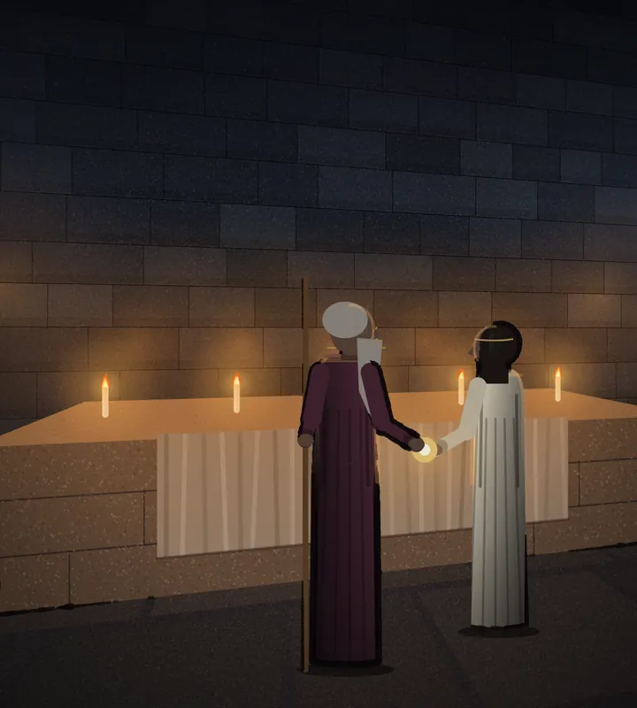
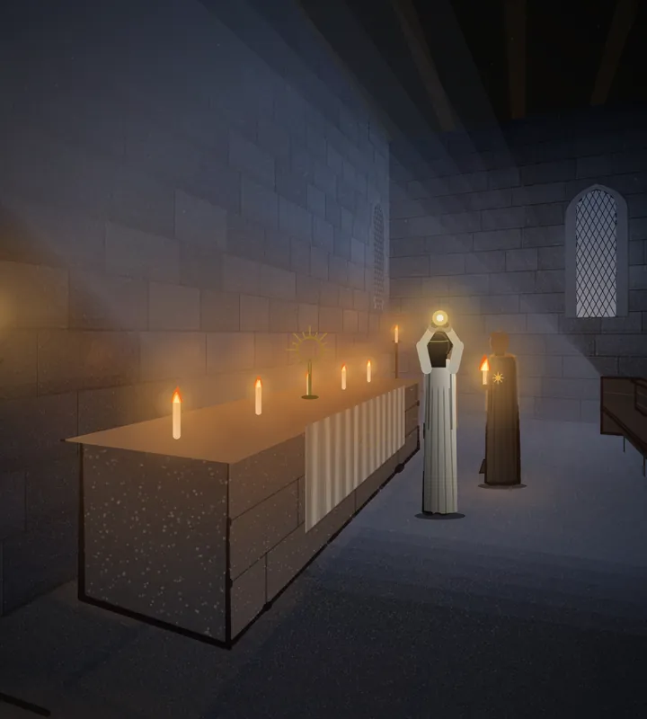
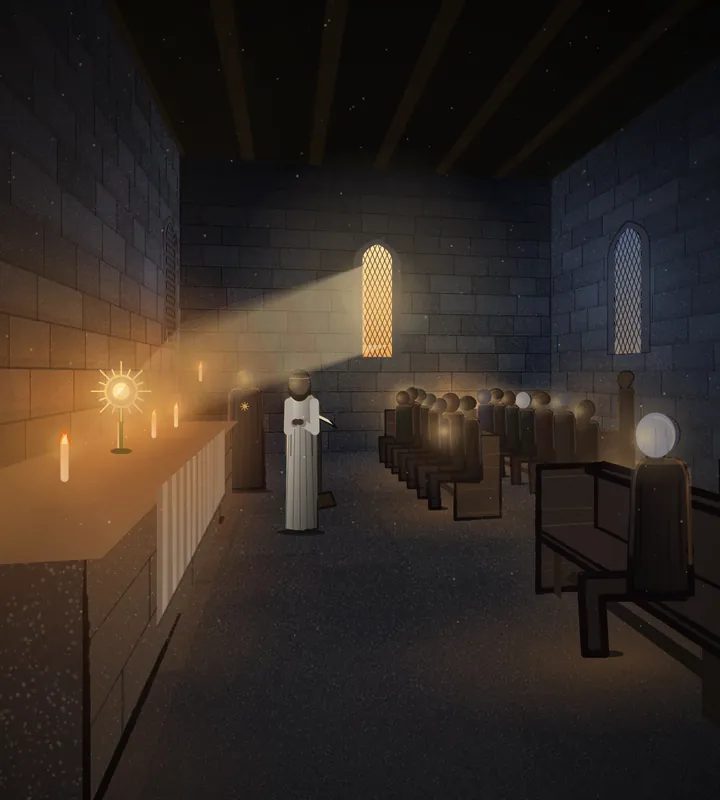
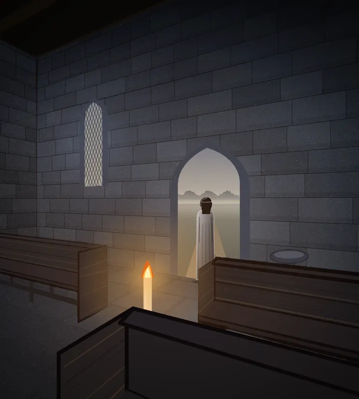

# 613 · Zwischensequenzen mit Tusche: Intro und Tempelszene · Tom (Spike) · 08.11., 19:10

Die zehn Bilder einzeln, in voller Größe auf Telegram (je eine Meldung mit Bildname). Inhalt wie um 17:14, nur nicht mehr in einer Tafel.

Alle Bilder des Intros und der Tempelszene haben jetzt die Tuschelinie der Signatur (302.3), etwas kräftiger als bei Intro 4, das du am 23.10. abgenommen hast (Strich 8,5 statt 6,5, auch an Intro 4 selbst). Sonst ist nichts verändert. Der Prüferbefund vom Lauf um 15:43 ist behoben: die Tannen werden von der Linie nicht mehr zugedeckt, die Bankenden sind dünner, und beleuchtete Seiten bekommen keine Linie.

## Intro 1 · Weg

Mir fällt auf: Die drei Tannen vorn heben sich mit ihrem Umriss deutlich vom Wald dahinter ab, denn der hat keine Linie. Sie wirken dadurch etwas ausgeschnitten.

## Intro 2 · Brücke

## Intro 3 · Platz

## Intro 3 · Platz mit Fackelzug

## Intro 4 · Rowena in der Tür

## Tempel 1

Mir fällt auf: Vorn rechts sieht ein Kopf wie ein heller, unscharfer Fleck aus, ohne Haar; das war schon vor der Tusche so (Vorgang 68, Tempelszene). Am linken Ende der vordersten Bank bleibt eine kräftige dunkle Kante.

## Tempel 2

## Tempel 3

## Tempel 4

## Tempel 5

## Bewegung

Bewegung ist auf Standbildern nicht zu sehen. Im Spiel flackern im Tempel die Kerzen, das Licht um sie atmet, in Tempel 4 treibt Staub im Sonnenstrahl. Im Intro zieht weiter der Fackelzug. Einen Film davon gibt es erst nach einem Probebild (511).

Geprüft an: https://github.com/tramour-cmyk/androidapp_rpg_bornim/commit/0a0bef05b (Vorschau am Rechner, `ZWISCHEN613=app`, Zweig `claude/tom-613-zwischensequenzen`; die Einzelbilder entsprechen den Bildern im Zweig)

Sag bitte: „613 passt“ oder was anders sein soll. Danach fährt es im nächsten Build mit.
