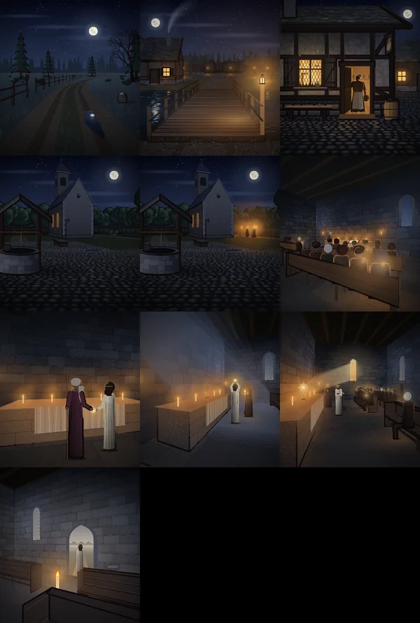

# 613 · Zwischensequenzen mit Tusche: Intro und Tempelszene · Tom (Spike) · 08.11., 17:14

[Bild von 08.11., 17:15](https://github.com/tramour-cmyk/androidapp_rpg_bornim/blob/bilder/2026-11/08-1715-613-Spike.png) (eingetragen von meldung.sh, Spike)

Oben Intro 1 (Weg), 2 (Brücke), 4 (Rowena in der Tür); zweite Reihe Intro 3 (Platz) ohne und mit Fackelzug, Tempel 1; dritte Reihe Tempel 2 bis 4; unten Tempel 5.

Alle Bilder des Intros und der Tempelszene haben jetzt die Tuschelinie der Signatur (302.3), etwas kräftiger als bei Intro 4, das du am 23.10. abgenommen hast (Strich 8,5 statt 6,5, auch an Intro 4 selbst). Sonst ist nichts verändert. Der Prüferbefund vom Lauf um 15:43 ist behoben: die Tannen werden von der Linie nicht mehr zugedeckt, die Bankenden sind dünner, und beleuchtete Seiten bekommen keine Linie.

Was mir selbst auffällt:
- **Intro 1:** Die drei Tannen vorn heben sich mit ihrem Umriss deutlich vom Wald dahinter ab, denn der hat keine Linie. Sie wirken dadurch etwas ausgeschnitten.
- **Tempel 1:** Vorn rechts sieht ein Kopf wie ein heller, unscharfer Fleck aus, ohne Haar. Das war schon vor der Tusche so (Vorgang 68, Tempelszene).
- **Tempel 1:** Am linken Ende der vordersten Bank bleibt eine kräftige dunkle Kante.

Bewegung ist auf Standbildern nicht zu sehen. Im Spiel flackern im Tempel die Kerzen, das Licht um sie atmet, in Tempel 4 treibt Staub im Sonnenstrahl. Im Intro zieht weiter der Fackelzug. Einen Film davon gibt es erst nach einem Probebild (511).

Geprüft an: https://github.com/tramour-cmyk/androidapp_rpg_bornim/commit/0a0bef05b (Vorschau am Rechner, `ZWISCHEN613=app`, Zweig `claude/tom-613-zwischensequenzen`)

Sag bitte: „613 passt“ oder was anders sein soll. Danach fährt es im nächsten Build mit.
