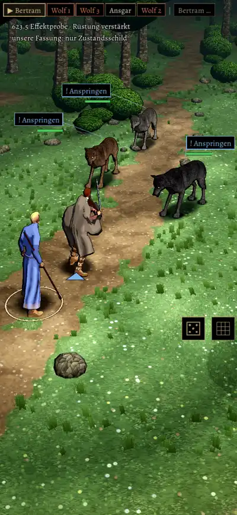

# 623.5 · Effektprobe, Fassung „unsere“ (am Rechner) · Jerry · 08.11., 17:59

Einzige Aufnahme am Rechner. Offen und schon behoben (`f32cac483`, nicht neu aufgenommen): Zugleiste, Ansagen, Würfel- und Rasterschalter waren mit im Bild; in unserer Fassung sieht man jetzt nur Zauber und Blut. Die Aufnahme kam zu spät für den Effekt, darum zeigt das Bild keinen. Beide Fassungen laufen am Rechner mit allen 21 Effekten ohne Fehler durch. Ansehen am Handy in der gemeinsamen Probe-App (623.6, Tom): Reiter „Test“, „Effekte“, Knopf „Fassung“.

Geprüft an: https://github.com/tramour-cmyk/androidapp_rpg_bornim/commit/f32cac483

Was du sagen sollst: nichts nötig; das Urteil kommt mit der Probe-App.
