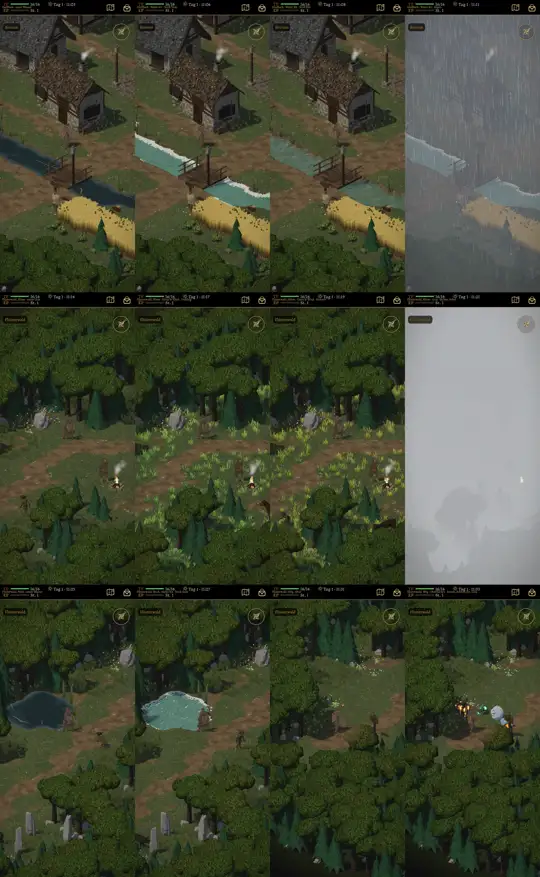

# 623.6 · Probe Welt: Gratisproben Gras, Wasser, Wetter, Oberflächen gegen unsere Fassung · Team Tom · 08.11., 16:20

[Bild von 08.11., 16:19](https://github.com/tramour-cmyk/androidapp_rpg_bornim/blob/bilder/2026-11/08-1619-623.6-Tom.png) (eingetragen von meldung.sh, Tom)

Neuer Lauf 301, diesmal im Zeichner des Handys (Mobil), Tag 11 Uhr, Spielkamera; die weißen Felder aus Lauf 298 sind behoben (das Wetterpaket wird nach seinem Feld zurückgesetzt). Die Bilder einzeln im Telegram.

1. **Dorfbach:** unser Wasser · Wasserpaket Teich Toon · Teich klar · Teich Toon mit Regen aus dem Wetterpaket.
2. **Flüsterwald, Wiese:** unser Gras · Graspaket Frühling · Sommer · Frühling mit dichtem Nebel (der Nebel des Pakets ist so dicht, dass fast nichts bleibt).
3. **Flüsterwald, Teich und Weg:** unser Wasser · Teich Toon; Weg ohne Zusatz · Oberflächenpaket (Runen, Schnee, Eis, Lava).

Zeichenzeit am Bauserver (ohne Grafikkarte, nur Vergleich untereinander): Wasserpaket am Dorfbach +1 %, am Teich +8 %, Regen +27 %, Graspaket +9 % bis +10 % (ein Viertel mehr Dreiecke), dichter Nebel +58 %, Oberflächen kein Unterschied.

Bekannt: Der Schaum des Teichs Toon reicht über die Uferkante; die Oberflächen sitzen noch auf eigenen kleinen Probekörpern neben dem Helden, nicht auf den Felsen am Weg. Wind im Gras, Wellen, Regen zeigt erst der Film.

Zu prüfen: Welche Fassung passt je Ort zu unserem Bild (Tuschelinie, Licht aus der Quelle, nicht quietschbunt)?

Antwort: „623.6 Bild passt, Film“ oder, welche Fassungen weg oder anders sollen.

Geprüft an: https://github.com/tramour-cmyk/androidapp_rpg_bornim/actions/runs/42488906335
