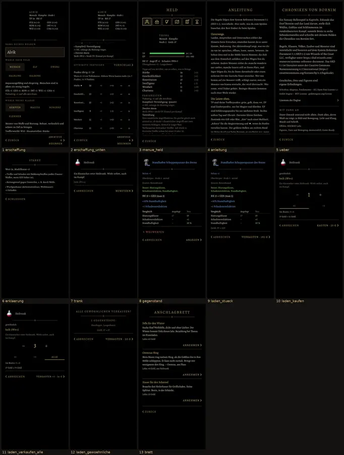

# 630 · Restliche Schirme ohne Kasten · Team Tom · 08.11., 10:1x

Kurz: Alle übrigen Schirme und Fenster sind nach der Regel „ohne Kasten“ (549a) umgebaut, so wie Spielstände, Laden und Rast schon aussehen: schwarzer Grund, Titel oben mit der Goldlinie und Raute, keine Rahmen, Knöpfe je halbe Breite, „‹ Zurück/Abbrechen“ links, was ausführt rechts mit „›“, Wegwerfen rötlich mit „ד. Kein Build, nur Bilder vom Rechner.

1–2 Neues Spiel (Erschaffung): ohne Kästen, Abschnitte durch Linien getrennt; Volk und Klasse als Felder ohne Rahmen, gewählt hell auf dunklem Grund; − und + ohne Rahmen. Der Held fehlt am Rechner (keine Kaufmodelle), im Spiel dreht er sich oben links.
3 Menü (Held) · 4 Anleitung · 5 Über das Spiel (Lizenzen als Zeile mit „›“) · 6 Erklärung eines Werts („‹ Schließen“) · 7 Trank · 8 Gegenstandsfenster über die Wechselliste · 9 Laden: Stück verkaufen · 10–11 Laden: Menge kaufen und verkaufen wie beim Brauen („− 2 +“, ×1 · ×5 · Alle) · 12 Laden: alle gewöhnlichen verkaufen · 13 Anschlagbrett.

Bekannt, nicht in diesem Vorgang: Neues Spiel hat keinen Titel (es gibt dafür noch keinen Text; geht als Frage an Homer, wenn du einen willst). Die Reiterzeichen oben im Menü bleiben, wie sie sind (eigene Regel 326). Das Hauptmenü selbst ist unverändert.

Antwort: „630 passt“, dann kommt es in den nächsten Build; oder was nicht passt, mit Bildnummer.

Geprüft an: https://github.com/tramour-cmyk/androidapp_rpg_bornim/commit/5d8f66470 (Bildlauf am Rechner 08.11., 10:11, `tests/schirme_630_bild.gd`; Fenster-Tests 0 Fehler)
