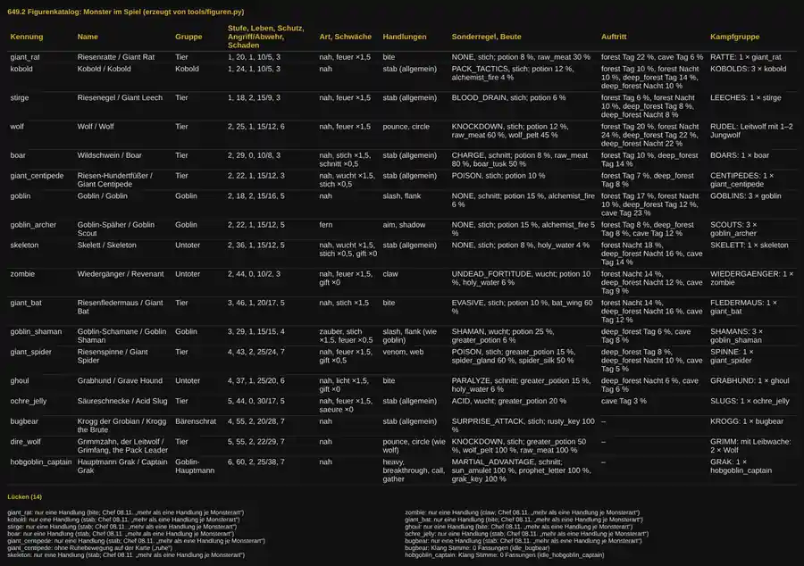

# 649.2 · Figurenkatalog Monster: Seite aus den Spielquellen erzeugt (Teil A)

Tuffy · 17.11., 23:42 · aus 649 (Figurenkatalog) und 649b A (alles an einer Stelle)
Kurz: `tools/figuren.py` schreibt den Abschnitt „Monster im Spiel“ in `LISTE-FIGUREN.md`: 18 Arten mit Werten, Handlungen, Beute, Auftritt, Kampfgruppe, Klängen, Aussehen und Kartenbewegungen, dazu 14 Lücken. Das Spiel ist unverändert.

Geprüft an: https://github.com/tramour-cmyk/androidapp_rpg_bornim/commit/e21717b1a (Logiktests 192 gut, 0 rot; Figurenprüfung 0 neu)

**Bild:** die erzeugte Tabelle und die Lücken. Keine neue Datei `figuren.json`, wie der Vorgangstitel sagt: 649b A schreibt „keine neue Datei“ vor, das Werkzeug liest nur, was das Spiel schon liest.

**Lücken:** 11 Arten haben nur eine Handlung (dein Wort 08.11.: „mehr als eine Handlung je Monsterart“). Das gehört zum neuen Gegnerverhalten (1589). Krogg und Grak haben keine Ruhestimme. Der Hundertfüßer hat keine Ruhebewegung auf der Karte.

**Offen:** Teil B (der Code liest aus der Tabelle; Bewegungen im Kampf und Kaufhäute kommen aus dem Kampfbau) ruht bis nach 1605 (Sa 21.11., 20:00), weil er den Kampfcode umbaut.

👍 so weiter · 👎 falsch
