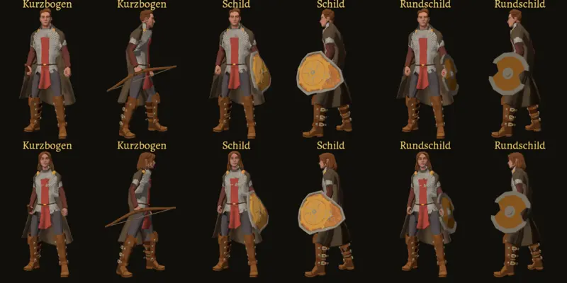

# 653 · Halt je Modell: Kurzbogen, Schild, Rundschild nachgebessert · Tom · 10.11., 13:48

[Bild von 10.11., 13:48](https://github.com/tramour-cmyk/androidapp_rpg_bornim/blob/bilder/2026-11/10-1348-653-Tom.png) (eingetragen von meldung.sh, Tom)

Volle Größe per Telegram. Nach deinem Befund 13:39: der Schild steht jetzt 5,5 cm außen vor der Faust (vorher steckte der Unterarm bis 4,2 cm im Brett; das Werkzeug misst jetzt mit Arm und Hand: 0 Ecken im Brett, an allen 10 Körpern), der Bogen steht mit seiner Fläche senkrecht, von der Seite mit Wurfarmen und Sehne. Die übrigen sechs Gegenstände sind unverändert (passt, 13:40).

Geprüft an: https://github.com/tramour-cmyk/androidapp_rpg_bornim/tree/c6d119d07

Offen wie vorher: 15 Gegenstände ohne Modell (458.3); Zwerg und Halbling noch nicht im Blatt; Held, Leute und Kampf noch nicht umgestellt, das folgt nach deinem Ja.

Sag „653 passt“ oder was nicht passt.
