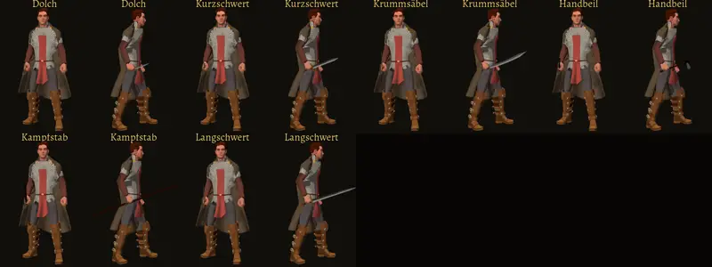

# 653 · Halt umgestellt: Klingen mit der Schneide nach vorn · Tom · 10.11., 14:52

Volle Größe per Telegram. Nach deinem „653 passt“ (14:22) laufen Held und Leute über den Halt (Waffe und Schild in der Hand je Modell). Dabei fiel auf: im abgenommenen Bild lag bei den Klingen die Fläche vorn, laut Modell (gemessen: Langschwert in der Schneide 20 cm breit, in der Fläche 3,7 cm) gehört die Schneide nach vorn, wie im Spiel seit 417. Jetzt von vorn die Schneide, von der Seite das Blatt (Krummsäbel gebogen, Beil mit Kopf). Frau gleich; Schilde und Bogen unverändert.

Geprüft an: https://github.com/tramour-cmyk/androidapp_rpg_bornim/tree/f8773b20c

Sag „653 passt“ oder was nicht passt.
