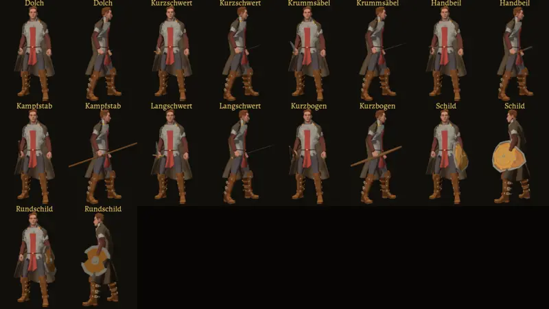

# 653 · Halt je Modell: Prüfbild aller Kombinationen · Tom · 10.11., 13:05

Volle Größe, Mann und Frau, per Telegram. Jeder Gegenstand mit Modell (9 von 24) mit der einen Anlegefunktion `Halt.anlegen` (Griff je Gegenstand aus dem Modell, Halterung je Körper aus dem Skelett, keine Zahlen je Paar), Haltung „Stehen“. Werkzeug `tests/halt_653.gd`: 10 Körper × 9 Gegenstände = 90 Paare, 0 Fehler (Griff in der Faust, Schaft zum Daumen, Schild mit der Vorderseite nach außen, nichts im Rumpf, mindestens 9 cm).

Geprüft an: https://github.com/tramour-cmyk/androidapp_rpg_bornim/tree/9ec27d7db

Offen: 15 Gegenstände haben noch kein Modell (Streitkolben, Speer, Kriegshammer …, 458.3); Kampfstab und Bogen hier nur in der Faust, ihre Tragehaltung bleibt in `tragen.gd`; Zwerg und Halbling noch nicht im Blatt; Held, Leute und Kampf (Jerry) noch nicht umgestellt, das folgt nach deinem Ja zum Sitz.

Sag „653 passt“ oder was am Sitz nicht passt.
