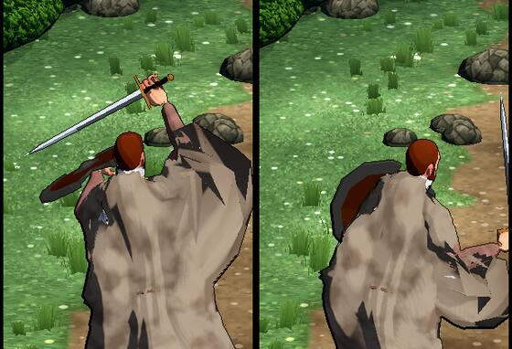

# 656 · Umhang: woher die Beule unter dem Schwertarm kommt · Tom · 08.11., 18:15

Der Umhang hing an Schulter und Seite an Ober- und Unterarm (er hatte dort die Gewichte des Ärmels übernommen). Hebt der Held den Schwertarm, zieht er den Umhang mit hoch wie einen Flügel (Bild aus Lauf 300, Siegerposen von Jerry).

Behoben im Arbeitszweig `claude/tom-656-umhang`, noch nicht auf main: Der Umhang hängt dort jetzt am Schlüsselbein, nur an der Schulter bleibt ein Rest. Die Siegerposen laufen damit noch einmal (die eine Probe); die drei Bilder wie in Lauf 300 kommen hier zum Vergleich dazu.

Geprüft an: https://github.com/tramour-cmyk/androidapp_rpg_bornim/actions/runs/42488035226

Was du sagen sollst: nichts nötig; das Urteil mit dem Vergleichsbild.
