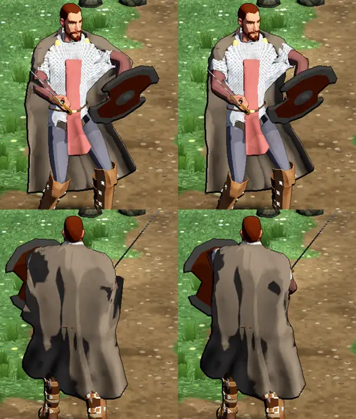

# 656 · Umhang des Kämpfers vorher und nachher · Tom · 08.11., 21:44

[Bild von vorn, 20:57](https://github.com/tramour-cmyk/androidapp_rpg_bornim/blob/bilder/2026-11/08-2057-656-Tom.png) · [Bild von hinten, 20:57](https://github.com/tramour-cmyk/androidapp_rpg_bornim/blob/bilder/2026-11/08-2057-656-Tom-2.png) (Tom)

Ursache der Beule: Der Umhang hing auch an den Knochen des Oberarms. Hob der Kämpfer den Schwertarm, zog er den Umhang mit hoch und beulte ihn aus. Jetzt hängt er am Schlüsselbein statt am Arm. Am Rechner gemessen, mit gehobenen Armen (nicht im Bild): unter der Achsel verschob sich der Umhang vorher bis 42 cm, jetzt 13 cm.

Offen: Das Prüfwerkzeug hat das Bild zu früh genommen, noch in der Grundstellung statt mitten in der Siegerpose. Der Arm hängt, die große Beule unter dem gehobenen Schwertarm ist nicht zu sehen. Von hinten sieht man den Unterschied: vorher steht der Umhang unter dem Schwertarm mit einem Knick ab, nachher fällt er glatt, der Schwertarm schaut seitlich heraus. Das Werkzeug ist behoben; die fünf Siegerposen kommen mit dem nächsten Lauf, sobald Sokrates ihn freigibt.

Gesehen, nicht Teil von 656: rosa Streifen vorn auf dem Kettenhemd, Kettenhemd an den Schultern ausgefranst.

Geprüft an: https://github.com/tramour-cmyk/androidapp_rpg_bornim/commit/b243b8c52 (Zweig `claude/tom-656-umhang`)

Was du sagen sollst: „656 passt“, „656 erst mit den Siegerposen“ oder was nicht passt.
