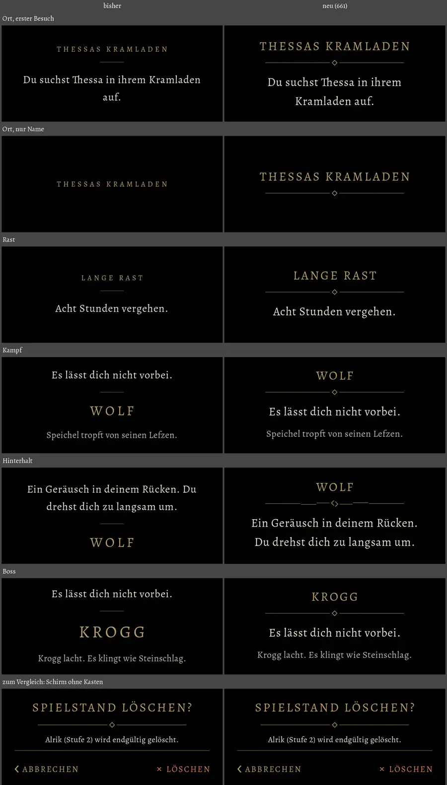

# 661 · Alle Blenden in einem Aufbau · Tom · 10.11., 10:56

[Bild von 10.11., 10:58](https://github.com/tramour-cmyk/androidapp_rpg_bornim/blob/bilder/2026-11/10-1058-661-Tom.png) (eingetragen von meldung.sh, Tom)

Links bisher, rechts neu, untereinander Ort (erster Besuch, nur Name), Rast, Kampf, Hinterhalt, Boss; unten zum Größenvergleich ein Schirm ohne Kasten (Rückfrage „Spielstand löschen?“). Standbild am Rechner, Handybreite 1080 px, Ausschnitt um die Schrift.

Geprüft an: https://github.com/tramour-cmyk/androidapp_rpg_bornim/commit/95140f155 (Zweig `claude/tom-661-blenden`)

- **Neu bei allen gleich:** Name gesperrt so groß wie die Titel der Schirme, darunter deren Zierleiste mit Raute, dann der Satz größer (21 statt 19 sp); im Kampf darunter der Satz des Gegners etwas kleiner (17 sp).
- **Kampf:** Name jetzt oben wie beim Ort (bisher Satz oben, Name darunter). Boss gleich groß wie die anderen Gegner (bisher größer); nur seine Blende steht länger.
- **Hinterhalt:** Zierleiste gebrochen (Linie mehrfach gerissen und versetzt, Raute gespalten).
- Tempo und Klang sonst unverändert (Hinterhalt schlagartig mit Herzschlag, Boss länger).

Bitte: **passt** oder was anders soll. Erst danach kommt es in den nächsten Build.
