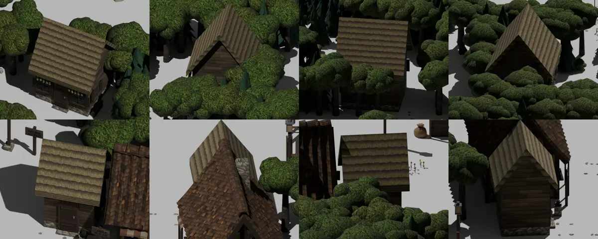

# 664 · Kaels Haus und Morwens Hütte nicht mehr halb · Tom · 08.11., 16:00

Oben Morwens Hütte im Tiefen Flüsterwald, unten Kaels Haus im Dorf; je von vorn schräg, von Osten, von hinten, von Westen. Modell am Rechner, ohne Spielzeichnung (Toon, Tusche) und ohne Licht des Spiels.

- **Kael:** Tür mittig, Wand links und rechts (deine Worte vom 03.11.: „die Tür dann mittig rein“); seine Laterne steht jetzt rechts neben der Tür.
- **Morwen:** Hütte drei mal drei Kacheln statt zwei mal zwei; vorn Fenster, Tür, Fenster; ein Fenster an der Ostseite; unter der Traufe eine Stange mit kopfüber gebundenen Kräuterbündeln (grün, graugrün, lavendel, gelb).
- **Eingangsschild Tiefer Flüsterwald:** um 90° gedreht, das Brett schaut jetzt dem entgegen, der von Westen hereinkommt (im Bild nicht zu sehen).

Geprüft an: https://github.com/tramour-cmyk/androidapp_rpg_bornim/commit/3bc19a09f

Sag bitte: „664 passt“ oder was anders sein soll. Danach fährt es im nächsten Build mit.
