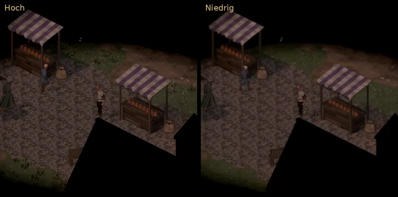
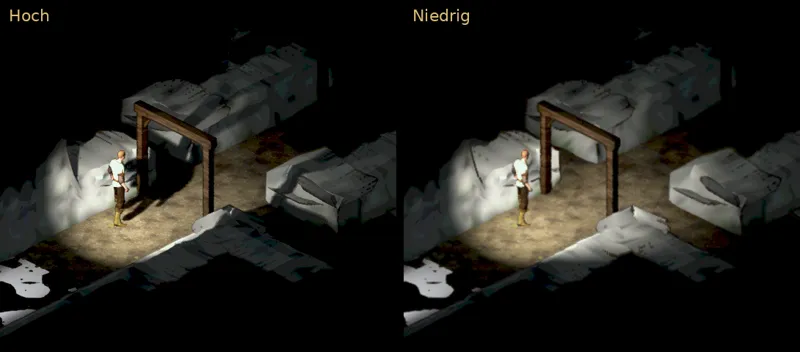
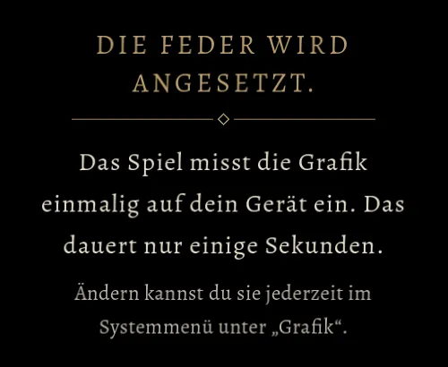
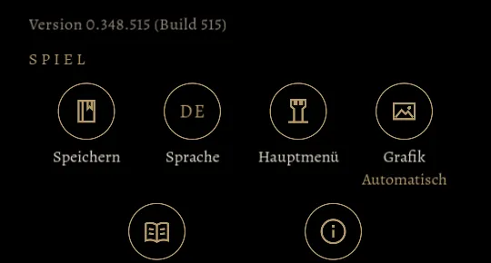

# 698 · Grafikstufen: Hoch gegen Niedrig, Einmess-Blende, Zeichen „Grafik“ · Spike · 16.11., 07:52

[Bild von 16.11., 07:53](https://github.com/tramour-cmyk/androidapp_rpg_bornim/blob/bilder/2026-11/16-0753-698-Spike-2.png) (eingetragen von meldung.sh, Spike)

[Bild von 16.11., 07:53](https://github.com/tramour-cmyk/androidapp_rpg_bornim/blob/bilder/2026-11/16-0753-698-Spike.png) (eingetragen von meldung.sh, Spike)

Bilder auf Telegram (je Bild 👍 oder 👎)

E Technik

Beim Chef, weil: Aussehen (was auf schwachen Handys fehlt; Prüfart Bild nach 1128 A)

Geprüft an: [Lauf 515](https://github.com/tramour-cmyk/androidapp_rpg_bornim/actions/runs/43815710630), Stand `ef8a61e73` (Zweig `claude/spike-698-grafikstufen`), Renderer mobile (Vulkan, Lavapipe); Einmess-Blende am Rechner von `8550b09c7` (nur Schrift, gleich in jedem Renderer)

Gebaut nach 698a A (Tabelle) mit Sokrates' Hinweis und deiner Ergänzung 06:55: Automatisch misst einmal beim ersten Start hinter der Einmess-Blende, danach senkt es nur am Ortswechsel oder Kampfort, herauf nie von selbst.

| Prüfpunkt | passt | falsch |
|---|---|---|
| Dorf | Niedrig sieht noch nach uns aus | Niedrig verliert zu viel |
| Höhle | Niedrig ohne Schatten der Fackel ist in Ordnung | Schatten der Fackel muss bleiben |
| Einmess-Blende | Gestaltung und Dauer (bis zu lesen, höchstens 7 s) passen | Gestaltung oder Dauer stimmt nicht |
| Systemmenü | Zeichen und Platz passen | anderes Zeichen oder anderer Platz |

Grafikzeit am Bauserver (Lavapipe, nur Verhältnis, kein Handywert): Dorf Hoch 404, Mittel 357, Niedrig 245 ms; Höhle 111, 89, 54 ms je Bild.

Offen: Erklärsatz beim Gedrückthalten vorläufig (Homer, 1370). Danach Sammelbuild mit Handyfrage am A56 (Einmess-Blende, Stufe unter „Gerät“, Bildrate je Stufe, zugleich 1145).
