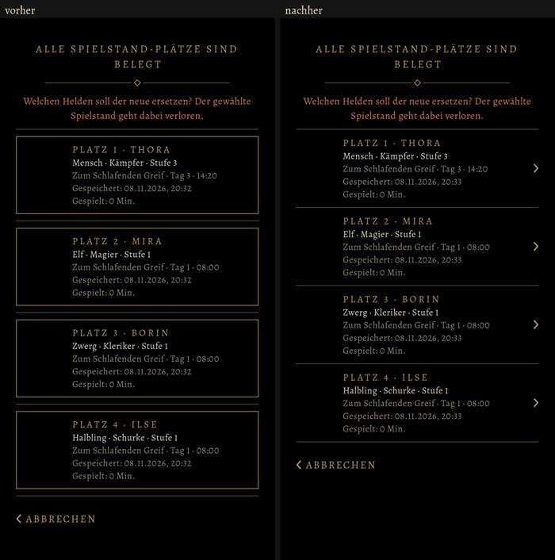

# 700 · Platzwahl der Erschaffung ohne Rahmen · Tom · 08.11., 20:34

Sind alle vier Plätze belegt, fragt die Erschaffung, welchen Helden der neue ersetzt. Die Plätze standen dort noch in Rahmen; jetzt ist jeder Platz eine Zeile ohne Rahmen mit dem Pfeil rechts, wie jede Liste im neuen Stil (549a). Antippen wählt den Platz wie bisher. Links vorher, rechts nachher (am Rechner, 20:33).

Am Rechner fehlt das Bild des Helden links in jeder Zeile (die gekauften Figuren gibt es dort nicht); im Spiel steht es da, vorher wie nachher.

Geprüft an: https://github.com/tramour-cmyk/androidapp_rpg_bornim/commit/506b7f577 (Zweig `claude/tom-700-platzwahl`)

Was du sagen sollst: „700 passt“ oder was nicht passt.
