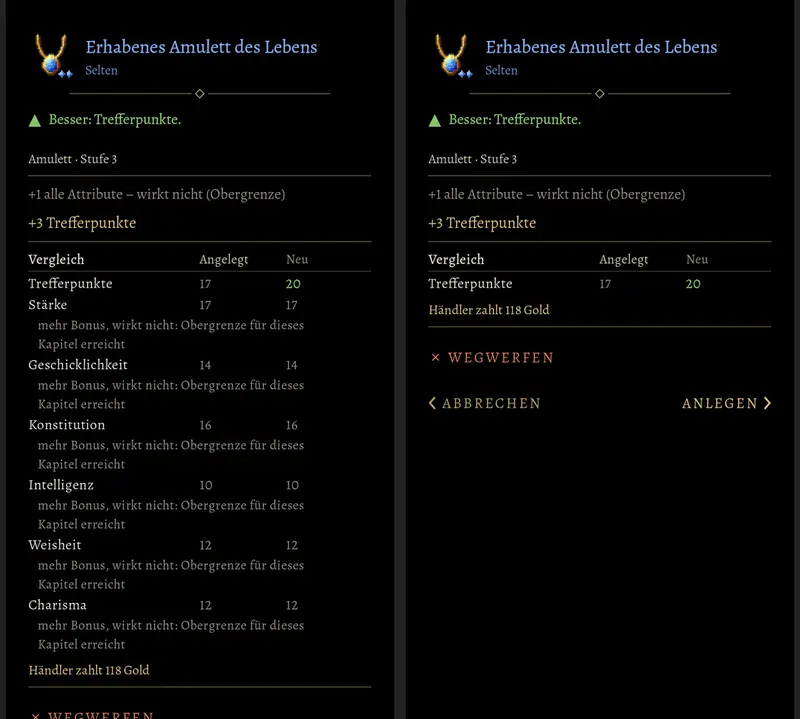

# 701 · Gegenstandsfenster: Hinweis auf die Obergrenze einmal · Tom · 09.11., 18:35

Links heute (wie dein Foto t270.5): der Hinweis auf die Obergrenze an der Bonuszeile und noch einmal unter allen sechs Attributen. Rechts neu: nur an der Bonuszeile, die Tabelle zeigt nur Werte, die sich ändern. Im Laden (dort steht an den Boni kein Hinweis) einmal als Sammelzeile „Alle Attribute: Bonus wirkt nicht …“ wie in der Kotlin-Fassung. Zweig `claude/tom-701-obergrenze`, fährt im nächsten Build mit.

Geprüft an: [b2bbb1024](https://github.com/tramour-cmyk/androidapp_rpg_bornim/commit/b2bbb1024) (Test obergrenze_701, vorher rot)

Sag „passt“ oder was anders sein soll.
