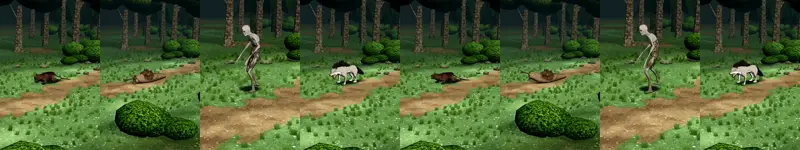

# 744 · Kampfort: Ruhebewegungen für alle Monster, die welche haben, nicht nur den Wolf (Vorgang 744) · Jerry (Tuffy) · 11.11., 20:43

Dein Wort 20:05: „744 passt“, weiter mit dem Kampfort. Bögen laufen im Kampfort schon seit 682, Ruhebewegungen hatte nur der Wolf. Film per Telegram (116 s), am Rechner gedreht, kein Build: Ratte, Säureschnecke, Wiedergänger, Grabhund je 12 s in Ruhe von nah, erst „vorher“ (bis 58 s), dann „nachher“.

Von links: vorher Ratte, Säureschnecke, Wiedergänger, Grabhund, dann dieselben nachher.

**Was du sagen sollst:** „744 passt“, oder was anders sein soll. Danach kommt es in den nächsten gemeinsamen Build.

Neu gegenüber vorher:
- Jedes Monster spielt in Ruhe die Ruhebewegungen, die sein Modell hat: Ratte und Fledermaus ihre Bewegung „Lefzen“ (Maul, bei der Ratte auch der Schwanz), die Spinne sieht sich um, der Grabhund atmet schwer und sieht sich um, Egel und Säureschnecke sehen sich um, der Wiedergänger lauert. Wer nur eine hat, wiederholt sie; vorher kam sie höchstens einmal im ganzen Kampf.
- Gemessen im Kampfort auf Autopilot, 75 s je Gruppe; längste Spanne in Ruhe ohne Ruhebewegung, schlechtestes Monster der Gruppe: Ratte 38 → 6 s, Fledermaus 20 → 8 s, Spinne 69 → 6 s, Säureschnecke 21 → 4 s, Wiedergänger 22 → 7 s, Grabhund 32 → 6 s. Zwei Monster begannen in der Messung nie innerhalb einer halben Sekunde.
- Am Wolf ist nichts geändert; seine längste Spanne schwankt zufällig zwischen 6 und 10 s.

Bekannt, nicht geändert:
- Keiler, Skelette und Goblins haben in ihren Modellen keine Ruhebewegung, die in den Kampf passt (gemessen; der Keiler hat nur Fressen), Kobolde, Krogg und Grak nach dem Bestand vom 11.11. auch nicht; sie stehen und atmen wie bisher. Drohen (der Kampfschrei zu Beginn) und Fressen habe ich bewusst nicht genommen.
- Die Bewegungen sind klein (Kopf, Maul); man sieht sie am besten im Vergleich vorher und nachher. Egel und Fledermaus sind nicht im Film, nur gemessen.

Geprüft an: https://github.com/tramour-cmyk/androidapp_rpg_bornim/commit/d73e416bf (Zweig `claude/tuffy-744-bewegung`), Messung `tests/ruhe_kampf_744.gd` und Film am Rechner 11.11., 20:38.
