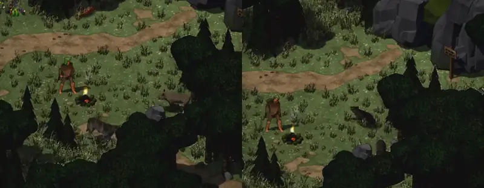

# 744 · Monster auf der Karte: Bogen statt Roboter-Takt, Verweilen mit Ruhebewegung (Vorgang 744) · Jerry (Tuffy) · 11.11., 19:47

Dein Wort vom 09.11., 11:18: „nicht wie auf Schienen laufen … mal verweilen, eine Ruheanimation haben“, dazu 744 A (ein Bewegungsbaustein für alle Figuren). Hier der erste Teil: die Monster auf der Gebietskarte. Film per Telegram (92 s): erst „vorher“ (Stand vor 744), dann „nachher“ (Zweig), je 46 s, Flüsterwald am Tag, die Monster bemerken den Helden nicht. Kein Build.

Links vorher: der graue Wolf unten rechts vom Feuer, der braune Keiler weiter rechts. Rechts nachher: der Wolf rechts oberhalb des Feuers.

**Was du sagen sollst:** „744 passt“, oder was anders sein soll. Erst danach baue ich den Baustein in den Kampfort ein; die Leute übernimmt danach Tom.

Neu gegenüber vorher:
- Die Monster laufen Bögen über 2 bis 5 Kacheln statt Schritt, Drehen, Schritt; sie drehen im Gehen, laufen weich an und bremsen länger.
- Danach verweilen sie meist 3 bis 12 s mit Ruhebewegungen ihrer Art (Wolf: Umsehen, Scharren, Hecheln, Lefzen, Knurren, beim langen Verweilen im Sitzen, im Film nicht vorgekommen; Ratte: Lefzen; wer keine eigene hat, wie der Tausendfüßler, sieht sich um). Zwei Monster beginnen nie im selben Augenblick eine Ruhebewegung.
- Der Heimweg geht als Bogen um Hindernisse; ein Jäger, der den Helden bemerkt, hält weich auf der nächsten Kachel an (im Film nicht zu sehen).

Bekannt, nicht geändert:
- Die Baumkronen im Vordergrund verdecken die rechte Bildhälfte: Riesenratte und Tausendfüßler sind im „nachher“ meist dahinter, gut zu sehen ist vor allem der Wolf.
- Die Monster werden zufällig gesetzt: vorher Wolf, Riesenratte, Keiler, Kobold; nachher Wolf, Tausendfüßler, Riesenratte (nur drei, ein viertes fand keinen Heimplatz in der Nähe).
- Der Wolf knurrt auch beim friedlichen Verweilen (eine seiner Ruhebewegungen); soll das Knurren nur kommen, wenn er den Helden bemerkt, sag „744 ohne Knurren“.

Geprüft an: https://github.com/tramour-cmyk/androidapp_rpg_bornim/commit/ce46d4a36 (Zweig `claude/tuffy-744-bewegung`, Lauf 357).
