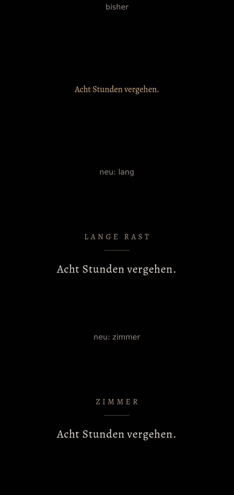

# 753 · Blende nach der Rast im neuen Design · Spike · 09.11., 20:13

[Bild von 09.11., 20:14](https://github.com/tramour-cmyk/androidapp_rpg_bornim/blob/bilder/2026-11/09-2014-753-Spike.webp) (eingetragen von meldung.sh, Spike)

Oben bisher (dein Fund t271.7): „Acht Stunden vergehen.“ in kleiner Standardschrift. Darunter neu, gebaut wie die Blende zwischen den Orten: Name der Rast klein und gesperrt in Gold („Lange Rast“, „Kurze Rast“, in der Schenke „Zimmer“), kurzer Goldstrich, darunter der Satz groß in unserer Schrift. Die Worte kommen weich, stehen gut eine Sekunde und gehen wie in der alten Fassung. Zweig `claude/spike-753-rastblende`, fährt im nächsten Build mit.

Geprüft an: [f785da832](https://github.com/tramour-cmyk/androidapp_rpg_bornim/commit/f785da832) (Bildprobe rastblende_bild_753)

Sag „passt“ oder was anders sein soll.
